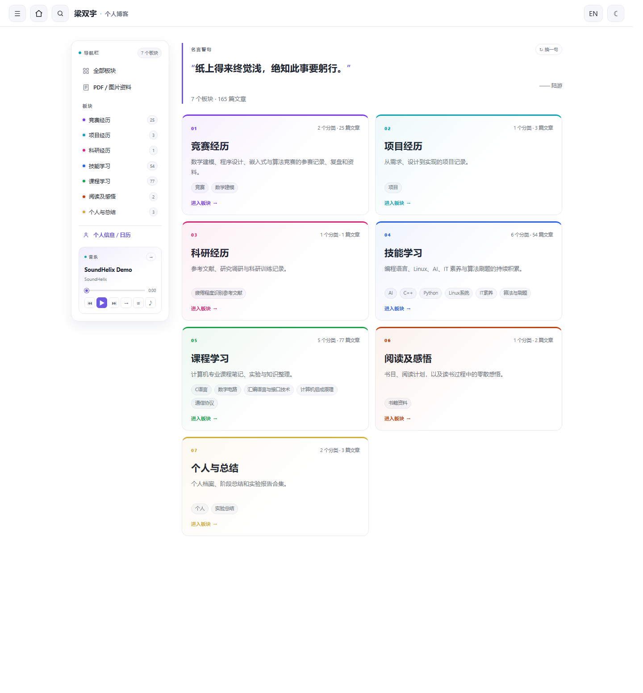
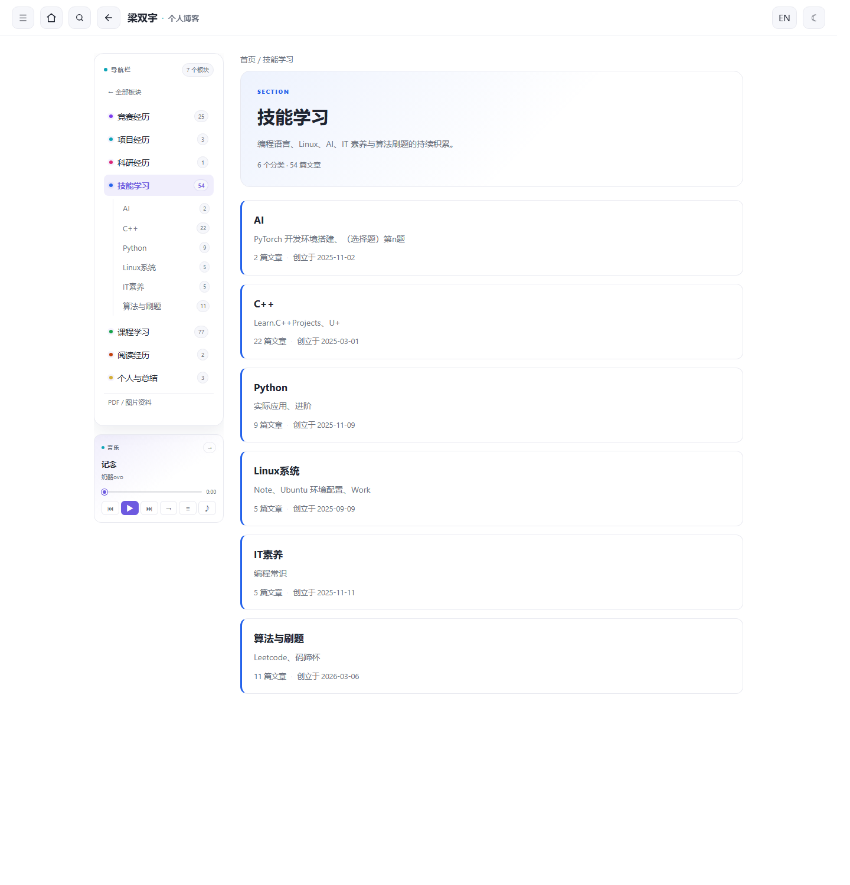
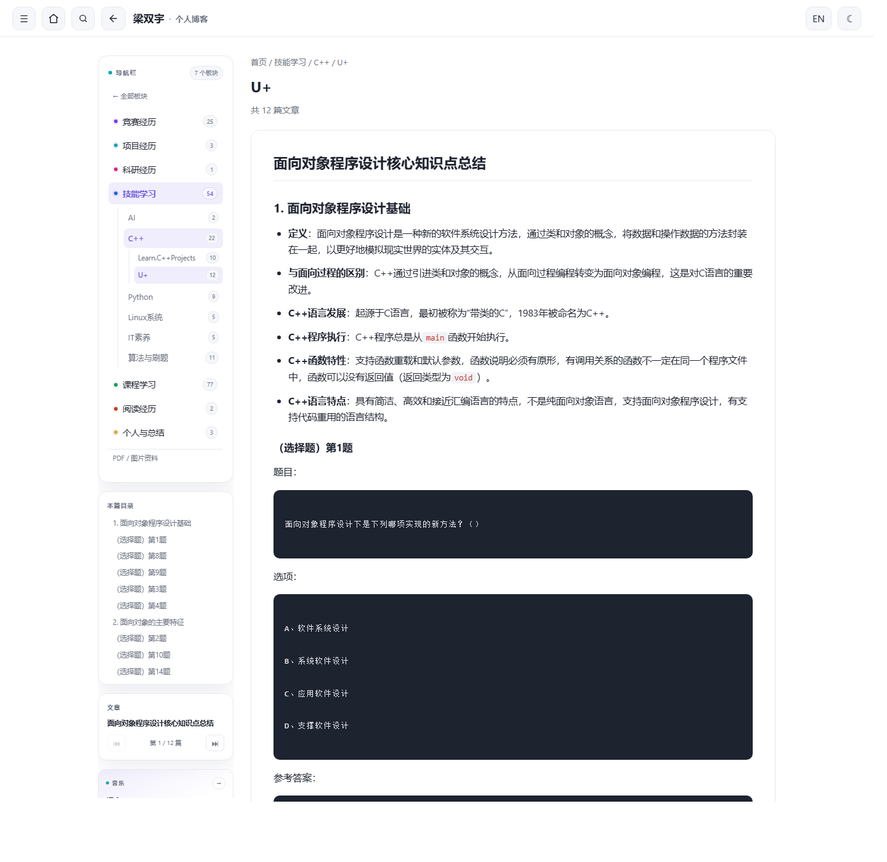
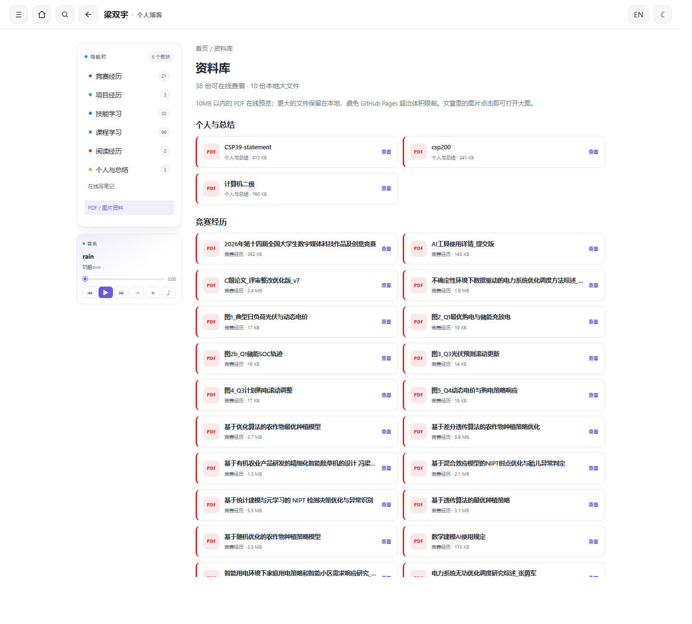

# 个人博客 · 梁双宇（Shine Leong）

在线访问：<https://no-zland.github.io/>

一个**板块式个人博客**：把 Obsidian 笔记库 `content/post` 按竞赛经历、项目经历、科研经历、技能学习、课程学习、阅读及感悟、个人与总结七个大板块组织，再用 Python 静态生成器渲染成站点，交给 Hugo 本地预览与服务。

- 首页：名言警句 + 左侧板块导航 + 顶栏搜索 + 音乐播放器 + 大板块卡片
- 板块页：单列展示该板块下的分类，左侧导航随层级展开
- 分类页：展示子分类，或进入文章阅读页
- 阅读页：多篇文章默认分页阅读，可切换连续阅读；长文再按章节分页
- 资料库：在线查看 PDF，文章图片点击放大
- 左侧抽屉：对外个人主页（头像 / GitHub / 哔哩哔哩 / 邮箱 / 更新日历与主人任务）

## 功能特性

| 模块 | 说明 |
| --- | --- |
| 板块式导航 | 首页大板块 → 板块内分类 → 子分类 → 阅读页；每个层级左侧都有随当前路径展开的导航栏 |
| 名言警句 | 从「阅读及感悟 / 书籍资料 / 名人名言」随机抽取；每次打开不同，可点“换一句”立刻更换 |
| 阅读模式 | 多篇文章默认分页阅读；可一键切换连续阅读，文章之间不再插入“分隔线” |
| 左侧抽屉主页 | 头像、简介、GitHub / B 站 / 邮箱（带 logo），不放个人简历 |
| 浅色 / 暗色主题 | 浅色以白为主、紫/青/绿/蓝辅助；暗色藏蓝为主、黑金/墨绿/暗紫辅助 |
| 中英切换 | 梁双宇 / Shine Leong，记忆用户偏好 |
| Obsidian 风格渲染 | 表格、公式、加粗、`==高亮==`、`~~删除~~`、`^上标^`、`~下标~`、任务列表、wiki 链接与图片嵌入 |
| 头像 | 默认使用根目录 `头像.jpg`，缺失时回退为默认人形图标 |
| 更新日历 + 任务提醒 | 按文章修改日期统计更新热力；任务默认访客不可见，主人登录后可增删、提醒、导出/导入 |
| 访客 / 主人模式 | 任务清单默认隐藏；主人模式用本地 PBKDF2 密码解锁，密码只保存在本机，不上传服务器 |
| PDF / 图片 | 资料库在线预览 10MB 以内 PDF；文章图片点击后弹层放大 |
| 音乐播放器 | 导航栏下方符号化播放器，支持顺序、随机、单曲循环、可拖动进度条、播放歌单；悬浮歌词可拖动，配色跟随主题 |
| 顶栏搜索 | 搜索按钮放在首页按钮旁边；搜索结果可跳到对应文章锚点 |
| 长文分章阅读 | 超过一定长度的阅读页按章节/内容块自动分页，支持上一页、下一页和页码跳转 |
| GitHub Pages | `.github/workflows/pages.yml` 在 push 后构建 `site/` 并部署 GitHub Pages |
| 动画与无障碍 | 入场/悬浮动画、`prefers-reduced-motion`、键盘 Esc、aria 标签 |

> 原先分散在 C++、Linux、汇编、高级编程中的实验报告已合并为「实验总结」分类下的一篇综合博客。

## 快速开始

### 依赖

- Python 3.9+，安装依赖：

```bash
pip install -r requirements.txt
```

- Hugo（extended，用于本地预览）：

```bash
hugo version
```

### 生成并预览

```bash
# 1. 从 content/post 生成静态站点到 site/
python build_blog.py

# 2. 用 Hugo 服务 site/（默认 http://localhost:1313/）
hugo server
```

> 笔记有改动后，重新运行 `python build_blog.py` 即可；如果预览页仍显示旧样式/脚本，重启一下 `hugo server`。
> 需要全量清理旧输出时使用 `python build_blog.py --clean`（会删除并重建 `site/`）。

## 项目结构

```
d:\My Personal Blogs\
├── build_blog.py          # 静态站点生成器（入口）
├── src/                   # 生成器使用的样式与脚本
│   ├── calendar.css / calendar.js
│   ├── search.css / search.js
│   ├── reading.css / reading.js / reading-mode.js
│   ├── media.css / media.js
│   ├── music.css / music.js
│   └── quotes.js
├── music/                 # 播放列表、音频与 LRC 歌词
│   ├── playlist.json
│   └── README.md
├── docs/
│   ├── ARCHITECTURE.md    # 架构、生成流程与维护约定
│   └── previews/          # 界面预览图
├── content/post/          # Obsidian 笔记库（数据源）
│   ├── 竞赛/  项目/  书籍资料/  ...
│   └── ...
├── layouts/index.html     # Hugo 首页模板：直接读取 site/index.html
├── hugo.toml              # Hugo 配置（服务 site/ 为静态站点）
├── requirements.txt       # Python 依赖
├── .gitignore             # 忽略生成物、缓存、大文件与本地临时文件
├── .github/workflows/
│   ├── build.yml          # 构建校验
│   └── pages.yml          # GitHub Pages 部署
├── 头像.jpg               # 站点头像（可选，缺失时用默认图标）
├── site/                  # 生成产物（Hugo 直接服务，不入库）
│   ├── index.html
│   ├── assets/style.css / app.js / search-index.json / files/ / music/
│   ├── 资料库/index.html   # PDF 在线预览
│   ├── <板块>/index.html    # 竞赛经历、项目经历、科研经历……
│   └── <分类>/index.html
├── public/                # Hugo 预览 / 发布输出（首页渲染需要，不入库）
└── README.md
```

## 实现要点

- **渲染**：`build_blog.py` 用 `python-markdown` + `pymdownx`（`mark`/`tilde`/`caret`/`tasklist`/`arithmatex`）复刻 Obsidian 语法；`fix_tables` 合并被空行打断的表格；MathJax 3 渲染公式。
- **板块导航**：`content/post` 的分类目录按 `SECTION_SPECS` 归入“竞赛经历 / 项目经历 / 科研经历 / 技能学习 / 课程学习 / 阅读及感悟 / 个人与总结”，首页生成板块卡片，每个板块页再列出其分类。
- **层级侧栏**：`src/search.css` 与生成器共同输出左侧导航；进入板块、分类、子分类时自动展开当前路径，并高亮当前节点。
- **阅读模式**：`src/reading-mode.js` 默认只显示一篇文章，提供上一篇/下一篇/选择器；切换连续阅读时显示全部文章，不再输出“分隔线”。
- **目录简介/创立时间**：简介取子目录名或前几篇文章标题；创立时间取目录下最早文件修改时间。
- **Hugo 集成**：`hugo.toml` 把 `site/` 设为 `staticDir`，`contentDir` 指向空目录避免二次渲染，`layouts/index.html` 用 `readFile` 输出生成好的首页。

## 任务数据与主人模式

- 任务保存在浏览器 `localStorage`，**不需要服务器**；换设备或清浏览器数据不会自动同步。
- 默认访客模式：任务列表、任务圆点和提醒都隐藏，只展示博客更新日历。
- 主人模式：首次点击“设置主人密码”，之后用密码登录；密码用 PBKDF2-SHA256 加盐哈希保存，只存在本机。
- 这是**界面保护**，不是数据加密：能打开浏览器开发者工具的人仍可读取 localStorage。请把它当作“防误看/防误改”，不要把高度敏感信息放进去。
- 主人模式提供“导出备份 / 导入备份”，建议定期导出 JSON；忘记密码只能清站点数据或导入备份。
- 需要跨设备同步时，才需要服务器、数据库或云同步服务。

## 名言警句

- 句子放在 [content/post/书籍资料/名人名言.md](content/post/书籍资料/名人名言.md)，每行一条，格式：
  `- 句子｜作者`
- 首页从这份文件随机抽取，每次打开都不同；也可以点“换一句”立即更换。
- 文件本身同时是「阅读及感悟」里的一篇文章，方便阅读和继续追加。

## PDF 与音乐

- PDF 放在 `content/post` 下，资料库自动收集；单文件 **≤10MB** 的 PDF 会复制到站点并在线预览。
- 超过 10MB 的 PDF 只在本地资料库标记为“本地”，不上传 GitHub Pages；完整教材体积过大，GitHub Pages 也不适合承载。
- 文章里的图片点击会打开大图弹层，Esc 或点击背景关闭。
- 音乐播放列表在 `music/playlist.json`，音频和 `.lrc` 放 `music/`；支持顺序、随机、单曲循环。
- 播放器按钮全部使用符号；进度条可拖动；`≡` 打开播放歌单，`♪` 打开可拖动的悬浮歌词。
- 默认是两首 SoundHelix 测试曲，没有歌词文件；换成自己的音乐和 LRC 即可。

## GitHub Pages

1. 推送到 GitHub 仓库（`main` 或 `master`）。
2. 仓库 **Settings → Pages → Build and deployment → Source** 选择 **GitHub Actions**。
3. push 后 `.github/workflows/pages.yml` 会执行 `python build_blog.py --clean`，把 `site/` 发布到 Pages。
4. 访问地址通常是 `https://<用户名>.github.io/<仓库名>/`；如果是 `<用户名>.github.io` 仓库，则是 `https://<用户名>.github.io/`。

当前部署：<https://no-zland.github.io/>

> `site/` 和 `public/` 都是生成物，不入库；`public/` 仅用于本地 Hugo 首页渲染，Pages 部署的是 `site/`。

## 预览









## 更多实现细节

架构与 GitHub 维护约定见 [docs/ARCHITECTURE.md](docs/ARCHITECTURE.md)。
各功能的完整实现说明见笔记：[个人博客实现笔记](content/post/项目/个人博客/个人博客实现笔记.md)。
