第一章 C++入门及简单的顺序结构

编程是一种控制计算机的方式，和我们平时双击打开文件、关机、重启没有任何区别。

———闫学灿

- 软件环境

- 编译软件的安装与使用

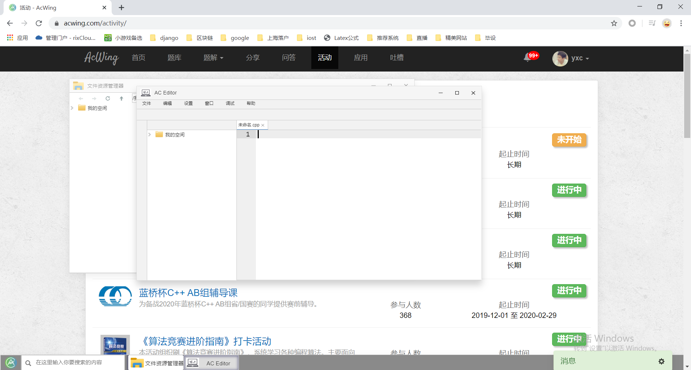

2．作业的评测与提交

在线练习地址：www.acwing.com

作业提交地址：https://www.acwing.com/activity/content/21/

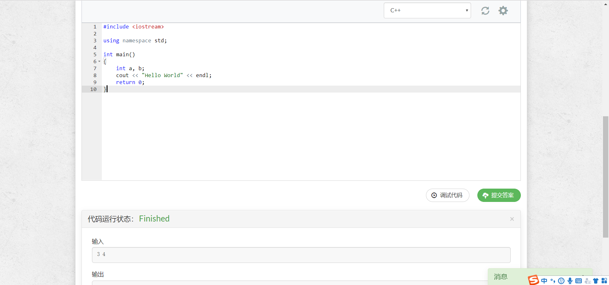

- 编写一个简单的C++程序——手速练习

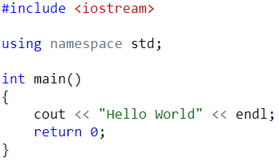

- 语法基础

- 变量的定义

变量必须先定义，才可以使用。不能重名。

变量定义的方式：

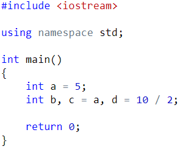

常用变量类型及范围：

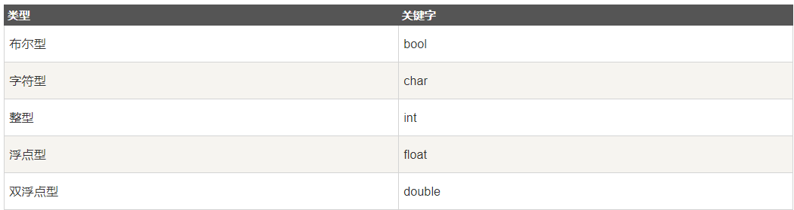

- 输入输出

整数的输入输出：

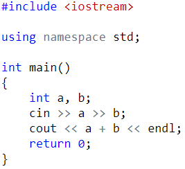

字符串的输入输出：

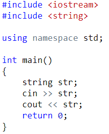

输入输出多个不同类型的变量：

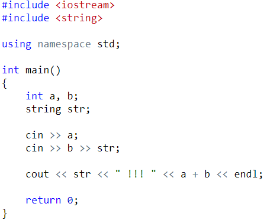

- 表达式

整数的加减乘除四则运算：

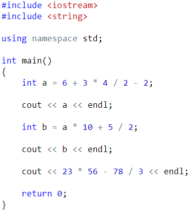

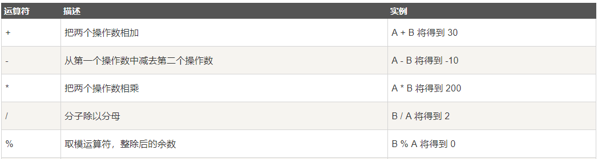

浮点数（小数）的运算：

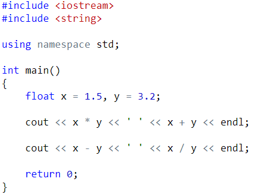

整型变量的自增、自减：

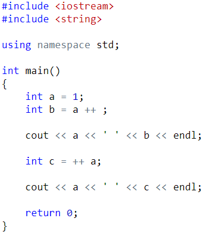

变量的类型转换：

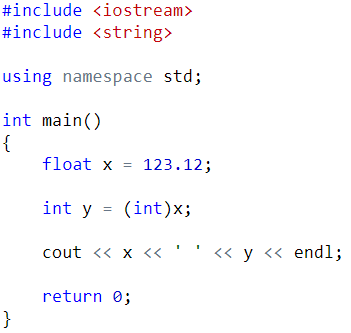

- 顺序语句

- 输出第二个整数：

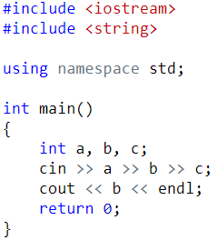

- 计算 (a + b) * c的值

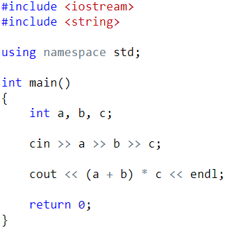

- 带余除法

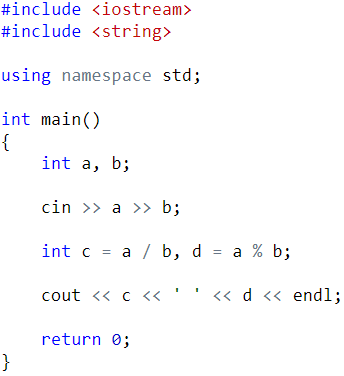

- 求反三位数：

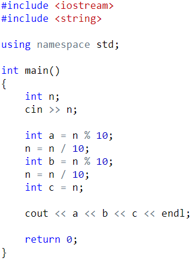

- 交换两个整数

- 输出菱形

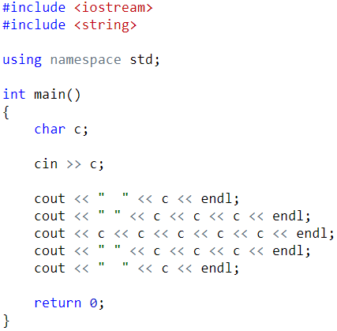
