第二章 printf语句与C++中的判断结构

学习语言最好的方式就是实践，每当掌握一个新功能时，就要立即将这个功能应用到实践中。

——闫学灿

一、printf输出格式

注意：使用printf 时最好添加头文件 #include <cstdio>。

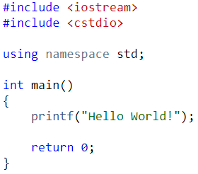

- Int、float、double、char等类型的输出格式：

- Int：%d

- Float: %f, 默认保留6位小数

- Double: %lf， 默认保留6位小数

- Char: %c, 回车也是一个字符，用’\n’表示

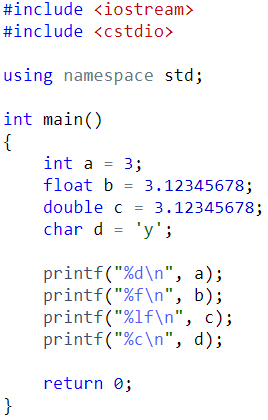

- 所有输出的变量均可包含在一个字符串中：

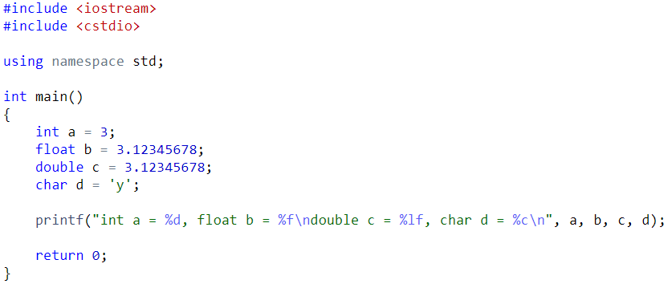

练习：输入一个字符，用这个字符输出一个菱形：

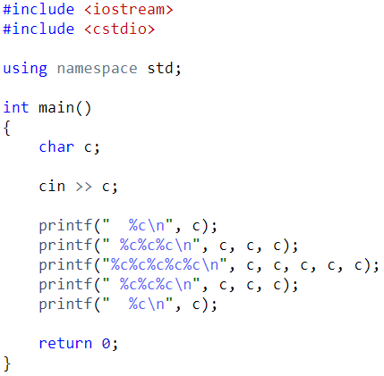

练习：输入一个整数，表示时间，单位是秒。输出一个字符串，用”时:分:秒”的形式表示这个时间。

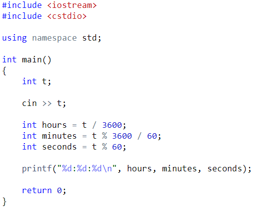

- 扩展功能

- Float, double等输出保留若干位小数时用：%.4f, %3lf

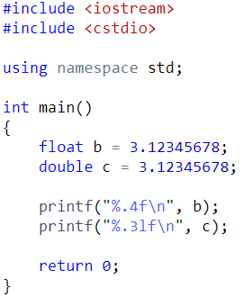

- 最小数字宽度

- %8.3f, 表示这个浮点数的最小宽度为8，保留3位小数，当宽度不足时在前面补空格。

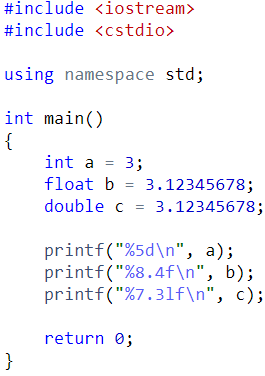

- %-8.3f，表示最小宽度为8，保留3位小数，当宽度不足时在后面补上空格

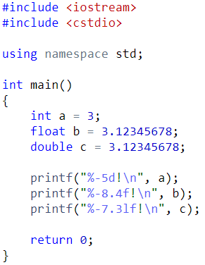

- %08.3f, 表示最小宽度为8，保留3位小数，当宽度不足时在前面补上0

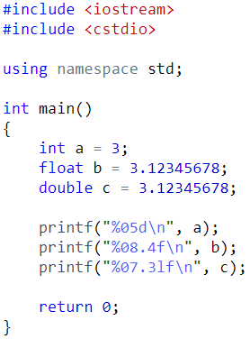

二、if 语句

1. 基本if-else语句

当条件成立时，执行某些语句；否则执行另一些语句。

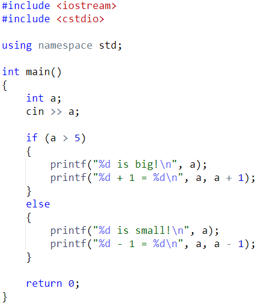

Else 语句可以省略：

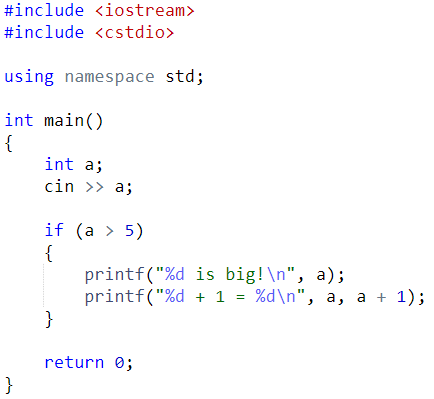

当只有一条语句时，大括号可以省略：

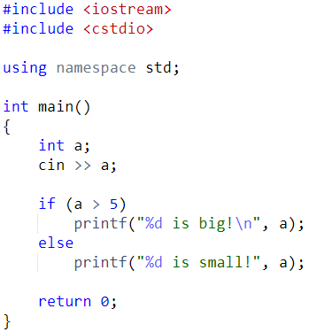

练习：输入一个整数，输出这个数的绝对值。

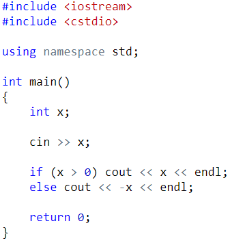

练习：输入两个整数，输出两个数中较大的那个。

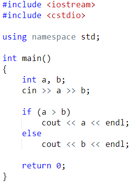

If-else语句内部也可以是if-else语句。

练习：输入三个整数，输出三个数中最大的那个。

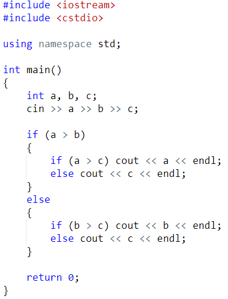

2. 常用比较运算符

(1) 大于 >

(2) 小于 <

(3) 大于等于 >=

(4) 小于等于 <=

(5) 等于 ==

(6) 不等于 !=

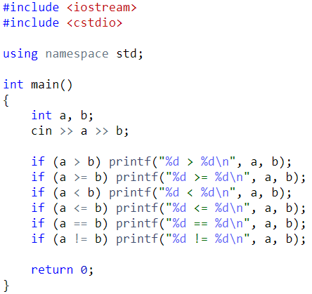

- If-else 连写：

输入一个0到100之间的分数，

如果大于等于85，输出A；

如果大于等于70并且小于85，输出B；

如果大于等于60并且小于70，输出C；

如果小于60，输出 D；

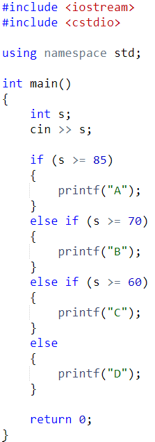

练习：

- 简单计算器输入两个数，以及一个运算符+, -, *, /，输出这两个数运算后的结果。

当运算符是/，且除数是0时，输出”Divided by zero!”; 当输入的字符不是+, -, *, /时，输出”Invalid operator!”。

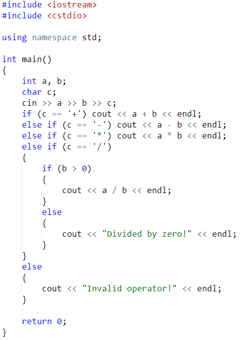

- 判断闰年。闰年有两种情况：

- 能被100整除时，必须能被400整除；

- 不能被100整除时，被4整除即可。

输入一个年份，如果是闰年输出yes，否则输出no。

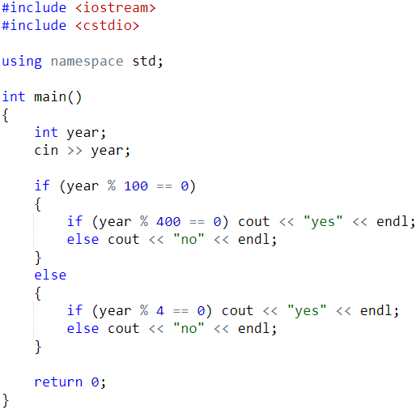

三、条件表达式

(1) 与 &&

(2) 或 ||

(3) 非

例题：输入三个数，输出三个数中的最大值。

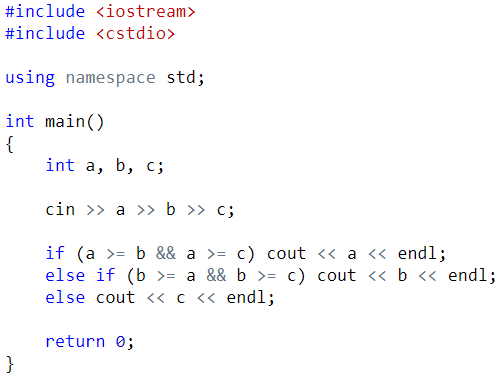

练习：用一条if语句，判断闰年。

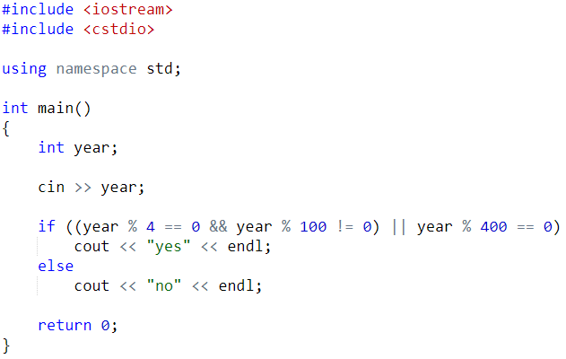
