第三章 C++中的循环结构

学习编程语言语法是次要的，思维是主要的。如何把头脑中的想法变成简洁的代码，至关重要。

——闫学灿

学习循环语句只需要抓住一点——代码执行顺序！

- while循环

可以简单理解为循环版的if语句。If语句是判断一次，如果条件成立，则执行后面的语句；while是每次判断，如果成立，则执行循环体中的语句，否则停止。

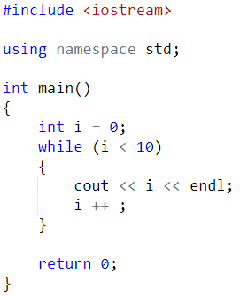

练习：求1~100中所有数的立方和。

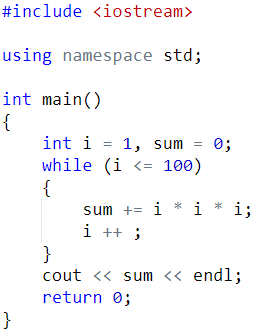

练习：求斐波那契数列的第n项。f(1)=1, f(2)=1, f(3)=2, f(n)=f(n-1) + f(n-2)。

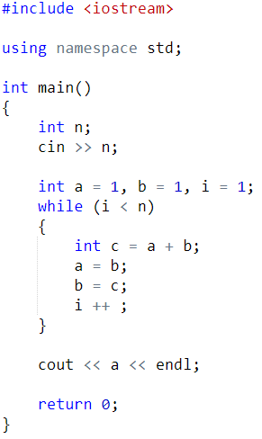

死循环：循环永久执行，无法结束。我们要避免写出死循环。

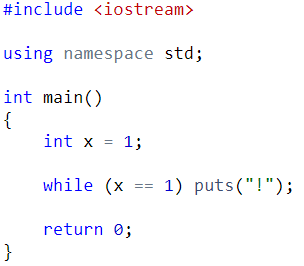

- do while循环

do while循环不常用。

do while语句与while语句非常相似。唯一的区别是，do while语句限制性循环体后检查条件。不管条件的值如何，我们都要至少执行一次循环。

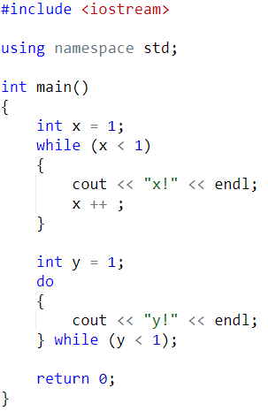

- for 循环

基本思想：把控制循环次数的变量从循环体中剥离。

for (init-statement : condition: expression)

{

statement

}

init-statement可以是声明语句、表达式、空语句，一般用来初始化循环变量；

condition 是条件表达式，和while中的条件表达式作用一样；可以为空，空语句表示true

expression 一般负责修改循环变量，可以为空

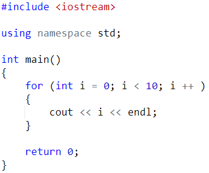

练习：求1~100中所有数的立方和。

练习：求斐波那契数列的第n项。f(1)=1, f(2)=1, f(3)=2, f(n)=f(n-1) + f(n-2)。

init-statement可以定义多个变量，expression也可以修改多个变量。

例如求 1 * 10 + 2 * 8 + 3 * 7 + 4 * 6：

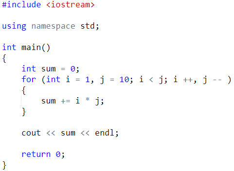

- 跳转语句

- break

可以提前从循环中退出，一般与if语句搭配。

例题：判断一个大于1的数是否是质数：

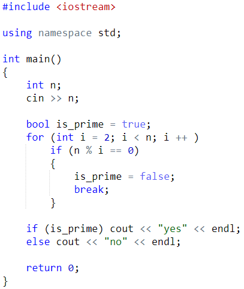

- continue

可以直接跳到当前循环体的结尾。作用与if语句类似。

例题：求1~100中所有偶数的和。

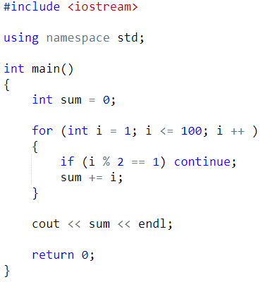

- 多层循环

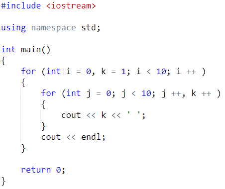

练习：打印1~100中的所有质数

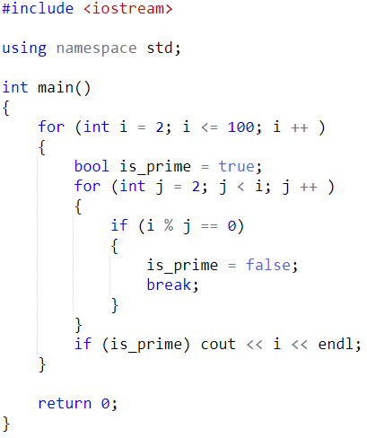

练习：输入一个n，打印n阶菱形。n是奇数。

n=9时的结果：

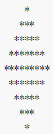

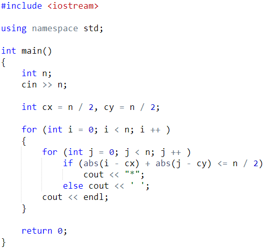
