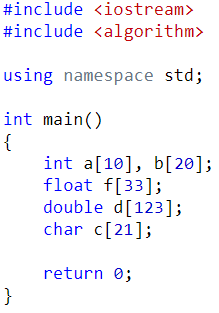
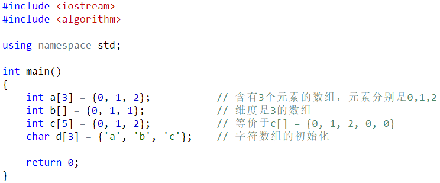
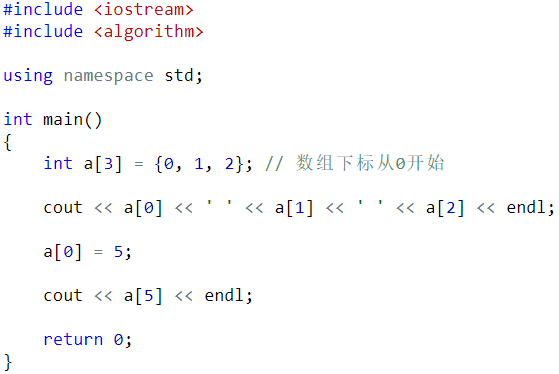
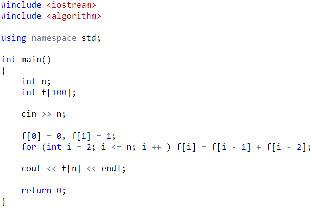
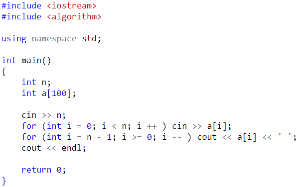
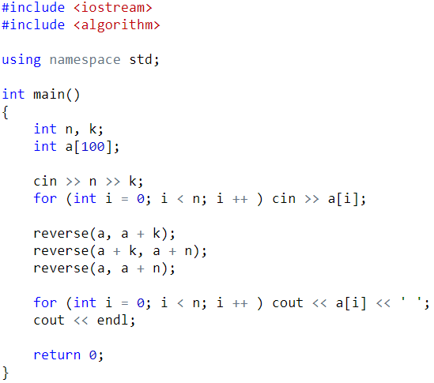
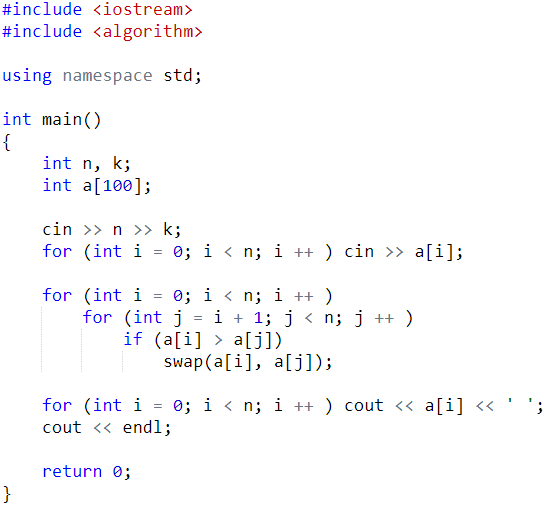
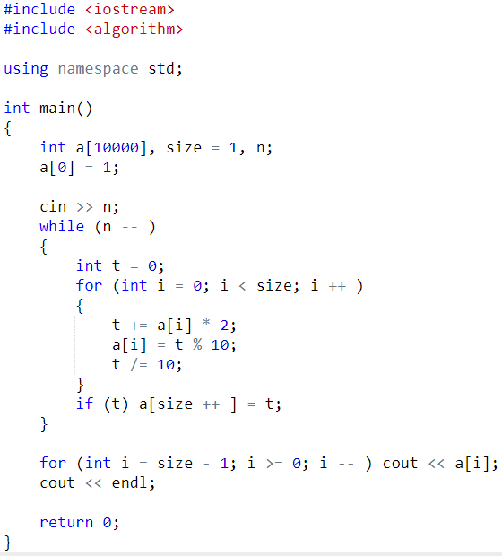
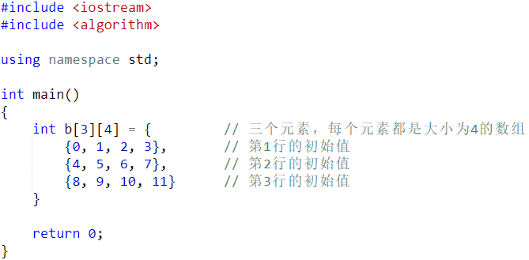
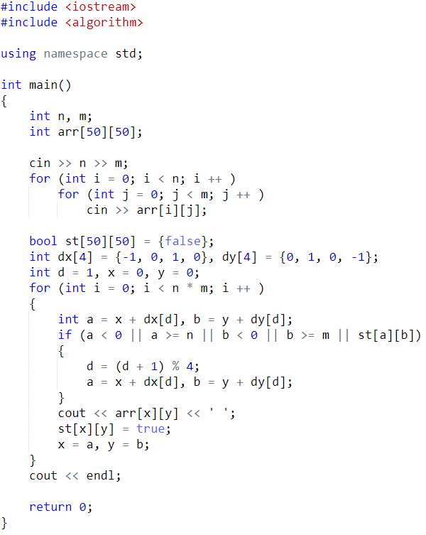

第四章 C++中的数组

程序 = 逻辑 + 数据，数组是存储数据的强而有力的手段。

——闫学灿

- 一维数组

- 数组的定义

数组的定义方式和变量类似。

- 数组的初始化

在main函数内部，未初始化的数组中的元素是随机的。

- 访问数组元素

通过下标访问数组。

练习题1： 使用数组实现求斐波那契数列的第N项。

练习题2：输入一个n，再输入n个整数。将这n个整数逆序输出。

练习题3：输入一个n，再输入n个整数。将这个数组顺时针旋转k(k <= n)次，最后将结果输出。

练习题4：输入n个数，将这n个数按从小到大的顺序输出。

练习题5：计算2的N次方。N <= 10000

- 多维数组

多维数组就是数组的数组。

Int a[3][4]; // 大小为3的数组，每个元素是含有4个整数的数组。

Int arr[10][20][30] = {0}; // 将所有元素初始化为0

// 大小为10的数组，它的每个元素是含有4个整数的数组

// 这些数组的元素是含有30个整数的数组

练习题：输入一个n行m列的矩阵，从左上角开始将其按回字形的顺序顺时针打印出来。

