第五章 C++中的字符串

字符串是计算机与人类沟通的重要手段。

——闫学灿

- 字符与整数的联系——ASCII码

每个常用字符都对应一个-128~127的数字，二者之间可以相互转化：

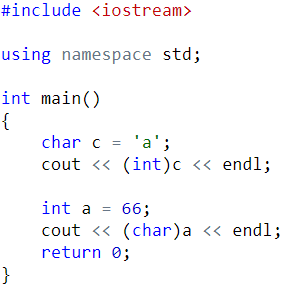

常用ASCII值：’A’-‘Z’ 是65~90，’a’-‘z’是97-122，’0’-‘9’是48-57。

字符可以参与运算，运算时会将其当做整数：

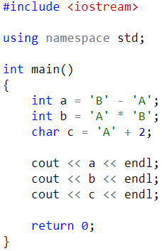

练习：输入一行字符，统计出其中数字字符的个数，以及字母字符的个数。

- 字符数组

字符串就是字符数组加上结束符’\0’。

可以使用字符串来初始化字符数组，但此时要注意，每个字符串结尾会暗含一个’\0’字符，因此字符数组的长度至少要比字符串的长度多1！

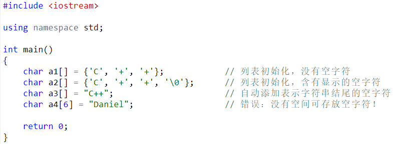

- 字符数组的输入输出：

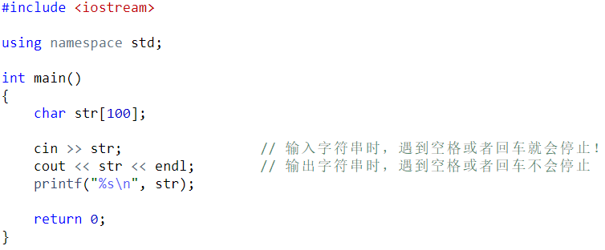

读入一行字符串，包括空格：

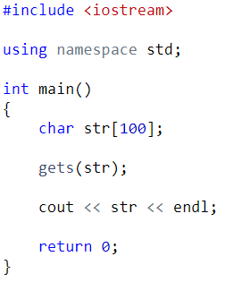

- 字符数组的常用操作

下面几个函数需要引入头文件:

#include <string.h>

- strlen(str)，求字符串的长度

- strcmp(a, b)，比较两个字符串的大小，a < b 返回-1，a == b 返回0，a > b返回1。这里的比较方式是字典序！

- strcpy(a, b)，将字符串b复制给从a开始的字符数组。

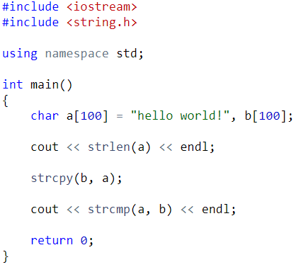

- 遍历字符数组中的字符：

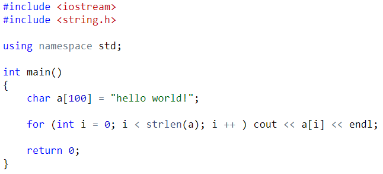

练习：给定一个只包含小写字母的字符串，请你找到第一个仅出现一次的字符。如果没有，输出“no”。

练习：把一个字符串中特定的字符全部用给定的字符替换，得到一个新的字符串。

- 标准库类型 string

可变长的字符序列，比字符数组更加好用。需要引入头文件：

#include <string>

- 定义和初始化

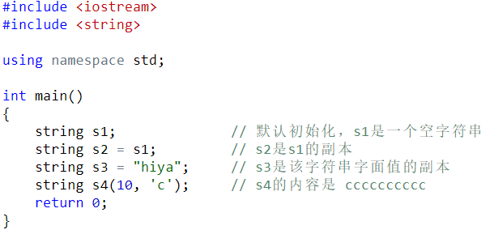

- string 上的操作

- string的读写：

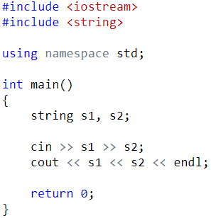

注意：不能用printf直接输出string，需要写成：printf(“%s”, s.c_str());

- 使用getline读取一整行

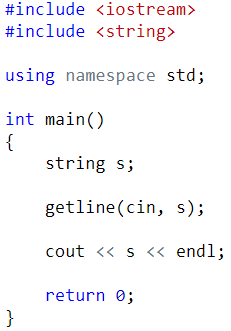

- string的empty和size操作（注意size是无符号整数，因此 s.size() <= -1一定成立）：

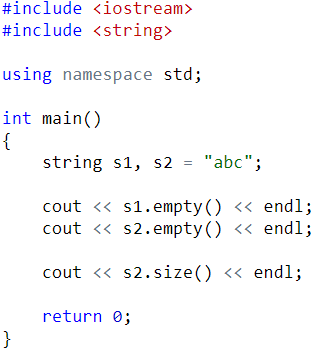

- string 的比较：

支持 > < >= <= == !=等所有比较操作，按字典序进行比较。

- 为string对象赋值：

string s1(10, ‘c’), s2;		// s1的内容是 cccccccccc；s2是一个空字符串

s1 = s2;					// 赋值：用s2的副本替换s1的副本

// 此时s1和s2都是空字符串

- 两个string对象相加：

string s1 = “hello,  ”, s2 = “world\n”;

string s3 = s1 + s2;					// s3的内容是 hello, world\n

s1 += s2;								// s1 = s1 + s2

- 字面值和string对象相加：

做加法运算时，字面值和字符都会被转化成string对象，因此直接相加就是将这些字面值串联起来：

string s1 = “hello”, s2 = “world”;		// 在s1和s2中都没有标点符号

string s3 = s1 + “, “ + s2 + ‘\n’;

当把string对象和字符字面值及字符串字面值混在一条语句中使用时，必须确保每个加法运算符的两侧的运算对象至少有一个是string：

string s4 = s1 + “, “;	// 正确：把一个string对象和有一个字面值相加

string s5 = “hello” +”, “; // 错误：两个运算对象都不是string

string s6 = s1 + “, “ + “world”;  // 正确，每个加法运算都有一个运算符是string

string s7 = “hello” + “, “ + s2;  // 错误：不能把字面值直接相加，运算是从左到右进行的

3.3 处理string对象中的字符

可以将string对象当成字符数组来处理：

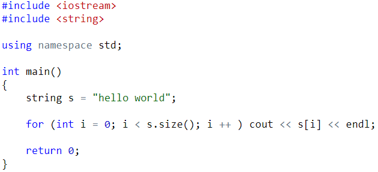

或者使用基于范围的for语句：

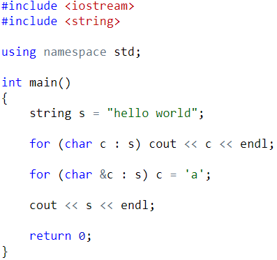

练习：密码翻译，输入一个只包含小写字母的字符串，将其中的每个字母替换成它的后继字母，如果原字母是’z’，则替换成’a’。

练习：输入两个字符串，验证其中一个串是否为另一个串的子串。
