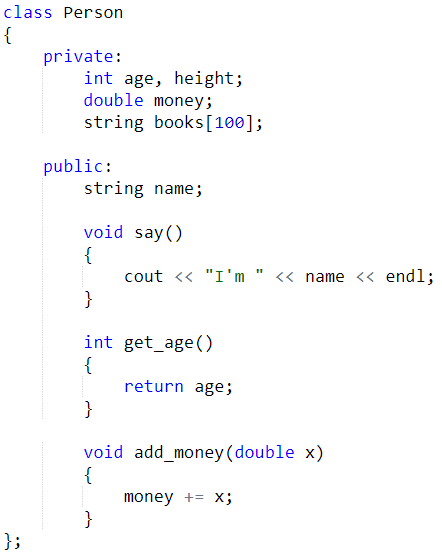
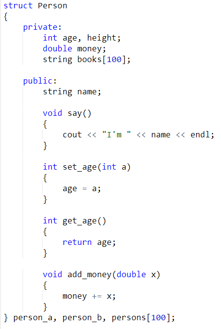
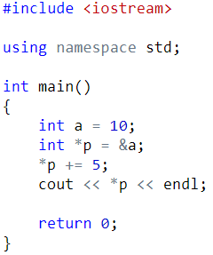
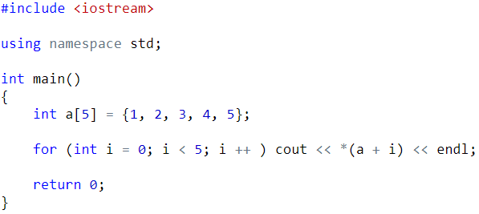
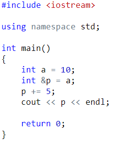
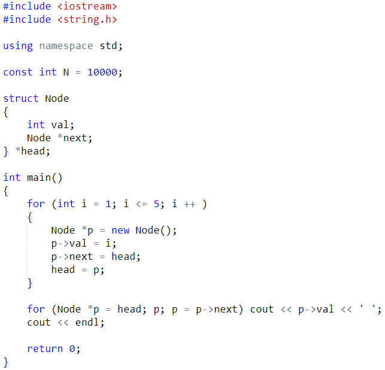

第七章 类、结构体、指针、引用

类可以将变量、数组和函数完美地打包在一起。

——闫学灿

- 类与结构体

类的定义：

类中的变量和函数被统一称为类的成员变量。

private后面的内容是私有成员变量，在类的外部不能访问；public后面的内容是公有成员变量，在类的外部可以访问。

类的使用：

#include <iostream>

using namespace std;

const int N = 1000010;

class Person

{

private:

int age, height;

double money;

string books[100];

public:

string name;

void say()

{

cout << "I'm " << name << endl;

}

int set_age(int a)

{

age = a;

}

int get_age()

{

return age;

}

void add_money(double x)

{

money += x;

}

} person_a, person_b, persons[100];

int main()

{

Person c;

c.name = "yxc";      // 正确！访问公有变量

c.age = 18;          // 错误！访问私有变量

c.set_age(18);       // 正确！set_age()是共有成员变量

c.add_money(100);

c.say();

cout << c.get_age() << endl;

return 0;

}

结构体和类的作用是一样的。不同点在于类默认是private，结构体默认是public。

- 指针和引用

指针指向存放变量的值的地址。因此我们可以通过指针来修改变量的值。

数组名是一种特殊的指针。指针可以做运算：

引用和指针类似，相当于给变量起了个别名。

- 链表

