# VMware Workstation Pro 17安装与CentOS7虚拟机创建教程

# 前期准备

## 所需文件下载

### 官方正版VMware Workstation Pro 17安装包：

https://pan.quark.cn/s/b3e13befc19f

### Linux系统镜像（CentOS7）：

The CentOS Project

### 虚拟机激活密钥：

教程配套密钥文件包含各版本通用批量永久激活许可，其中VMware 17 pro版本密钥如下：

| MC60H-DWHD5-H80U9-6V85M-8280D |

|---|

| 4A4RR-813DK-M81A9-4U35H-06KND |

| NZ4RR-FTK5H-H81C1-Q30QH-1V2LA |

| JU090-6039P-08409-8J0QH-2YR7F |

| 4Y09U-AJK97-089Z0-A3054-83KLA |

| 4C21U-2KK9Q-M8130-4V2QH-CF810 |

| ZA30U-DXF84-4850Q-UMMXZ-W6K8F |

| AC590-2XW97-48EFZ-TZPQE-MYHEA |

| YF39K-DLFE5-H856Z-6NWZE-XQ2XD |

| AC15R-FNZ16-H8DWQ-WFPNV-M28E2 |

| CZ1J8-A0D82-489LZ-ZMZQT-P3KX6 |

| YA11K-6YE8H-H89ZZ-EXM59-Y6AR0 |

## 安装环境要求

### 操作系统：

Windows 10/11 64位系统（推荐）

### 硬件配置：

- 处理器：支持Intel VT-x或AMD-V虚拟化技术（需在BIOS中开启）

- 内存：至少4GB（建议8GB及以上，分配给虚拟机1GB以上内存）

- 硬盘空间：至少预留30GB空闲空间（含虚拟机安装文件和系统镜像存储）

### 权限要求：

需使用管理员权限运行安装程序

# VMware Workstation Pro 17安装步骤

## 启动安装程序

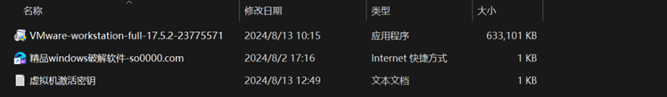

找到下载完成的VMware安装包（文件名为VMware-workstation-full-17.5.2-23775571.exe），右键单击该文件，选择“以管理员身份运行”，启动安装向导。

## 许可协议确认

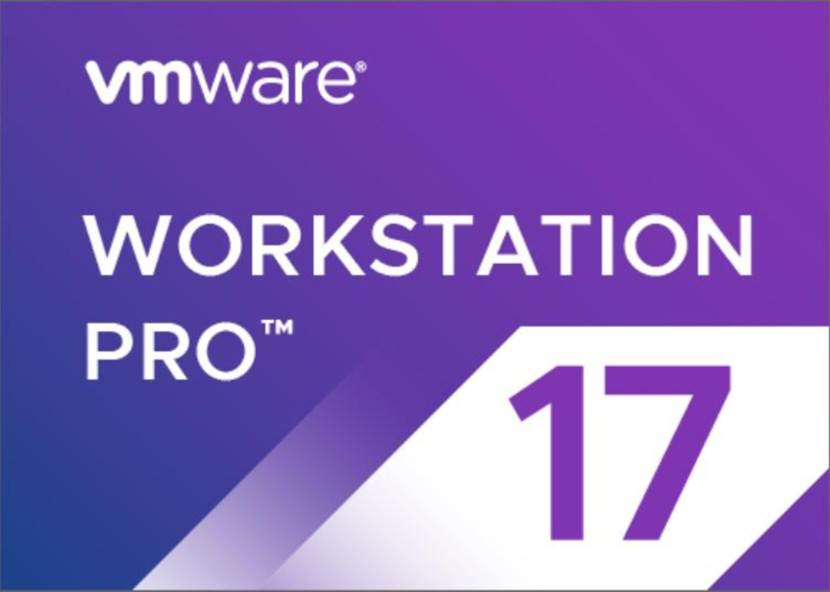

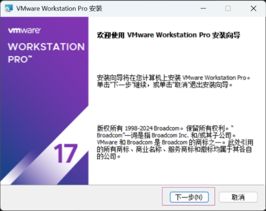

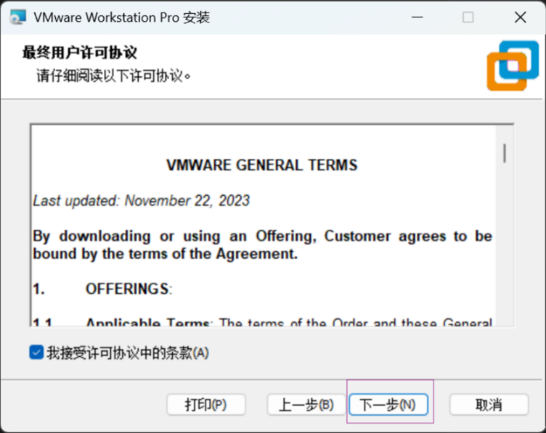

安装向导启动后，首先显示欢迎界面，点击“下一步（N）”进入许可协议页面。仔细阅读最终用户许可协议后，勾选“我接受许可协议中的条款（A）”，然后点击“下一步（N）”。

## 自定义安装设置

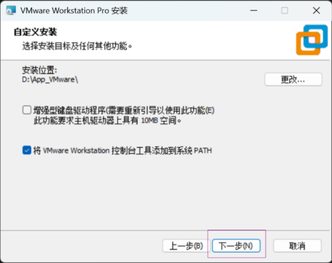

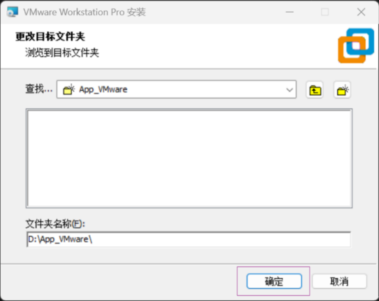

### 安装位置选择：

默认安装路径为系统盘（C盘），为避免占用系统盘空间，建议点击“更改（...）”选择其他磁盘（如D盘），并指定安装文件夹（示例路径：D:\App_VMware\），选择完成后点击“确定”。

### 功能选项选择：

页面中显示“增强型键盘驱动程序（需要重新引导以使用此功能（E））”，该功能可提升虚拟机中键盘操作的兼容性，如需启用可勾选（勾选后安装完成需重启电脑）；下方“将VMware Workstation控制台工具添加到系统PATH”建议保持默认勾选，便于后续命令行操作。设置完成后点击“下一步（N）”。

## 用户体验设置

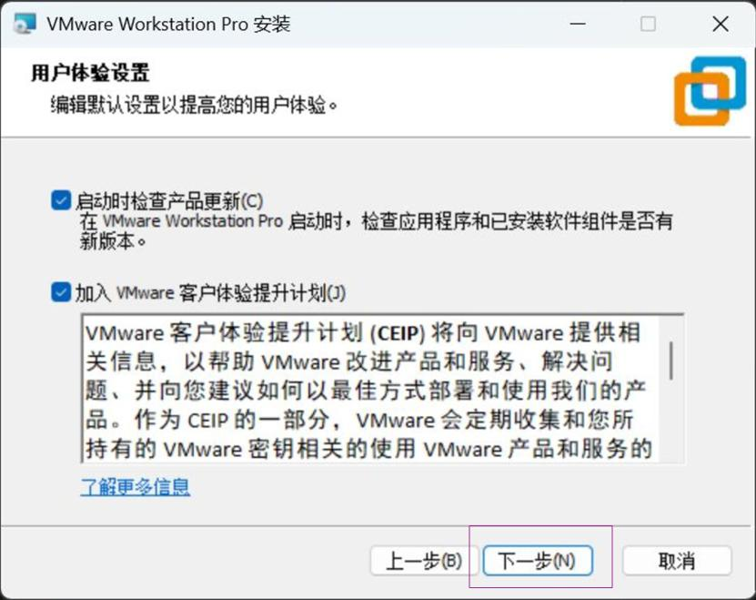

### 启动时检查产品更新：

勾选“启动时检查产品更新（C）”，可确保后续能及时获取软件更新补丁，提升使用稳定性，建议保持勾选。

### 客户体验提升计划：

根据个人需求选择是否勾选“加入VMware客户体验提升计划（J）”，该计划会收集产品使用信息以帮助改进产品，无需参与可取消勾选。设置完成后点击“下一步（N）”。

## 快捷方式创建

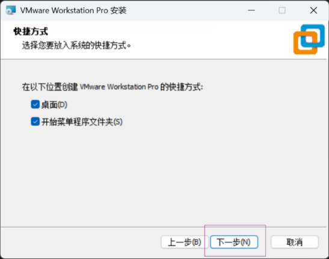

在快捷方式设置页面，可选择需要创建快捷方式的位置，默认勾选“桌面（D）”和“开始菜单程序文件夹（S）”，便于后续快速启动软件，保持默认设置点击“下一步（N）”。

## 开始安装与完成

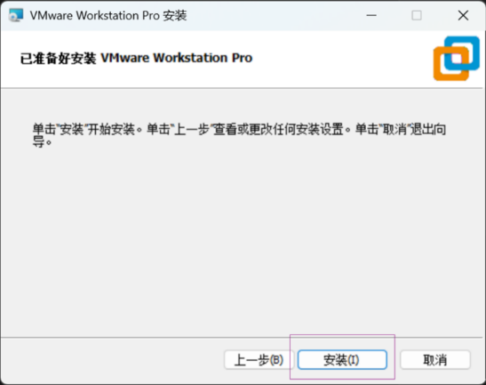

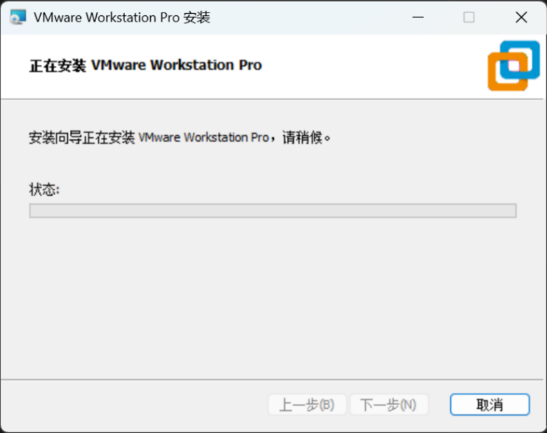

1. 进入“已准备好安装VMware Workstation Pro”页面，确认所有安装设置无误后，点击“安装（I）”开始安装，安装过程中会显示进度状态，等待5-10分钟（具体时间取决于电脑配置）。

2. 安装完成后，进入完成页面，如需立即激活软件，点击“许可证（L）”；无需立即激活可直接点击“完成（F）”退出安装向导（后续可在软件中输入密钥激活）。

## 软件激活操作

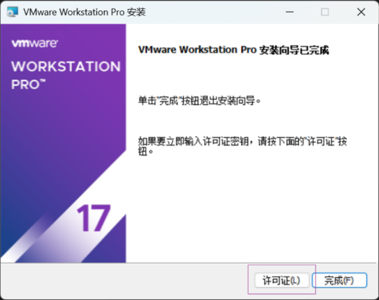

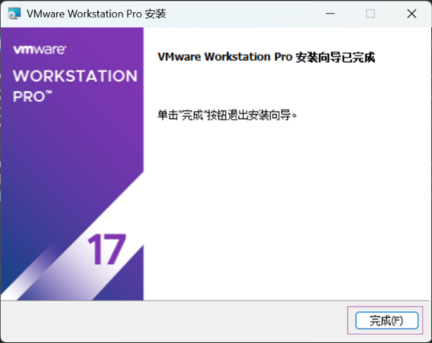

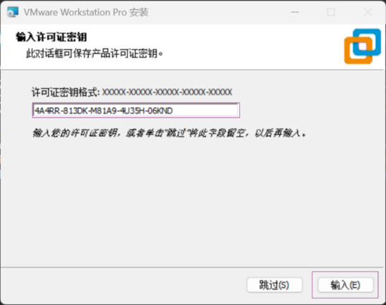

1. 若安装完成后未立即激活，启动VMware Workstation Pro，点击软件顶部菜单栏“帮助”，选择“输入许可证密钥”。

2. 在弹出的密钥输入框中，复制粘贴VMware 17对应的激活密钥（如4A4RR-813DK-M81A9-4U35H-06KND），点击“确定”即可完成激活，激活后软件可永久使用（现在个人可以免费使用，也可以跳过此操作）。

# CentOS7虚拟机创建步骤

## 启动新建虚拟机向导

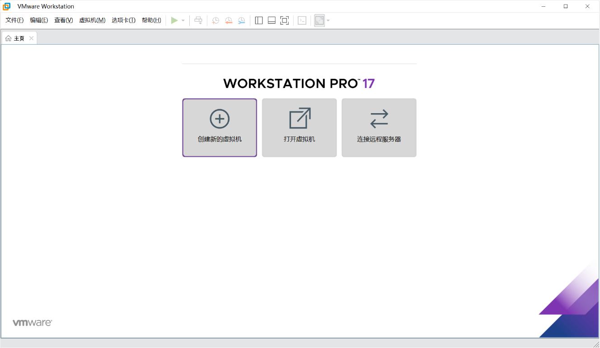

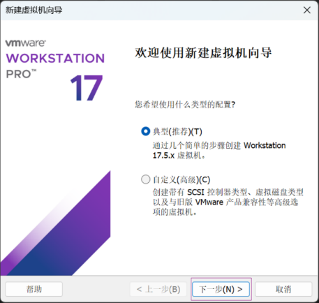

1. 打开VMware Workstation Pro软件，点击主界面“创建新的虚拟机”，启动新建虚拟机向导。

2. 虚拟机配置类型选择：默认显示“典型（推荐）（T）”，适合新手快速创建虚拟机；如需自定义SCSI控制器类型、虚拟磁盘类型等高级设置，可选择“自定义（高级）（C）”，此处选择“典型（推荐）（T）”，点击“下一步（N）”。

## 安装来源选择

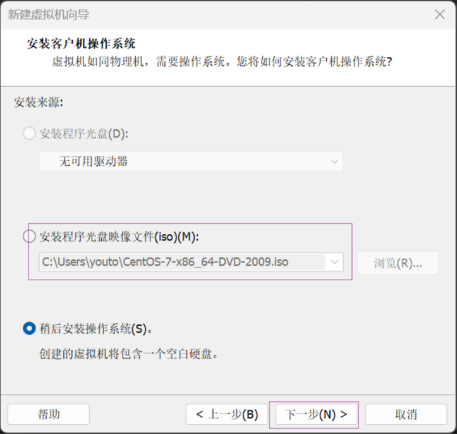

1. 选择“安装程序光盘映像文件（iso）（M）”，点击“浏览（R）”找到已下载的CentOS7镜像文件（示例路径：C:\Users\youto\CentOS-7-x86_64-DVD-2009.iso），选中后点击“打开”，确保镜像文件路径正确后点击“下一步（N）”。

2. 若暂时未下载镜像文件，可选择“稍后安装操作系统（S）”，后续可在虚拟机设置中添加镜像文件。

## 客户机操作系统选择

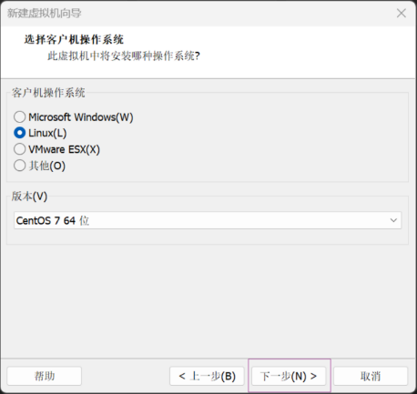

1. 在“客户机操作系统”选项中，选择“Linux（L）”，下方“版本（V）”选择“CentOS 7 64位”（需与下载的镜像文件版本一致），确认后点击“下一步（N）”。

## 虚拟机命名与位置设置

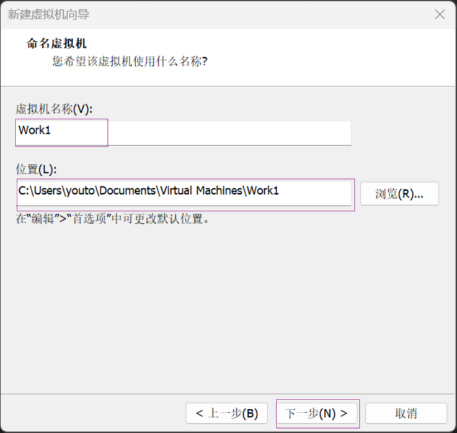

1. 虚拟机名称：输入自定义名称（示例名称：Work1），便于区分不同虚拟机。

2. 存储位置：点击“浏览（R）”选择虚拟机文件的存储路径（建议选择空闲空间充足的磁盘，示例路径：C:\Users\youto\Documents\Virtual Machines\Work1），设置完成后点击“下一步（N）”。

## 虚拟磁盘容量设置

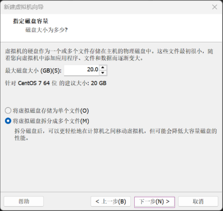

1. 最大磁盘大小：默认推荐20GB（针对CentOS7 64位），可根据实际需求调整（建议不小于20GB，确保系统安装和后续使用空间充足）。

2. 磁盘存储方式：选择“将虚拟磁盘存储为单个文件（O）”或“将虚拟磁盘拆分成多个文件（M）”，单个文件便于管理，拆分文件便于在不同电脑间移动虚拟机，此处选择默认的“将虚拟磁盘拆分成多个文件（M）”，点击“下一步（N）”。

## 虚拟机创建完成

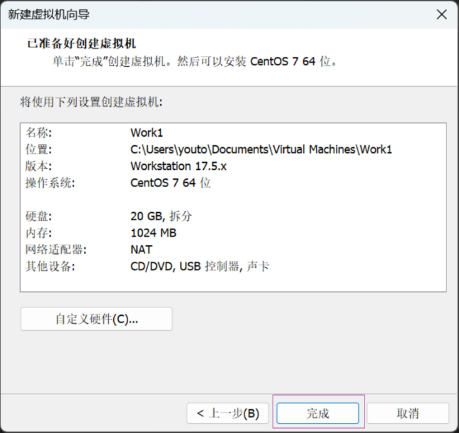

1. 进入“已准备好创建虚拟机”页面，可查看虚拟机的名称、位置、操作系统版本、硬盘大小、内存、网络适配器等配置信息，如需修改配置，点击“自定义硬件（C）”进行调整（如增加内存大小、修改网络模式等）。

2. 确认配置无误后，点击“完成”，即可创建CentOS7虚拟机，创建完成后在VMware主界面可看到名为Work1的虚拟机，状态为“已关机”。

# 后续操作提示

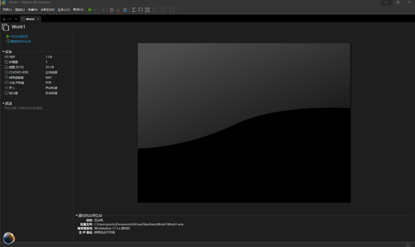

## 启动虚拟机：

选中创建好的虚拟机（Work1），点击主界面“开启此虚拟机”，即可进入CentOS7系统安装流程，后续可按照CentOS7安装向导完成系统部署。

## 虚拟机设置调整：

如需修改虚拟机的硬件配置（如内存、CPU、网络适配器等），可在虚拟机关机状态下，点击“编辑虚拟机设置”进行调整。

## 网络模式选择：

默认网络模式为NAT，适合虚拟机访问互联网；如需让局域网内其他电脑访问虚拟机，可切换为桥接模式。
