# 基于FTP与Apache的web服务器配置

# 实验目的

本实验的核心联动逻辑为：通过 FTP 服务实现对 Apache 网站目录的文件上传 / 管理，公共站点允许所有用户匿名访问，私有站点仅授权用户通过 Web 认证和 FTP 权限双重管控访问。

三个核心关注维度的具体意义：

- 配置文件语法一致性：避免因配置项缺失、格式错误导致服务启动失败；

- 权限继承与传播：确保 FTP 用户、Apache 服务用户（www-data）对共享目录的访问权限不冲突；

- 网络端口双向可达性：FTP 需开放 21 端口（控制）、40000-40100 端口（被动模式数据传输），Apache 需开放 80 端口，确保客户端（本地 / 局域网）能正常连接

# 实验环境

| 组件 | 版本 / 配置 |

|---|---|

| 操作系统 | Ubuntu 20.04 LTS（桌面版） |

| vsftpd | 3.0.5 |

| Apache2 | 2.4.52 |

| 网络环境 | 虚拟机 NAT 模式（IP：192.168.77.128） |

说明：

- 虚拟机 NAT 模式下，IP 地址 192.168.77.128 为实验环境示例 IP，实际操作需通过ip addr命令确认本机真实 IP 并替换所有配置中的 IP 参数；

- vsftpd 3.0.5 为 Ubuntu 20.04 LTS 默认稳定版本，Apache2 2.4.52 为对应系统适配版本，无需手动升级，避免兼容性问题。

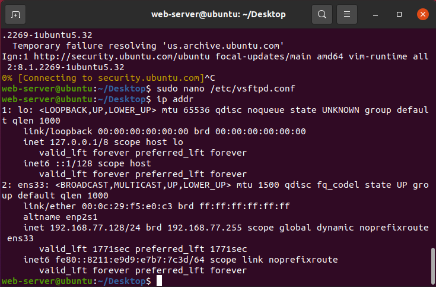

# 实验步骤

## 环境初始化与依赖安装

### 系统更新与依赖检查

| sudo apt update && sudo apt upgrade -y |

|---|

| sudo apt install net-tools tree  # 安装网络工具与目录树工具（便于调试） |

说明：

- sudo apt update && sudo apt upgrade -y：更新软件源索引并自动升级系统已安装包，确保依赖库版本兼容；

- net-tools包含ifconfig等网络查询工具，tree可可视化目录结构，均为后续调试（如确认目录权限、网络状态）必备工具。

注意：若执行更新时出现 “Temporary failure resolving” 报错（如文档中示例），需先按 “问题解决 Q6” 修复 DNS 配置，再重新执行更新命令。

|  |

|---|

### 创建实验专用用户组与目录

| sudo groupadd ftpgroup  # 创建FTP专用用户组 |

|---|

| sudo mkdir -p /var/ftp/shared /home/ftpuser/private  # 共享目录与用户私有目录 |

| sudo chown root:root /var/ftp/shared  # 共享目录所有者设为root（增强安全） |

| sudo chmod 775 /var/ftp/shared  # 组可写，其他可读 |

说明：

- 共享目录/var/ftp/shared所有者设为 root 而非 FTP 用户，是为了防止 FTP 用户误删共享目录本身，仅开放组写权限（775）允许合法用户上传文件；

- 私有目录/home/ftpuser/private后续将与 Apache 私有站点目录关联，提前创建并绑定用户组，为后续权限联动铺垫。

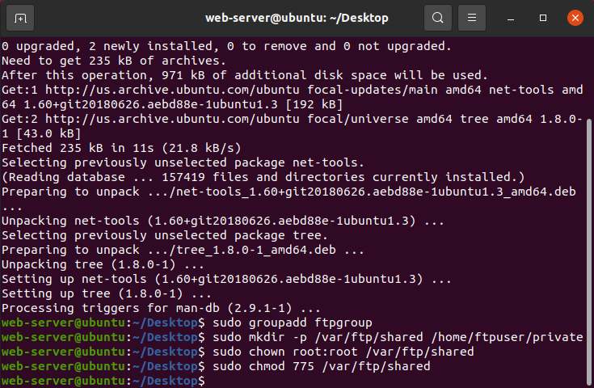

## vsftpd 精细化安装与配置

### 安装 vsftpd 及辅助工具

| sudo apt install vsftpd ftp  # ftp为命令行客户端，便于测试 |

|---|

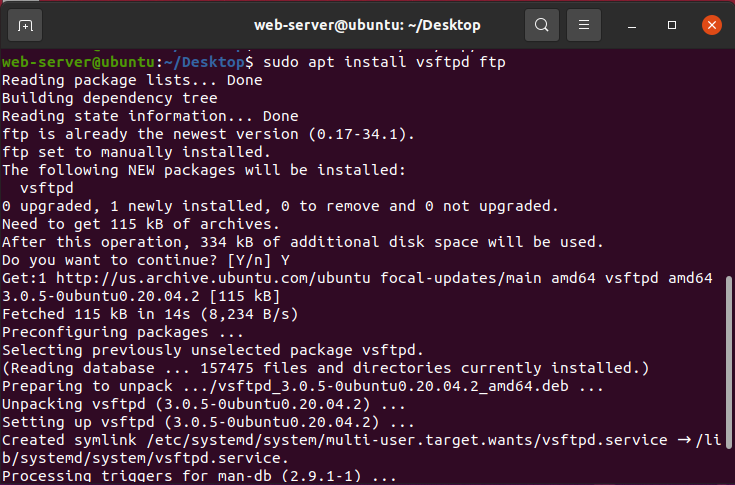

### 配置文件分层优化

#### 主配置文件/etc/vsftpd.conf：

| sudo nano /etc/vsftpd.conf |

|---|

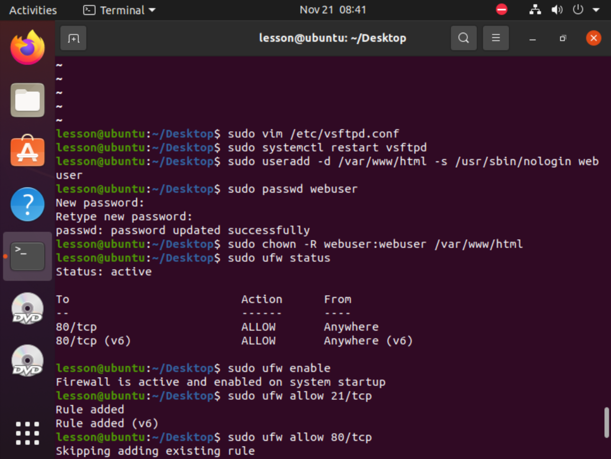

核心配置（新增安全与功能项）：

| listen=YES |

|---|

| listen_ipv6=NO  # 关闭IPv6监听（简化实验） |

| anonymous_enable=NO  # 禁用匿名登录 |

| local_enable=YES |

| write_enable=YES |

| chroot_local_user=YES |

| allow_writeable_chroot=YES |

| local_umask=022 |

| # 被动模式配置（必须，否则客户端无法列出目录） |

| pasv_enable=YES |

| pasv_min_port=40000 |

| pasv_max_port=40100 |

| pasv_address=192.168.227.128  # 虚拟机IP，需替换为实际值 |

| # 用户隔离与权限配置 |

| user_config_dir=/etc/vsftpd/user_conf  # 用户级配置目录 |

| allow_writeable_chroot=YES |

核心配置项说明：

- anonymous_enable=NO：禁用匿名登录是 FTP 安全配置的基础，避免匿名用户非法访问；

- chroot_local_user=YES+allow_writeable_chroot=YES：限制用户登录后只能访问自身主目录（禁锢目录），同时允许该目录可写（默认 chroot 后目录不可写，需手动开启）；

- 被动模式配置（pasv_*）：解决 FTP 客户端因防火墙限制无法主动连接服务器的问题，pasv_address必须填写虚拟机真实 IP，否则客户端无法解析数据连接地址；

- user_config_dir=/etc/vsftpd/user_conf：开启用户级配置，不同 FTP 用户可通过该目录下的专属文件自定义权限（如默认目录、读写权限），实现精细化管理。

### 创建用户级配置目录并配置示例用户：

| sudo mkdir -p /etc/vsftpd/user_conf |

|---|

| sudo nano /etc/vsftpd/user_conf/ftpuser  # 为ftpuser创建专属配置 |

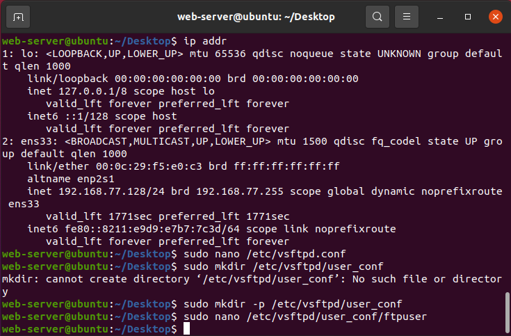

内容：

| local_root=/home/ftpuser  # 用户登录后默认目录 |

|---|

| write_enable=YES |

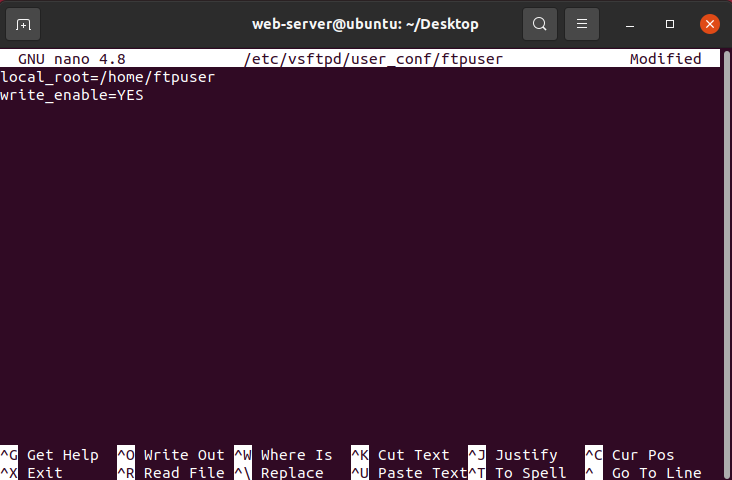

### 用户创建与权限绑定

| sudo useradd -m -g ftpgroup ftpuser  # 创建用户并加入ftpgroup组 |

|---|

| sudo passwd ftpuser  # 设置密码 |

| sudo chown ftpuser:ftpgroup /home/ftpuser/private  # 私有目录用户归属 |

| sudo chmod 750 /home/ftpuser/private  # 仅用户和组可访问 |

说明：

- useradd -m -g ftpgroup ftpuser：-m参数自动创建用户主目录/home/ftpuser，-g指定用户归属 ftpgroup 组，确保用户继承组权限；

- 私有目录/home/ftpuser/private权限设为 750（用户读 / 写 / 执行，组读 / 执行，其他无权限），仅允许 ftpuser 本人和 ftpgroup 组内用户访问，增强数据安全性。

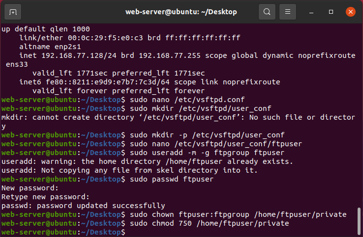

### 防火墙与服务启动

| sudo ufw enable |

|---|

| sudo ufw allow 21/tcp  # FTP数据端口 |

| sudo ufw allow 80/tcp  # FTP控制端口 |

| sudo ufw allow 40000:40100/tcp  # 被动模式端口范围 |

| sudo ufw status #输出端口状态 |

| sudo systemctl restart vsftpd  # 重启vsftpd服务，使修改后的配置文件生效 |

| sudo systemctl enable vsftpd  #设置vsftpd服务为开机自启 |

说明：

- 防火墙需开放 FTP 控制端口（21）、被动模式数据端口范围（40000-40100）和 Apache 端口（80），缺一不可；

- sudo systemctl enable vsftpd：设置服务开机自启，避免虚拟机重启后需手动启动 FTP 服务；

- 执行ufw status后需确认所有端口状态为 “ALLOW”，且防火墙状态为 “active”，否则客户端无法连接。

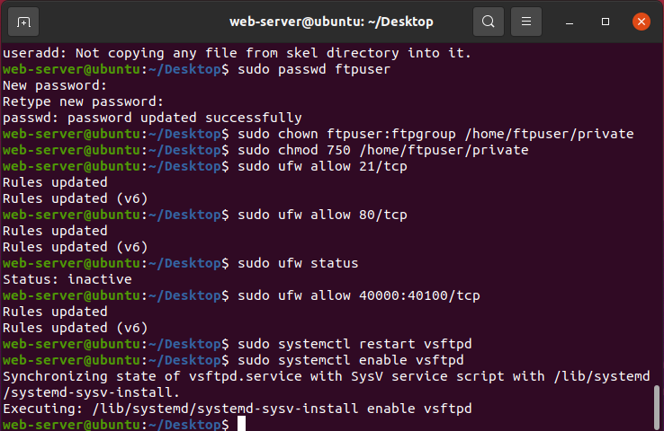

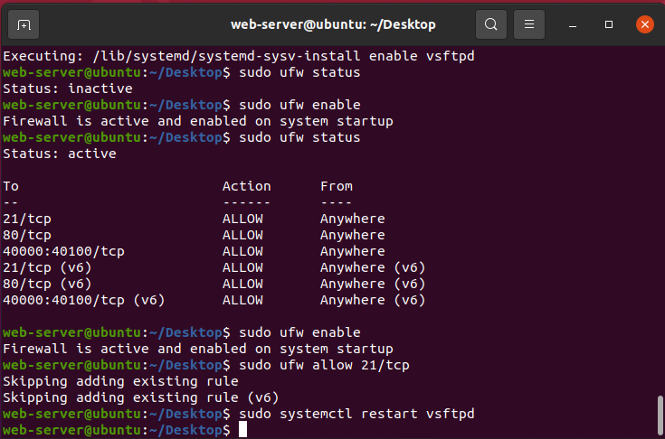

## Apache2 深度配置与联动

### 安装Apache2

| sudo apt install apache2 -y |

|---|

说明：

- 公共站点/var/www/public所有者设为 Apache 默认用户 www-data，确保 Apache 服务能正常读取站点文件；

- 私有站点/var/www/private所有者设为 ftpuser:ftpgroup，且权限为 775（组可写），允许 FTP 用户（ftpuser）上传文件到该目录，同时 Apache 服务（www-data 属于 www-data 组，需确保 www-data 组有读权限）能读取文件并提供 Web 访问。

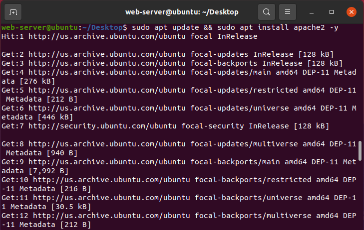

### Apache 多站点与权限配置

#### 创建两个站点示例（公共站点与用户私有站点）：

| sudo mkdir -p /var/www/public /var/www/private |

|---|

| sudo chown www-data:www-data /var/www/public |

| sudo chown ftpuser:ftpgroup /var/www/private |

| sudo chmod 775 /var/www/private  # 组可写（便于FTP用户上传） |

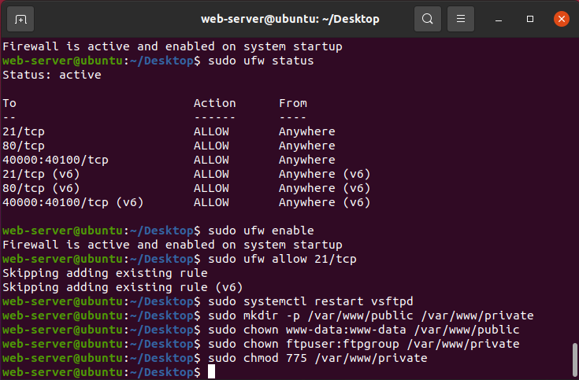

#### 配置公共站点（001-public.conf）：

| sudo nano /etc/apache2/sites-available/001-public.conf |

|---|

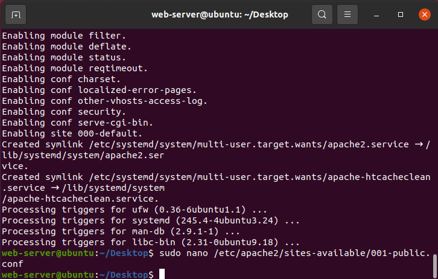

内容：

| <VirtualHost *:80> |

|---|

| ServerName public.example.com |

| DocumentRoot /var/www/public |

| <Directory /var/www/public> |

| Options Indexes FollowSymLinks |

| AllowOverride None |

| Require all granted |

| </Directory> |

| </VirtualHost> |

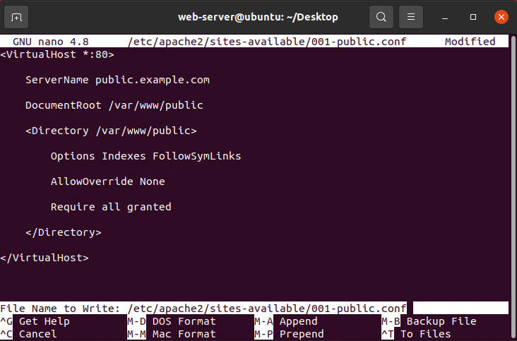

#### 配置私有站点（002-private.conf）：

| sudo nano /etc/apache2/sites-available/002-private.conf |

|---|

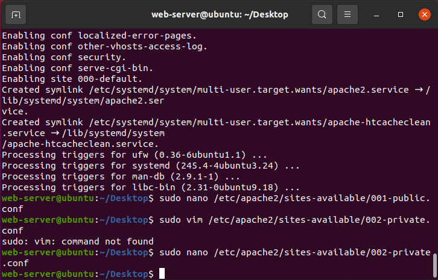

内容：

| <VirtualHost *:80> |

|---|

| ServerName private.example.com |

| DocumentRoot /var/www/private |

| <Directory /var/www/private> |

| Options Indexes FollowSymLinks |

| AllowOverride None |

| Require user ftpuser |

| AuthType Basic |

| AuthName "Private Area" |

| AuthUserFile /etc/apache2/.htpasswd |

| </Directory> |

| </VirtualHost> |

配置项说明：

- Require user ftpuser：仅允许 ftpuser 用户通过 Web 访问该站点；

- AuthType Basic：采用基础认证方式（用户名 + 密码）；

- AuthUserFile /etc/apache2/.htpasswd：指定认证密码文件路径，后续通过htpasswd命令创建该文件并设置密码。

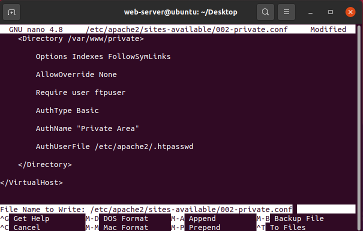

#### 创建 Apache 认证文件：

| sudo htpasswd -c /etc/apache2/.htpasswd ftpuser  # 设置ftpuser的Web访问密码 |

|---|

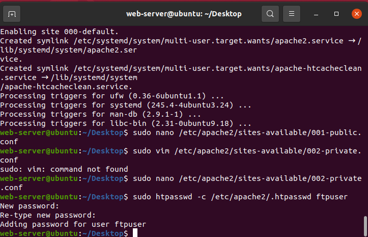

### 联动 FTP 与 Apache 目录

#### 配置 ftpuser 的 FTP 目录指向 Apache 私有站点目录：

| sudo nano /etc/vsftpd/user_conf/ftpuser |

|---|

修改local_root为：

| local_root=/var/www/private |

|---|

联动逻辑说明：

将 ftpuser 的 FTP 默认目录（local_root）修改为 Apache 私有站点目录/var/www/private后，FTP 用户上传的文件会直接存入该目录，无需手动复制，实现 “FTP 上传→Web 即时访问” 的联动效果；

注意：修改配置后必须重启 vsftpd 服务（sudo systemctl restart vsftpd），否则配置不生效，可通过sudo systemctl status vsftpd确认服务状态为 “active (running)”。

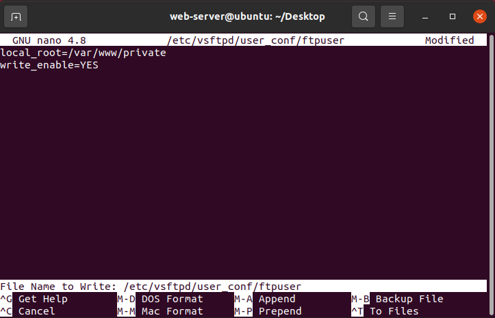

#### 重启 vsftpd 使配置生效：

| sudo systemctl restart vsftpd |

|---|

| sudo systemctl status vsftpd |

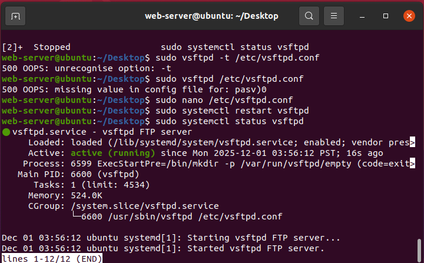

### Apache 服务启动与模块启用

| sudo a2ensite 001-public.conf 002-private.conf |

|---|

| sudo a2enmod auth_basic authn_file  # 启用认证模块 |

| sudo systemctl restart apache2 |

| sudo systemctl enable apache2 |

| sudo systemctl status apache2 |

说明：

- a2ensite 001-public.conf 002-private.conf：启用两个站点配置（默认 Apache 仅启用 000-default.conf），执行后会在/etc/apache2/sites-enabled目录创建配置文件的软链接；

- a2enmod auth_basic authn_file：启用基础认证模块和文件认证模块，是私有站点密码验证的必备模块；

- 重启 Apache 服务后，需通过sudo systemctl status apache2确认服务正常运行，否则需检查站点配置文件语法（可通过sudo apache2ctl configtest排查语法错误）。

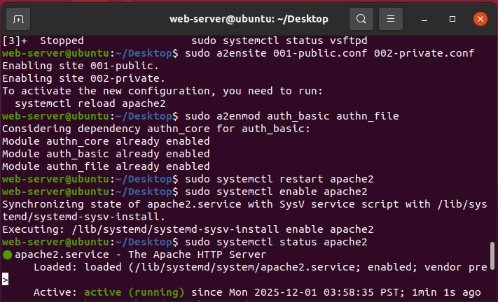

## 多场景验证

### FTP 服务功能验证

#### 命令行客户端连接测试：

| touch test.txt |

|---|

| ftp 192.168.77.128 |

| # 输入用户名ftpuser和密码，执行以下命令 |

| ls  # 列出目录 |

| mkdir private  # 创建远程目录private |

| cd private |

| put test.txt  # 上传本地文件test.txt |

| get test.txt  # 下载文件 |

预期结果：

- 输入用户名 ftpuser 和密码后成功登录 FTP 服务器；

- 执行ls命令可列出/var/www/private目录下的文件；

- mkdir private命令可在该目录下创建子目录；

- put test.txt命令可成功上传本地 test.txt 文件到远程目录，get test.txt可将远程文件下载到本地；

若执行命令时出现 “Permission denied”，需检查目录权限（如/var/www/private是否为 ftpuser:ftpgroup 所有，且权限为 775）；若出现 “Connection refused”，需检查 vsftpd 服务是否启动、防火墙端口是否开放。

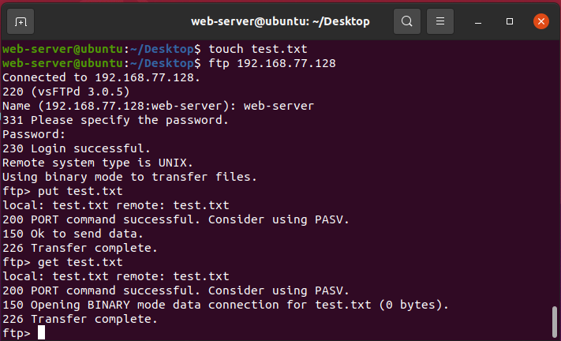

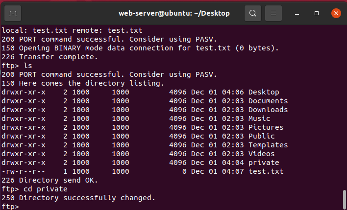

#### FileZilla 图形化连接测试：

配置主机为192.168.77.128，用户名ftpuser，密码为设置值，测试目录切换、文件上传下载。

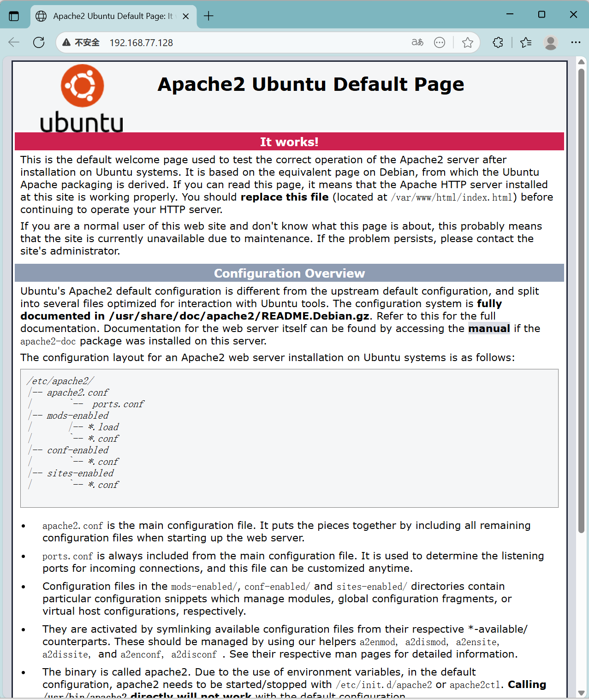

### Apache 联动验证

公共站点访问：在/var/www/public中创建index.html，内容为<h1>Public Site</h1>，浏览器访问http://192.168.227.128（或配置的public.example.com，需修改本地 hosts）。

| # 方法1：直接在服务器创建index.html |

|---|

| sudo nano /var/www/public/index.html |

| # 粘贴上述公共站点HTML内容，按Ctrl+O保存，Ctrl+X退出 |

|  |

| # 方法2：若本地已有文件，通过FTP上传（可选） |

| # 本地终端执行ftp连接，登录后执行：put /本地路径/index.html /var/www/public/ |

详细验证步骤：

- 公共站点验证：

- 在/var/www/public创建 index.html 后，打开浏览器输入http://192.168.77.128（虚拟机 IP），无需登录即可看到 “Public Site - Not need Password” 页面；

- 私有站点验证：

- 通过 FTP 上传 private.html 到/var/www/private目录；

- 浏览器输入http://192.168.77.128（或private.example.com，需修改本地 hosts 文件：在 Windows 宿主机C:\Windows\System32\drivers\etc\hosts中添加192.168.77.128 private.example.com）；

- 浏览器会弹出认证窗口，输入 ftpuser 的 Web 密码（通过htpasswd命令设置的密码）后，可看到 “Private Site” 页面，未输入密码或密码错误则无法访问。

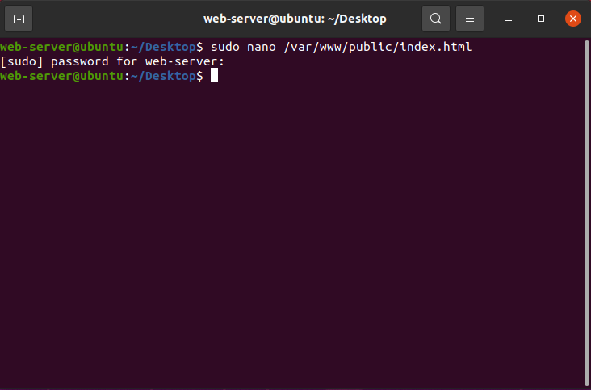

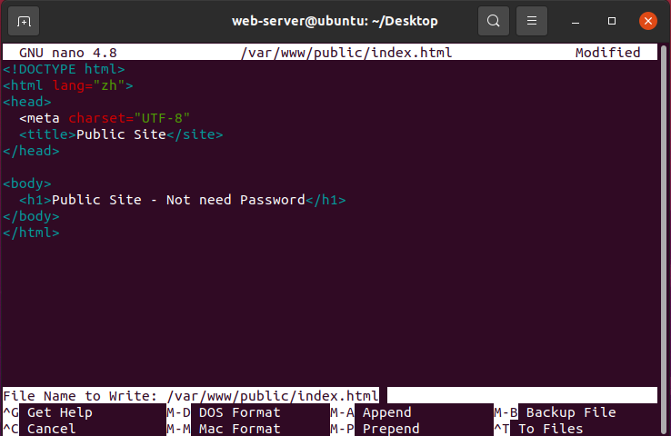

私有站点访问：（需要共享文件夹，先到这吧）在 FTP 私有目录上传private.html（内容<h1>Private Site</h1>），浏览器访问http://192.168.227.128（或private.example.com），验证需输入ftpuser的 Web 密码，且页面正常显示。

# 问题解决

遇到的问题主要是上一个虚拟机没有卸载干净，导致现在的虚拟机产生了一堆问题（Q1、Q5、Q6、Q7、Q8）。

## Q1:虚拟机始终无法连上主机的虚拟网关

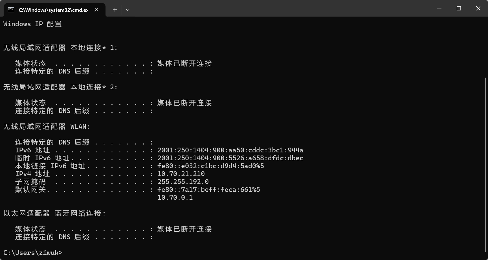

### 问题分析：

排查思路：

- 先确认虚拟机网络模式为 NAT 模式，且 VMware 的 NAT 服务（VMware NAT Service）已启动（可在宿主机 “服务” 中查看）；

- 检查虚拟机 IP 是否与宿主机在同一网段（如宿主机 IP 为 192.168.77.1，虚拟机 IP 应为 192.168.77.X），若 IP 为 169.254.X.X，说明未获取到 DHCP 地址，需重启 VMware DHCP Service；

- 若之前安装过 VMware，优先按 Q6 方法清理注册表残留，再重新配置网络，避免旧配置冲突。

### 解决方法：

##### 结果：Q6解决了就解决这个问题了，原因是上次卸载残留在注册表或者系统文件当中的配置文件

### 尝试方法

#### 重装虚拟机；

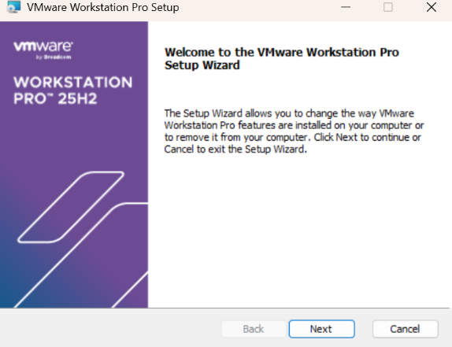

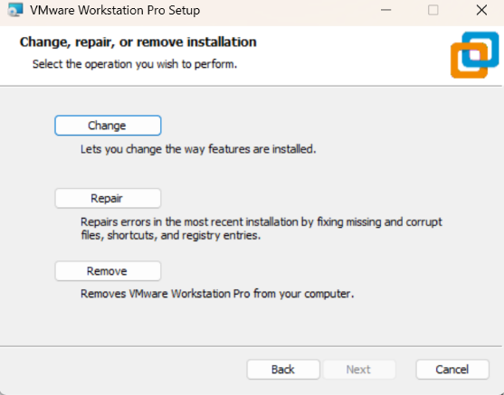

##### 结果：失败，甚至导致产生接下来的一堆问题

#### 重启主机系统；重新配置Ubuntu环境；

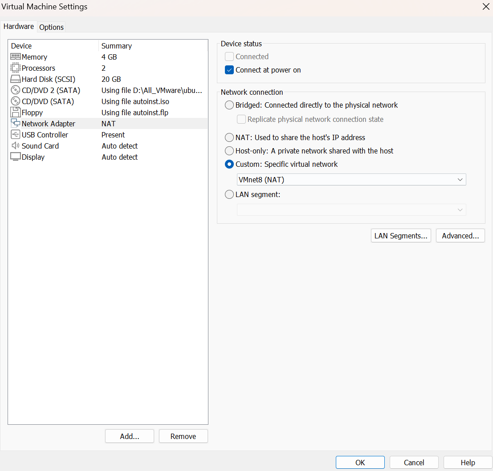

##### 结果：失败

#### 重启本地服务；

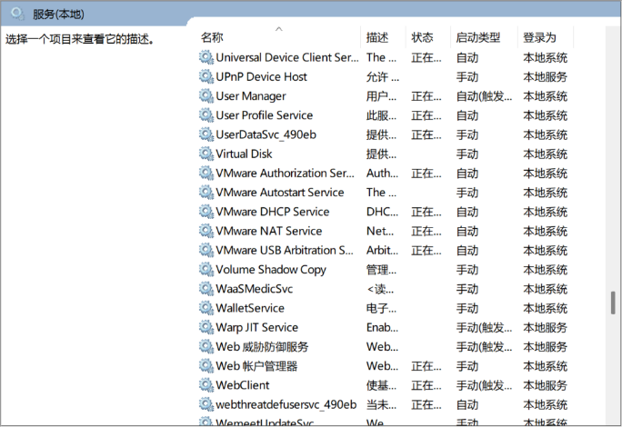

##### 结果：失败

## Q2 sudo: vim: command not found

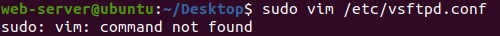

在Ubuntu系统中下载安装vim的步骤如下：

### 解决方法

#### 安装vim：

| sudo apt install vim -y |

|---|

补充说明：（-y参数会自动确认安装，无需手动输入yes）

若sudo apt install vim -y安装失败（如 DNS 解析问题），可使用 Ubuntu 默认文本编辑器 nano 替代，操作快捷键：Ctrl+O 保存，Ctrl+X 退出，功能完全满足配置文件编辑需求，无需强制安装 vim。

#### 验证是否安装成功：

输入`vim --version`，若显示vim的版本信息，则安装完成。

##### 结果：安装失败，使用nano进行文本编辑

## Q3 mkdir: cannot create directory ‘XXXXXX’: No such file or directory

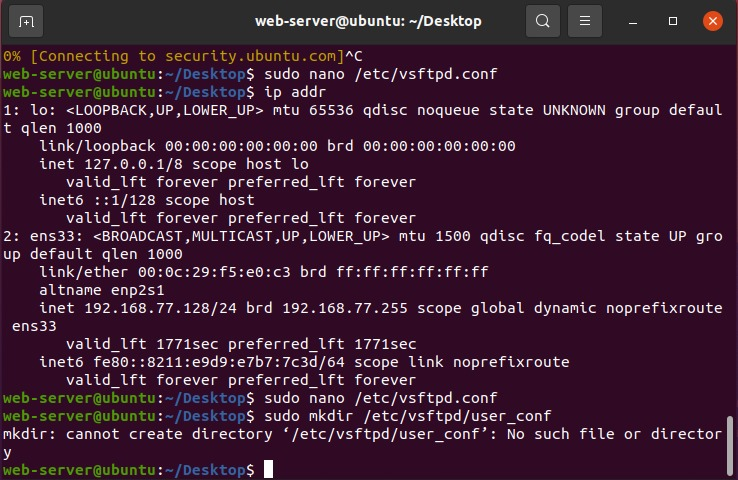

这是在Ubuntu终端操作中出现的目录创建失败问题，核心信息及分析如下：

执行命令：sudo mkdir /etc/vsftpd/user_conf`

错误提示：

mkdir: cannot create directory '/etc/vsftpd/user_conf': No such file or directory

### 问题分析：

/etc/vsftp目录不存在，直接创建其子目录user_conf会失败（mkdir默认不会自动创建上级目录）

### 解决方法：

#### 创建目录时，添加-p参数（自动创建上级目录）：

| sudo mkdir -p /etc/vsftpd/user_conf |

|---|

##### 结果：运行成功。

## Q4 Error writing /etc/apache2/sites-available/001-public.conf: No such file or directory

### 问题分析

这个报错Error writing /etc/apache2/sites-available/001-public.conf: No such file or directory的原因是：目标路径不存在。

1. 你要写入的文件是`/etc/apache2/sites-available/001-public.conf`，但系统中可能缺少`/etc/apache2`目录（或其下的`sites-available`子目录）。

2. 通常`/etc/apache2`是Apache Web服务器的配置目录，出现这个问题说明Apache可能未安装**，导致对应的配置目录不存在。

### 解决方法：

#### 先安装Apache（若未安装）：

| sudo apt update && sudo apt install apache2 -y |

|---|

安装完成后，`/etc/apache2/sites-available`目录会自动创建，此时再尝试编辑该配置文件即可。

##### 结果：重新运行成功

## Q5 与vmx86驱动程序的版本不匹配：预期为XX，实际为XX。

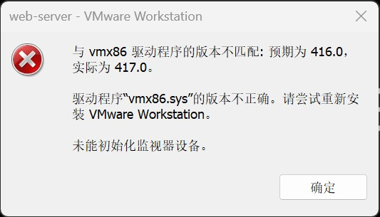

### 问题分析

这个问题是因为系统里的vmx86.sys驱动版本和VMware Workstation需要的版本不匹配导致的，按以下步骤解决：

### 解决方法

#### 步骤1：重命名/删除旧驱动文件

1. 打开文件资源管理器，进入路径：`C:\Windows\System32\drivers`

2. 找到`vmx86.sys`文件，右键重命名为`vmx86_old.sys`（如果提示“文件正在使用”，先重启电脑后再操作）

#### 步骤2：修复/重新安装VMware Workstation

1. 找到VMware的安装包，右键选择“以管理员身份运行”

2. 在安装界面选择“修复”（如果没有修复选项，先卸载现有版本，再重新安装）

3. 安装完成后重启电脑

##### 结果：重启后成功

#### 步骤3：清理残留（若上述步骤无效）

1. 用【Everything】工具（官网可下载）搜索所有`vmx86.sys`文件，删除残留的旧版本

2. 用【CCleaner】清理注册表中VMware的残留项

3. 再次重新安装VMware Workstation

## Q6 无法解析软件源域名

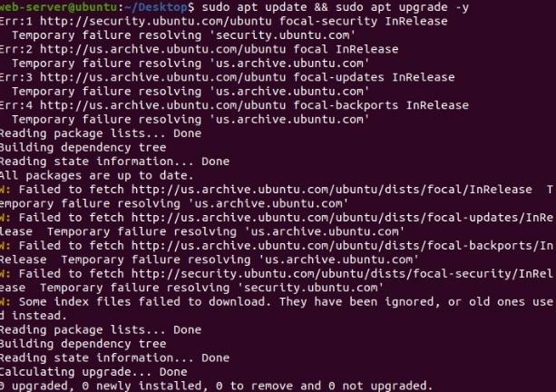

### 问题分析

这个问题是Ubuntu虚拟机 无法解析软件源域名（网络DNS配置异常）导致的，直接按以下步骤解决：

### 解决方法

##### 结果：解决Q5就解决了

### 尝试方法

#### 步骤1：临时切换国内软件源（解决域名解析+加速更新）

1. 打开终端，先备份原软件源文件：

| sudo cp /etc/apt/sources.list /etc/apt/sources.list.bak |

|---|

2. 编辑软件源文件，替换为阿里云的Ubuntu20.04源：

sudo nano /etc/apt/sources.list

3. 删除文件中所有内容，粘贴以下内容（阿里云源）：

| deb http://mirrors.aliyun.com/ubuntu/ focal main restricted universe multiverse |

|---|

| deb-src http://mirrors.aliyun.com/ubuntu/ focal main restricted universe multiverse |

| deb http://mirrors.aliyun.com/ubuntu/ focal-security main restricted universe multiverse |

| deb-src http://mirrors.aliyun.com/ubuntu/ focal-security main restricted universe multiverse |

| deb http://mirrors.aliyun.com/ubuntu/ focal-updates main restricted universe multiverse |

| deb-src http://mirrors.aliyun.com/ubuntu/ focal-updates main restricted universe multiverse |

| deb http://mirrors.aliyun.com/ubuntu/ focal-proposed main restricted universe multiverse |

| deb-src http://mirrors.aliyun.com/ubuntu/ focal-proposed main restricted universe multiverse |

| deb http://mirrors.aliyun.com/ubuntu/ focal-backports main restricted universe multiverse |

| deb-src http://mirrors.aliyun.com/ubuntu/ focal-backports main restricted universe multiverse |

4. 按 `Ctrl+O` 保存，`Ctrl+X` 退出。

#### 步骤2：配置DNS服务器（解决域名解析失败）

1. 编辑DNS配置文件：

| sudo nano /etc/resolv.conf |

|---|

2. 添加国内常用DNS（如阿里云或114）：

| nameserver 223.5.5.5 |

|---|

| nameserver 223.6.6.6 |

| nameserver 114.114.114.114 |

3. 保存退出后，重启网络服务：

| sudo systemctl restart NetworkManager |

|---|

#### 步骤3：重新执行更新命令

终端输入：

| sudo apt update && sudo apt upgrade -y |

|---|

此时应该能正常解析源地址，完成系统更新。

如果还是不行，检查虚拟机的桥接网络是否真的连通（比如ping `223.5.5.5`，能ping通则网络没问题，只是DNS的事；ping不通则重新配置Vmware桥接模式）。

## Q7 WMware Virual Ethemet Adapter for VMnet1

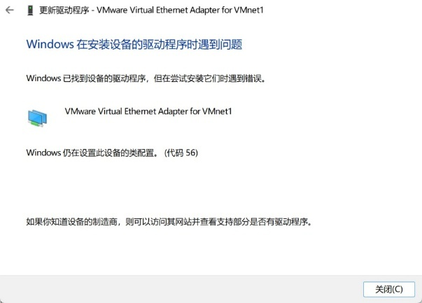

### 问题分析

这个问题（VMware虚拟网卡VMnet1错误代码56）通常是VMware卸载/安装残留的注册表冲突导致的，以下是分步解决方法：

### 解决方法

#### 删除冲突的注册表项（优先尝试）

这是最常见的解决方式：

1. 按 `Win + R` 打开“运行”，输入 regedit 打开注册表编辑器（操作前建议备份注册表）。

2. 按 `Ctrl + F` 搜索：{3d09c1ca-2bcc-40b7-b9bb-3f3ec143a87b}。

3. 找到该注册表项后，右键选择**删除**。

4. 重启电脑，再检查设备管理器中VMnet1的状态。

##### 结果：成功

### 其他情况

#### 修复VMware安装（不卸载虚拟机）

如果还需要保留VMware，可通过修复工具恢复配置：

1. 打开 控制面板 → “程序和功能”，找到 `VMware Workstation`。

2. 右键选择 更改 → 点击“修复”，等待VMware重新安装必要组件。

3. 修复完成后，打开VMware的 虚拟网络编辑器 ，点击“恢复默认设置”。

4. 重启电脑，检查虚拟网卡是否恢复正常。

#### 清理VMware残留（彻底解决）

若上述方法无效，需彻底清理VMware残留：

1. 卸载VMware（控制面板→程序和功能→卸载）。

2. 用 `CCleaner`（免费工具）扫描并清理**注册表残留**（选择“VMware”相关项）。

3. 再次打开注册表，按 `Ctrl + F` 搜索 `VMnet`，删除所有相关项。

4. 重启电脑后，重新安装最新版本的VMware。

#### 补充：系统组件修复

若仍有问题，可修复Windows网络组件：

1. 以管理员身份打开命令提示符。

2. 依次执行：

sfc /scannow

DISM /Online /Cleanup-Image /RestoreHealth

netsh winsock reset

3. 重启电脑后再次检查。

## Q8 VMware虚拟机界面的右下角（无法解析更新服务器域名（softwareupdate.vmware.com））

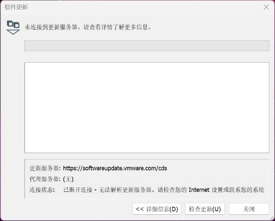

### 问题分析

这是VMware的“软件更新”窗口，提示“未连接到更新服务器”，核心问题是无法解析更新服务器域名（softwareupdate.vmware.com），通常由网络配置异常导致。

该提示的关键信息：

1. 更新服务器地址为`https://softwareupdate.vmware.com/cds`；

2. 连接状态显示“已断开连接 - 无法解析更新服务器”，说明当前网络环境下，系统无法将该域名转换为IP地址。

其实与Q5同一个原因

### 解决建议

#### 检查宿主机网络连接

确认宿主机（安装VMware的电脑）能正常访问互联网，可尝试打开浏览器访问`https://softwareupdate.vmware.com`；

若宿主机也无法访问，需排查网络连接（如路由器、宽带状态）。

#### 修复DNS配置

在宿主机中修改DNS设置，添加公共DNS（如阿里云DNS：223.5.5.5、谷歌DNS：8.8.8.8）；

步骤（以Windows为例）：

1. 打开“网络和共享中心”→“更改适配器设置”；

2. 右键当前网络→“属性”→选择“Internet协议版本4 (TCP/IPv4)”→“属性”；

3. 手动输入DNS服务器地址，保存后重启网络。

#### 跳过VMware自动更新（临时方案）

若无需立即更新VMware，可点击“关闭”按钮跳过该提示，不影响虚拟机的正常使用；

后续可在网络恢复后，重新通过“帮助→检查更新”尝试连接。

##### 结果：Q5解决了，Q7就没有了

## Q9 无法连接虚拟设备sata0:1，因为主机上没有对应的设备

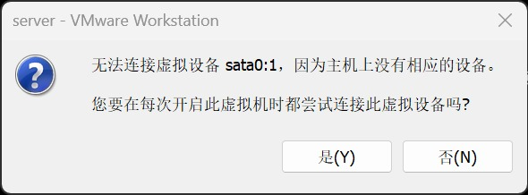

### 问题分析

这是VMware启动虚拟机时的设备连接错误提示，核心原因是 虚拟机配置中指定的SATA设备（如CD/DVD驱动器）在宿主机上不存在 （例如宿主机未连接光驱、或镜像文件路径失效）。

### 操作建议

#### 选择“否(N)”

点击“否(N)”，避免每次启动虚拟机都重复触发该提示；

此操作仅跳过当前设备连接，不影响虚拟机的正常启动。

#### 后续修复配置

启动虚拟机后，通过以下步骤修正设备配置：

- 关闭虚拟机，打开VMware的“虚拟机设置”；

- 找到“SATA控制器”下的“CD/DVD 2 (SATA)”设备；

- 选择“使用物理驱动器”（若宿主机有光驱），或“使用ISO镜像文件”（指定有效文件路径），或直接“移除”该冗余设备。

##### 结果：不用管
