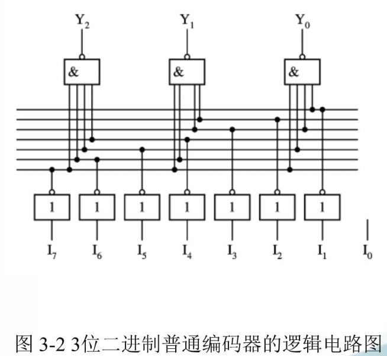
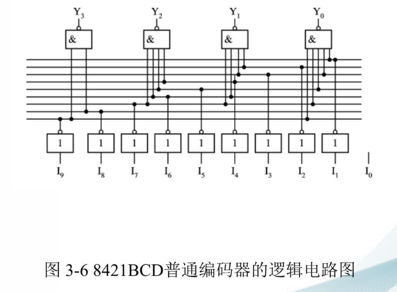
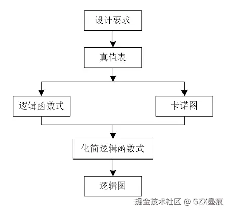
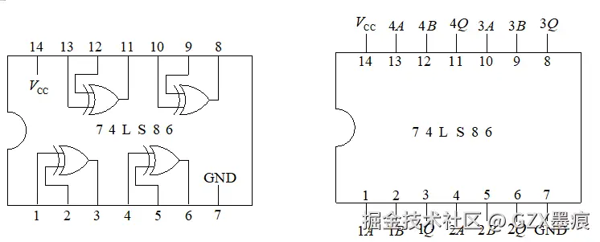

# 《数字电子技术基础》第六版

# 组合逻辑电路的分析与设计

# 典型电路分析图

## 编码器电路分析

编码器是将输入的特定信号转换为二进制代码的逻辑电路，在数字系统中广泛应用于键盘输入、优先级控制等场景。

### 8线- 3线编码器电路

| 表1-1 3位二进制普通编码器真值表 |

|---|

约束条件

由表1-1可以写出以下逻辑表达式（多行对齐）

利用约束条件和公式对上述表达式进行化简，可以得到：

图3-2是用与非门实现的3位二进制普通编码器的逻辑电路图。

Figure   3位二进制普通编码器的逻辑电路图

最基本的编码器类型，其逻辑电路如图所示(14)。

该电路有 8 个信号输入端（），

3 个二进制编码输出端（），

以及一个输入使能端 EN。

当 EN=1 时编码器工作，此时如果至少有一个输入有效，工作状态指示信号 GS 输出为1。编码器的核心逻辑是将 8 个输入信号中的有效信号转换为对应的 3 位二进制代码，例如当有效时，输出 。

### 8421BCD 优先编码器

另一种重要的编码器类型，其逻辑电路图如教材图 3-8 所示(14)。优先编码器的特点是允许同时输入多个电平信号，但只对其中优先权最高的一个输入信号进行处理。例如，在 8421BCD 优先编码器中， 的优先权最高， 的优先权最低(70)。这种设计特别适用于多个设备同时请求服务的场景，如计算机系统中的中断处理。

编码器的工作原理基于编码逻辑：每个输入信号对应一个唯一的二进制代码，当多个输入同时有效时，优先编码器根据预设的优先级进行选择。编码器的输出逻辑表达式可以通过真值表推导得出，例如 8 线 - 3 线编码器的输出逻辑为：

，

，

.

## 译码器电路分析

译码器是编码器的逆电路，其功能是将有特定含义的二进制码辨别出来，并转换成控制信号(17)。译码器在数字系统中常用于地址译码、数据分配等场景。

### 3 线 - 8 线译码器 74LS138

最常用的译码器芯片之一，其逻辑电路图如教材图 3-6 所示(15)。该译码器有 3 个地址输入端（A2-A0），8 个输出端（Y0'-Y7'），以及 3 个控制端（S1、S2'、S3'）。当控制端满足 S1=1 且 S2'+S3'=0 时，译码器处于工作状态，此时输出 Y0'-Y7' 中只有对应于输入地址的那一个输出为低电平，其余为高电平。例如，当 A2A1A0=101 时，Y5'=0，其余输出为 1。

译码器的工作原理基于译码逻辑：将输入的二进制代码转换为对应的输出信号。对于 n 线 - 2^n 线译码器，每个输出对应一个最小项，输出逻辑表达式为 ，其中  为输入变量。74LS138 的输出逻辑表达式为：，，，依此类推(19)。

### 二-十进制译码器（又称4线- 10线译码器）

是另一种重要的译码器类型，用于将 4 位 BCD 码转换为 10 个十进制输出信号(20)。该译码器有 4 个输入端，10 个输出端，常用于数字显示系统中驱动七段显示器。

## 加法器电路分析

加法器是实现二进制数加法运算的核心电路，是计算机算术逻辑单元（ALU）的基础。

### 半加器

是最简单的加法器，不考虑来自低位的进位，只将两个 1 位二进制数相加(43)。半加器的逻辑电路如教材图 3-17 所示，有两个输入（A、B）和两个输出（S 为和，C 为进位）。半加器的逻辑表达式为：S=A⊕B，C=AB。半加器可以用一个异或门和一个与门实现，也可以用与非门组成，如图 1.4.2 所示。

### 全加器

是考虑来自低位进位的加法器，有三个输入（被加数 A、加数 B 和来自低位的进位 Ci）和两个输出（和 Si、向高位的进位 Co）(15)。全加器的逻辑电路如教材图 3-18 所示，其逻辑表达式为：Si=A⊕B⊕Ci，Co=AB+ACi+BCi。全加器可以用两个半加器和一个或门组成，原理如图 1.4.3 所示。

### 4位串行进位加法器

由 4 个全加器级联组成，低位全加器的进位输出连接到高位全加器的进位输入，如图 3-22 所示(14)。这种加法器结构简单但速度较慢，因为进位信号需要逐级传递。

### 4位超前进位加法器

采用超前进位逻辑，并行产生所有进位信号，大大提高了运算速度，其结构图如图 3-23 所示(14)。集成芯片 74283 是 4 位二进制超前进位加法器，其引脚图和逻辑符号如图 3-24 所示，可通过级联构造 8 位或更宽的加法器，如图 3-25 所示(14)。

## 数据选择器电路分析

数据选择器是从多个输入数据中选择一个输出的电路，又称多路选择器（MUX），在数字系统中常用于数据路由、信号切换等场景。

### 四选一数据选择器

的逻辑框图如教材图 3-31 所示，有 4 个数据输入端（），2 个地址选择端（A1、A0），1 个使能端 EN，以及 1 个输出端 Y(48)。当 EN=0 时，选择器工作，根据地址码选择对应的数据输出。四选一数据选择器的逻辑表达式为：

。

### 八选一数据选择器 74151

是常用的集成数据选择器，具有互补输出（ 和 ），有 3 个数据选择端（），8 个数据输入端（），1 个低电平有效的选通使能端，其逻辑图和功能表如教材所示(48)。74151 的输出逻辑为：。

数据选择器的工作原理基于选择逻辑：通过地址码控制多路开关，将选中的数据通路接通，其余断开。数据选择器可以实现任意逻辑函数，通过将逻辑函数的输入变量作为地址码，函数值作为数据输入即可。

## 数值比较器电路分析

数值比较器是对两个二进制数进行大小比较的逻辑电路，在数字系统中常用于条件判断、排序等场景。

### 1 位数值比较器

有两个输入（A、B）和三个输出（、、），其逻辑功能是比较两个 1 位二进制数的大小。1位比较器的逻辑表达式为：

，

，

。

### 4 位数值比较器 7485

是常用的集成比较器，其引脚图和逻辑符号如图 3-29 所示，真值表如表 3-15 所示(51)。7485 有 8 个数据输入端（ 和 ），3 个级联输入端（A>B、A<B、A=B），以及 3 个输出端（、、）。7485 的工作原理是从最高位开始逐位比较，若高位不等则结果由高位决定，若高位相等则比较低位。

4 位比较器的逻辑图如图 3-28 所示(51)，其核心是通过异或门比较每一位的大小，然后通过与或门综合各位比较结果和级联输入信号。

## 特殊功能组合电路分析

除了标准的组合逻辑电路外，教材还介绍了一些具有特殊功能的组合电路，这些电路展示了组合逻辑设计的灵活性和实用性。

### 奇校验电路

是一种用于检测数据传输错误的电路。其逻辑功能是：当输入变量的取值中有奇数个 1 时，输出为 1；否则为 0。该电路的逻辑图如教材例 1 所示，通过异或门实现奇校验功能。奇校验电路的逻辑表达式为：

，

其中 A、B、C、D 为输入变量。

### 反码转换电路

用于将输入的二进制码转换为反码，最高位为符号位（0 表示正数，1 表示负数），正数的反码与原码相同，负数的数值部分是在原码的基础上逐位求反。该电路的逻辑图如教材例 2 所示，通过异或门和控制信号实现符号位处理和数值位取反功能。

### 表决电路

是实现 "少数服从多数" 原则的电路。其逻辑功能是：当多数输入变量为 1 时，输出为 1；当多数输入变量为 0 时，输出为 0。三人表决电路的逻辑图如教材例 3 所示，其逻辑表达式为：Y=AB+AC+BC。表决电路可以扩展到任意人数，核心是统计输入为 1 的个数并与半数比较。

### 格雷码转换电路

用于实现自然二进制码与格雷码之间的相互转换。n 位自然二进制码转换为格雷码的规则是：（i=0、1、2、…、n-1），其中 .。格雷码转换电路的逻辑图如教材例 4 所示，通过异或门实现相邻位的异或运算。

# 典型电路设计问题

## 优先级控制电路设计

优先级控制电路是组合逻辑设计中的经典问题，要求根据不同设备的重要程度分配响应优先级。

### 列车进站优先级控制电路

是一个典型的设计问题：

某火车站有特快、直快和慢车三种类型的客运列车，试用两输入与非门和反相器设计一个指示列车等待进站的逻辑电路，3 个指示灯一、二、三号分别对应特快、直快和慢车。

列车的优先级别依次为特快、直快和慢车，要求

当特快列车请求进站时，无论其它两种列车是否请求进站，一号灯亮；

当特快没有请求，直快请求进站时，无论慢车是否请求，二号灯亮；

当特快和直快均没有请求，而慢车有请求时，三号灯亮。

设计步骤如下：

#### 逻辑抽象：

设输入信号 、、 分别为特快、直快和慢车的进站请求信号，有进站请求时为 1，没有请求时为 0；输出信号 、、 分别为 3 个指示灯的状态，灯亮为 1，灯灭为 0。

#### 列真值表：

根据优先级要求列出真值表，其中  的优先级最高， 次之， 最低。

#### 写逻辑表达式：

根据真值表写出各输出逻辑表达式：

#### .表达式变换：

根据要求将表达式转换为与非形式：

,

（利用德摩根定律）,

（利用德摩根定律）.

#### 画逻辑图：

根据变换后的表达式画出逻辑图，使用两输入与非门和反相器实现。

## 码转换电路设计

码转换电路是将一种编码格式转换为另一种编码格式的电路，在数字系统中常用于不同编码标准之间的数据交换。

### 格雷码到自然二进制码转换电路

是一个典型的设计问题：试设计一个码转换电路，将 4 位格雷码转换为自然二进制码，可以采用任何逻辑门电路来实现。

设计步骤如下：

#### 明确逻辑功能：

输入为 4 位格雷码 G3G2G1G0，输出为 4 位自然二进制码 B3B2B1B0。根据格雷码到二进制码的转换规则：

B3 = G3

B2 = G3⊕G2

B1 = G3⊕G2⊕G1

B0 = G3⊕G2⊕G1⊕G0

#### 画卡诺图并化简：

虽然格雷码到二进制码的转换规则已经给出，但仍需验证其正确性。可以通过列出真值表，然后用卡诺图验证各输出表达式。

#### 画逻辑图：

根据逻辑表达式画出逻辑图，使用异或门实现各位的转换功能。

### 8421BCD 码到余三码转换电路

是另一个重要的码转换问题：试将 8421BCD 码转换成余三 BCD 码。

设计方法：余三码是在 8421BCD 码的基础上加 3（0011）得到的，因此可以使用 4 位加法器实现。将 8421BCD 码作为加法器的一个输入，另一个输入固定为 0011，加法器的输出即为余三码。

## 表决器电路设计

表决器是实现民主决策的电路，根据不同的应用需求有多种设计方案。

### $三人表决器：

设计一个三变量多数表决器，当至少两人同意时，决议通过(23)。

设计步骤：

#### 逻辑抽象：

设 A、B、C 为三人的投票，1 表示同意，0 表示反对；Y 为表决结果，1 表示通过，0 表示否决。

#### 列真值表：

列出所有输入组合及对应的输出，当输入中有两个或三个 1 时，Y=1。

| 输入 A | 输入 B | 输入 C | 输出 Y |

|---|---|---|---|

| 0 | 0 | 0 | 0 |

| 0 | 0 | 1 | 0 |

| 0 | 1 | 0 | 0 |

| 0 | 1 | 1 | 1 |

| 1 | 0 | 0 | 0 |

| 1 | 0 | 1 | 1 |

| 1 | 1 | 0 | 1 |

| 1 | 1 | 1 | 1 |

#### 写逻辑表达式：

#### 化简和变换：

该表达式已经是最简形式，如需用特定门电路实现则进行相应变换。

#### 画逻辑图：

使用与门和或门实现，或用与非门实现（通过德摩根定律变换）。

### 带否决权的表决器：

设计一个三人表决器，其中 A 具有否决权，即只要 A 反对，无论其他人如何投票，决议都不能通过(23)。

设计思路：A 的否决权意味着 ，即只有当 A 同意且 B 或 C 至少有一人同意时，决议才能通过。逻辑表达式为：。

## 交通灯控制系统设计

交通灯控制系统是组合逻辑设计在实际应用中的典型例子，涉及状态控制和时序管理。

### 交通灯故障检测电路：

设计一个监视交通信号灯工作状态的逻辑电路，每一组信号灯由红、黄、绿三盏灯组成。正常情况下，任何时刻总有一盏灯点亮，且仅有一盏灯点亮。当出现其他五种点亮状态时，电路发生故障，要求发出故障信号。

设计步骤：

#### 逻辑抽象：

设输入变量 R、A、G 分别表示红灯、黄灯、绿灯的状态，灯亮为 1，灯灭为 0；输出变量 Z 表示故障状态，正常为 0，故障为 1。

#### 分析故障状态：

正常状态只有三种（R=1 其余为 0，A=1 其余为 0，G=1 其余为 0），其余五种状态（000、001、010、101、110、111 中的前五种）为故障状态。

#### 列真值表：

列出所有 8 种输入组合，标记正常和故障状态。

#### 写逻辑表达式：

（对应五种故障状态）

#### 化简：

使用卡诺图化简，得到

#### 画逻辑图：

根据化简后的表达式画出逻辑图，使用与门和或门实现。

## 数据处理电路设计

数据处理电路是组合逻辑在算术运算和数据处理中的应用。

### 半加器和全加器设计：

掌握利用逻辑门电路对半加器和全加器进行设计与实现的方法(43)。

#### 半加器设计：

- 逻辑抽象：

两个 1 位二进制数 A、B 相加，和为 S，进位为 C

- 真值表：

A、B 取 00、01、10、11 时，S 分别为 0、1、1、0，C 分别为 0、0、0、1

- 逻辑表达式：

- 电路实现：

用异或门和与门，或用与非门组成

#### 全加器设计：

- 逻辑抽象：

两个 1 位二进制数 A、B 和来自低位的进位 Ci 相加，和为 Si，向高位的进位为 Co

- 真值表：

8 种输入组合，对应输出如教材表 1.4.2 所示

- 逻辑表达式：

，

- 电路实现：

可用两个半加器和一个或门组成，如图 1.4.3 所示

## 报警系统设计

报警系统是组合逻辑在安全监控中的应用，要求只有在特定条件下才发出报警信号。

### 火灾报警系统：

设有烟感、温感、紫外光感三种不同类型的火灾探测器。为了防止误报警，只有当其中有两种或两种以上类型的探测器发出火灾探测信号时，报警系统才产生报警控制信号。

设计步骤：

#### 逻辑抽象：

设 A、B、C 分别代表烟感、温感、紫外光感三种探测器的探测输出信号，1 表示有火灾报警，0 表示无火灾报警；F 为报警控制电路的输出，1 表示有火灾报警，0 表示无火灾报警。

#### 逻辑要求：

当 A、B、C 中有两个或三个为 1 时，F=1。

#### 列真值表：

列出 8 种输入组合，当输入中有两个或三个 1 时 F=1。

#### 写逻辑表达式：

#### 卡诺图化简：

验证表达式的最简性。

#### 画逻辑图：

使用与门和或门实现。

# 电路设计问题的设计思维

## 组合逻辑电路设计的一般流程

组合逻辑电路的设计是一个系统化的过程，需要遵循严格的步骤以确保设计的正确性和高效性。根据教材内容和工程实践，组合逻辑电路设计可分为以下几个关键步骤(35)：

第一步：明确设计要求。这是设计的起点，需要准确理解电路要实现的功能，包括输入输出信号的数量、类型、有效电平，以及电路的工作条件和性能指标。例如，在设计交通灯故障检测电路时，需要明确输入是三盏灯的状态，输出是故障指示，正常状态只有三种，其余为故障状态。

第二步：进行逻辑抽象。这是设计的核心环节，将实际问题转化为逻辑问题。具体包括：

- 分析事件的因果关系，确定输入变量和输出变量

- 定义逻辑状态的含义（通常用 1 表示肯定状态，0 表示否定状态）

- 对输入输出变量进行二进制编码

- 根据给定的因果关系列出逻辑真值表

以列车进站优先级控制为例，输入变量是三种列车的请求信号，输出变量是三个指示灯的状态，逻辑抽象后得到各输出的逻辑表达式：L0=I0，L1=I0'・I1，L2=I0'・I1'・I2。

第三步：写出逻辑表达式。根据真值表写出输出逻辑函数的标准表达式，通常是最小项之和的形式。例如，三人表决器的逻辑表达式为 Y=AB+AC+BC，对应真值表中输出为 1 的三个最小项(23)。

第四步：化简和变换逻辑表达式。使用逻辑代数的基本公式、常用公式或卡诺图法对逻辑表达式进行化简，得到最简与或式。如果有特定的器件要求（如只能用与非门），还需要将表达式变换为相应的形式。例如，将 Y=AB+AC 变换为与非形式：Y=((AB)'・(AC)')'。

第五步：选择器件类型并画出逻辑图。根据设计要求和实际条件选择合适的逻辑器件（小规模集成门电路、中规模集成器件、可编程逻辑器件等），然后根据化简或变换后的逻辑表达式画出逻辑电路图。例如，使用 74LS00（四 2 输入与非门）实现与非逻辑，使用 74LS138 实现译码功能等。

第六步：设计验证。对设计的电路进行功能验证，可以通过逻辑仿真或实验测试，检查电路是否满足设计要求。验证内容包括：

- 所有输入组合下的输出是否正确

- 在边界条件和异常情况下的工作是否正常

- 电路的时序特性是否满足要求

## 设计思维的核心要素

组合逻辑电路设计不仅仅是逻辑运算的应用，更需要培养正确的设计思维。根据教材内容和工程实践，设计思维包含以下核心要素：

逻辑抽象能力是设计思维的基础。面对实际问题，需要能够准确识别输入输出关系，建立正确的逻辑模型。例如，在设计格雷码到二进制码的转换电路时，需要理解格雷码的定义和转换规则，将其转化为逻辑表达式：Bi = Gi⊕Gi+1。这种能力需要通过大量练习来培养，特别是对各种逻辑关系的理解和抽象。

优化意识贯穿设计全过程。优化包括逻辑化简和电路优化两个层面：

- 逻辑化简：通过公式法或卡诺图法将逻辑表达式化简为最简形式，减少逻辑门的数量。例如，将 Y=AB+A'C+BC 化简为 Y=AB+A'C（利用冗余律）

- 电路优化：根据可用器件和成本要求，选择最优的实现方案。例如，优先使用同一类型的门电路，减少器件种类；利用器件的剩余资源，提高利用率

模块化设计思想是现代数字系统设计的重要理念。将复杂的电路分解为若干功能模块，每个模块完成特定功能，模块之间通过标准接口连接。例如，在设计全加器时，可以将其分解为两个半加器和一个或门，半加器又可以进一步分解为异或门和与门。这种方法的优点是：

- 简化设计复杂度，便于分工合作

- 提高设计的可重用性

- 便于调试和维护

工程实践意识要求设计不仅要满足功能要求，还要考虑实际应用中的各种因素：

- 器件的电气特性（如扇入扇出、传输延迟）

- 电路的可靠性和稳定性

- 成本控制和功耗要求

- 电磁兼容性（EMC）考虑

## 典型设计问题的思维方法

不同类型的设计问题需要不同的思维方法，以下是几类典型问题的设计思维：

优先级电路设计思维：优先级问题的核心是 "一旦高优先级条件满足，低优先级条件就被屏蔽"。设计时应遵循从高到低的顺序，每个输出只在其优先级条件满足且所有更高优先级条件不满足时才有效。例如，在列车进站优先级控制中，特快的输出直接等于其请求信号，直快的输出等于特快无请求且直快有请求，慢车的输出等于特快和直快都无请求且慢车有请求。

码转换电路设计思维：码转换的关键是理解两种编码之间的对应关系，建立准确的真值表。设计方法有两种：

- 直接转换法：根据编码规则直接写出逻辑表达式。如格雷码到二进制码的转换，利用公式 Gi=Bi⊕Bi+1

- 查表法：列出完整的真值表，然后对每个输出位进行独立化简

表决电路设计思维：表决问题的核心是 "统计" 和 "比较"。设计步骤为：

- 确定通过条件（如多数通过、2/3 通过等）

- 列出所有可能的输入组合

- 统计每种组合中赞成票的数量

- 将统计结果与通过条件比较，确定输出

对于带特殊条件的表决器（如带否决权），需要先处理特殊条件，再进行常规表决。例如，带否决权的表决器中，否决权相当于一个 "与" 条件：只有否决者同意，且满足其他表决条件，输出才为 1(23)。

数据处理电路设计思维：数据处理电路通常涉及算术运算或逻辑运算，设计时需要：

- 理解运算规则（如二进制加法、BCD 加法等）

- 确定运算的位数和溢出处理

- 设计相应的运算电路（如加法器、比较器等）

- 考虑级联和扩展需求

以半加器和全加器设计为例，需要理解二进制加法的规则，设计能够处理进位的电路，并考虑如何级联成多位加法器(43)。

## 设计中的常见问题和解决方法

在组合逻辑电路设计过程中，经常会遇到一些问题，需要掌握相应的解决方法：

逻辑冒险问题：在逻辑电路中，当输入信号发生变化时，可能会产生瞬间的错误输出，称为冒险。解决方法包括：

- 在卡诺图中增加冗余项，消除逻辑冒险

- 增加选通信号，在稳定时读取输出

- 采用可靠性编码（如格雷码），减少同时变化的位数

器件选择问题：选择合适的器件对设计至关重要。需要考虑：

- 逻辑功能是否匹配

- 速度是否满足要求

- 功耗是否在允许范围内

- 成本是否合理

- 是否易于采购和替换

电路测试问题：设计完成后需要进行全面测试：

- 测试所有可能的输入组合（边界条件尤其重要）

- 使用标准测试向量进行验证

- 检查电路的时序特性

- 进行故障注入测试，检查电路的鲁棒性

设计优化问题：优化是一个反复迭代的过程：

- 先实现基本功能，再进行优化

- 从逻辑优化入手，再考虑电路优化

- 权衡不同的优化目标（速度、面积、功耗）

- 保留设计的可修改性，便于后续改进

## 现代设计方法和工具

随着数字技术的发展，组合逻辑电路的设计方法也在不断演进：

硬件描述语言（HDL）设计：使用 Verilog HDL 或 VHDL 等硬件描述语言进行设计，通过行为描述、数据流描述或结构化描述来实现逻辑功能。HDL 设计的优势在于：

- 设计效率高，易于修改和维护

- 可以进行功能仿真和时序仿真

- 支持自动化综合和优化

- 便于团队协作和知识产权保护

可编程逻辑器件（PLD）设计：使用 FPGA 或 CPLD 等可编程器件实现组合逻辑电路。PLD 设计的流程包括：

- 逻辑设计和 HDL 编码

- 功能仿真

- 综合优化

- 布局布线

- 时序分析

- 编程下载

计算机辅助设计（CAD）工具：现代设计离不开各种 EDA 工具，如：

- 设计输入工具（原理图输入、HDL 编辑器）

- 仿真工具（功能仿真、时序仿真）

- 综合工具（逻辑综合、优化）

- 版图工具（布局布线）

- 测试工具（测试向量生成、故障诊断）

## 设计实例分析

通过分析典型设计实例，可以更好地理解设计思维的应用：

实例 1：三人表决器设计

问题描述：设计一个三人表决器，当至少两人同意时，决议通过。

设计思维分析：

- 逻辑抽象：将 "至少两人同意" 转化为逻辑条件

- 真值表：列出 8 种输入组合，确定 6 种通过情况

- 逻辑表达式：Y=AB+AC+BC，对应三个 2 输入与项

- 电路实现：使用 3 个与门和 1 个或门，或用与非门实现

这个设计展示了从问题描述到逻辑实现的完整过程，体现了逻辑抽象和优化设计的重要性。

实例 2：交通灯故障检测电路设计

问题描述：设计一个电路，检测交通灯的工作状态，正常时只有一盏灯亮，故障时输出报警信号。

设计思维分析：

- 条件分析：正常状态只有 3 种，故障状态有 5 种

- 故障检测：通过逻辑运算识别故障状态

- 逻辑表达式：Z=R'A'G'+R'A'G+R'AG'+RA'G'+RAG（对应 5 种故障）

- 优化化简：使用卡诺图化简，发现 Z=R'A'+R'G'+A'G'+RA+RG+AG

这个设计展示了如何处理复杂的条件判断，以及如何利用逻辑代数进行优化。

实例 3：格雷码到二进制码转换电路设计

问题描述：设计一个电路，将 4 位格雷码转换为自然二进制码。

设计思维分析：

- 编码理解：深入理解格雷码的定义和特性

- 转换规则：推导出转换公式 Gi=Bi⊕Bi+1

- 电路实现：使用异或门实现各位的转换

- 级联设计：最高位直接输出，其余位通过异或运算得到

这个设计展示了如何利用编码的数学特性进行设计，体现了理论与实践结合的重要性。

通过对这些实例的分析，可以看出成功的设计需要：准确的逻辑抽象、合理的电路选择、有效的优化方法，以及全面的验证测试。这些要素共同构成了组合逻辑电路设计的核心能力。

# 结语

组合逻辑电路的分析与设计是数字电子技术的核心内容，也是后续学习时序逻辑电路、数字系统设计的基础。通过对高等教育出版社《数字电子技术基础》第六版第四章的深入学习，我们系统掌握了编码器、译码器、加法器、数据选择器、数值比较器等典型组合逻辑电路的工作原理和分析方法，学会了解决优先级控制、码转换、表决器、交通灯控制等典型设计问题，并培养了逻辑抽象、优化设计、模块化设计等核心设计思维。

在学习过程中，我们不仅要掌握各种电路的具体实现，更要理解其设计思想和方法。通过大量的练习和实践，逐步培养从实际问题出发，建立逻辑模型，选择合适方案，优化电路设计的能力。同时，要关注现代设计方法和工具的发展，学会使用 HDL 语言、PLD 器件、EDA 工具等进行高效的设计。

组合逻辑电路设计是一个理论与实践紧密结合的领域，只有通过不断的学习和实践，才能真正掌握其精髓。希望通过本文的总结，能够帮助读者更好地理解和掌握组合逻辑电路的分析与设计方法，为今后的学习和工作打下坚实的基础。

参考资料

[1] 高教社产品信息检索系统 https://xuanshu.hep.com.cn/front/h5Mobile/bookDetails?bookId=619e6fac938b7cc2960eddf1

[2] 教材展示-数字电子技术-南京工程学院通信与人工智能学院、集成电路学院 https://sce.njit.edu.cn/info/1168/3584.htm

[3] 正版旧书 数字电子技术基础(第六版)阎石主编 高等教育出版社 面向21世纪课程教材 清华大学电子学教研室编9787040444933_孔夫子旧书网 https://mbook.kongfz.com/281008/8867933428/

[4] 数字电子技术 第六版 课件全套 杨志忠 第1-10章 绪论、逻辑代数基础-可编程逻辑器件.pptx - 人人文库 https://m.renrendoc.com/paper/337830154.html

[5] 数字电子技术基础(第六版)全书课件电子教案汇总.pptx-原创力文档 https://m.book118.com/html/2022/0124/6005233235004113.shtm

[6] 4)数字电子技术06版大纲.pdf-原创力文档 https://m.book118.com/html/2024/0716/8072024143006111.shtm

[7] 高教社产品信息检索系统 https://xuanshu.hep.com.cn/front/h5Mobile/bookDetails?bookId=59ccb77dba9eb884cf817dda

[8] 电子技术基础数字部分(第六版)康华光第4章组合逻辑电路共6节_人人文库网 https://m.renrendoc.com/paper/173361123.html

[9] 《电子技术基础-数字部分(第六版)-康华光第4章组合逻辑电路共6节》.ppt-原创力文档 https://m.book118.com/html/2019/1122/5040301231002202.shtm

[10] 电子技术基础-数字部分(第六版)-康华光第4章组合逻辑电路共6节课件-金锄头文库 https://m.jinchutou.com/p-143862511.html

[11] 【官方】电子技术基础 数字部分(第六版) 康华光 高等教育出版社 组合与时序单电路 数字逻辑 半导体储存器-当当网 http://product.m.dangdang.com/detail11741915228-24918-1.html

[12] 《数字电子技术》课件第四章.ppt_163文库_163wenku.com https://m.163wenku.com/p-8142169.html

[13] 《电子技术基础(数字部分)》第 4 章 组合逻辑电路_组合逻辑电路分析例题-CSDN博客 https://blog.csdn.net/2401_87618156/article/details/147593685

[14] 数字电路与逻辑设计(第四版)课件 第3章 常用组合逻辑电路及 MSI组合电路模块的应用.pptx - 人人文库 https://www.renrendoc.com/paper/375351749.html

[15] 第3章 组合逻辑电路-20240320.ppt - 人人文库 https://m.renrendoc.com/paper/319437521.html

[16] 【电子技术基础 数字部分】第4章常用组合逻辑功能器件.pptx-原创力文档 https://m.book118.com/html/2023/0716/6030014133005201.shtm

[17] 数字电子技术教学课件作者彭克发第4章组合逻辑电路.ppt 免费在线阅读 https://m.book118.com/html/2019/1013/5231342044002140.shtm

[18] 组合逻辑电路-CSDN博客 https://blog.csdn.net/xksjxhjwh/article/details/148678114

[19] 数字电子技术——组合逻辑电路-文库吧 https://www.wenkub.com/doc-112983141.html

[20] 数字电子技术基础电子教案-第3章 组 合 逻 辑 电 路-20230228.docx - 人人文库 https://m.renrendoc.com/paper/246262941.html

[21] 组合逻辑电路的分析与设计-CSDN博客 https://blog.csdn.net/m0_74749526/article/details/134198210

[22] 【数字电子技术】第四章 组合逻辑电路的分析与设计(上海理工大学)-CSDN博客 https://blog.csdn.net/persona5joker/article/details/139972530

[23] 数字电子技术之组合逻辑电路_51CTO博客_数字电路组合逻辑电路 https://blog.51cto.com/u_16011718/6127898

[24] 3.1组合逻辑电路的分析|江阴雨辰互联 https://www.yc00.com/news/1687524452a16960.html

[25] 组合逻辑电路-金锄头文库 https://m.jinchutou.com/shtml/view-513616712.html

[26] 【实验三】 组合逻辑电路的分析与设计_74ls00与74ls04组合逻辑电路-CSDN博客 https://blog.csdn.net/weixin_72935906/article/details/134106955

[27] [物理]组合逻辑电路 (2) - 豆丁网 https://www.docin.com/touch_new/preview_new.do?id=2501794089

[28] 数字电子技术基础入门(三)_双四选一数据选择器-CSDN博客 https://blog.csdn.net/qq_45471661/article/details/137406495

[29] 组合逻辑电路的设计-20240330.ppt - 人人文库 https://m.renrendoc.com/paper/321672309.html

[30] 组合逻辑电路的分析与设计方法ppt.pptx-原创力文档 https://mip.book118.com/html/2024/0223/8121064115006037.shtm

[31] 组合电路设计-电子技术基础-电子发烧友网站 https://www.elecfans.com/book/516/

[32] 组合逻辑电路的设计课件-20230607.pptx - 人人文库 https://m.renrendoc.com/paper/271318611.html

[33] 第三章 组合逻辑电路分析与设计.ppt - 金锄头文库 https://m.jinchutou.com/shtml/0511a67a2060d54b2a3727e02b972c56.html

[34] 组合逻辑电路深度解析:从基础理论到工程设计与 FPGA 实现_组合逻辑深度-CSDN博客 https://blog.csdn.net/iMo_2006/article/details/148641849

[35] 深入剖析组合逻辑电路的分析与设计方法_组合逻辑电路的设计方法-CSDN博客 https://blog.csdn.net/2501_92508036/article/details/148772592

[36] 组合逻辑电路的分析方法和设计方法 - 电子工程世界(EEWORLD) https://news.eeworld.com.cn/mndz/2011/0727/article_11119.html

[37] 组合逻辑电路_51CTO博客_组合逻辑电路包括哪些 https://blog.51cto.com/u_15350455/5668969

[38] 组合逻辑电路设计步骤详解(详细教程) -接线图网 https://www.jiexiantu.com/jiexiantu/72942.html

[39] 组合逻辑分析设计-20250723112715.ppt-原创力文档 https://m.book118.com/html/2025/0723/5012044124012301.shtm

[40] 实用整理-组合逻辑电路的分析方法和设计方法.pdf-原创力文档 https://m.book118.com/html/2023/0922/8061065034005134.shtm

[41] 数字逻辑_组合逻辑-CSDN博客 https://blog.csdn.net/asapigi/article/details/120476174

[42] 【ShuQiHere】半加器与全加器设计全攻略:从真值表到逻辑门的完整流程 ️✨_全加器真值表-CSDN博客 https://blog.csdn.net/wangshuqi666/article/details/143100965

[43] 组合逻辑电路设计一、实验目的 掌握组合逻辑电路的设计方法 掌握利用逻辑门电路对半加器和全加器进行设计与实现的方法。 二、 - 掘金 https://juejin.cn/post/7432146100276166706

[44] 组合逻辑电路的设计及半加器全加器-_蚂蚁文库 https://m.mayiwenku.com/p-9598211.html

[45] 《基于FPGA的数字电路系统设计》课件第2章.ppt - 人人文库 https://m.renrendoc.com/paper/465897718.html

[46] (27)--加法器数字电子技术.ppt-原创力文档 https://m.book118.com/html/2024/0322/8042107017006050.shtm

[47] 半加器和全加器 - 豆丁网 https://www.docin.com/touch_new/preview_new.do?id=2983516991

[48] 数字电路与逻辑设计(第四版)课件 第3、4章 常用组合逻辑电路及 MSI组合电路模块的应用、时序逻辑电路.pptx - 人人文库 https://m.renrendoc.com/paper/375516631.html

[49] 组合逻辑功能器件优秀文档.ppt https://m.renrendoc.com/paper/230239641.html

[50] 第四章常用组合逻揖功能器件-金锄头文库 https://m.jinchutou.com/shtml/view-422672868.html

[51] 数字电路与逻辑设计(第三版)课件:常用组合逻辑电路及MSI组合电路模块的应用.pptx - 人人文库 https://m.renrendoc.com/paper/310971217.html

[52] 《数字逻辑设计与计算机组成》一 2.8 设计实例-CSDN博客 https://blog.csdn.net/weixin_33922670/article/details/90361828

[53] process组合逻辑_mob64ca13f50747的技术博客_51CTO博客 https://blog.51cto.com/u_16213570/13802366

[54] 第七章门电路和组合逻辑电路69课件.pptx - 人人文库 https://m.renrendoc.com/paper/433252360.html

[55] 【数电】常用组合逻辑电路模块总结_74hc153-CSDN博客 https://blog.csdn.net/JeronZhou/article/details/112399353

[56] 041~044 组合逻辑电路_四人表决电路函数,如果表决结果为2:2,则以a为的结果为最终表决结果,求用译码-CSDN博客 https://blog.csdn.net/2302_81678505/article/details/144346735

[57] 2. 案例分析 - Digital Lab 2024 https://soc.ustc.edu.cn/Digital/2024/lab4/example/

[58] 组合逻辑电路_51CTO博客_组合逻辑电路包括哪些 https://blog.51cto.com/u_15350455/5668969

[59] 第11章 组合逻辑电路-20230111.ppt - 人人文库 https://m.renrendoc.com/paper/236858335.html

[60] 数字电子技术第六版 阎石 第四章 学习资料.pptx - 人人文库 https://m.renrendoc.com/paper/399503791.html

[61] 数字逻辑设计实践:从5人表决器到EDA乘法器和交通灯控制器-CSDN博客 https://blog.csdn.net/weixin_33628677/article/details/148218131

[62] 交通灯控制逻辑电路设计_交通灯控制电路设计-CSDN博客 https://blog.csdn.net/weixin_50810761/article/details/113074851

[63] 实验三 组合逻辑电路实验\n一､实验目的\n(1)掌握组合逻(pdf) https://dgdz.sqnu.edu.cn/__local/1/EF/ED/F00E2B6657B619A4CDADFF03832_89575D31_34D8A.pdf?e=.pdf

[64] 组合逻辑电路的设计题目-20230814102926.ppt-原创力文档 https://m.book118.com/html/2023/0814/8071072025005121.shtm

[65] 交通灯控制电路综合设计实验 - 豆丁网 https://www.docin.com/touch_new/preview_new.do?id=4770410564

[66] 交通灯控制逻辑电路设计_人人文库网 https://m.renrendoc.com/paper/199491123.html

[67] 【Electronics】数字电路实验——交通灯设计-腾讯云开发者社区-腾讯云 https://cloud.tencent.cn/developer/article/2106293

[68] 组合逻辑电路学习报告​-CSDN博客 https://blog.csdn.net/Flood_h/article/details/148719225

[69] 数字电子技术基础(三十二)——组合逻辑电路的特点和基本设计方法_数字电子技术之组合逻辑电路的设计-CSDN博客 https://blog.csdn.net/qq_54186956/article/details/146288724

[70] 组合逻辑电路_51CTO博客_组合逻辑电路包括哪些 https://blog.51cto.com/u_15350455/5668969

[71] 组合逻辑testbench 组合逻辑电路设计步骤_mob6454cc7945bd的技术博客_51CTO博客 https://blog.51cto.com/u_16099333/10511806

[72] 【西安交通大学】【数字逻辑实验】【实验三 组合电路与全加器设计实验-20250411143240.docx-原创力文档 https://m.book118.com/html/2025/0411/8041033045007052.shtm

[73] 组合逻辑电路的设计举例-20230612.ppt - 人人文库 https://m.renrendoc.com/paper/273033978.html

[74] 组合逻辑电路的设计 https://m.renrendoc.com/paper/321672309.html

[75] 组合逻辑电路深度解析:从基础理论到工程设计与 FPGA 实现_组合逻辑深度-CSDN博客 https://blog.csdn.net/iMo_2006/article/details/148641849

[76] 组合逻辑电路设计-20250610171714.pptx-原创力文档 https://m.book118.com/html/2025/0610/5023210124012222.shtm

[77] 组合逻辑电路分析与设计实验报告-20241122003628.docx-原创力文档 https://m.book118.com/html/2024/1122/6204002122011001.shtm

[78] 数字实验二 组合逻辑电路的分析及设计.doc - 人人文库 https://m.renrendoc.com/paper/295982212.html

[79] 课程思政教学案例---曲明哲:数字逻辑电路-哈尔滨学院 - 教务处 http://jwc.hrbu.edu.cn/info/1433/7086.htm

[80] 《数字电子技术》(非电类)(pdf) https://sfzx.yangtzeu.edu.cn/__local/2/AF/FE/A466DAC1E9479E792BB14FC1445_DFBF8C3E_256BF.pdf?e=.pdf

[81] 组合逻辑电路设计8篇(全文) https://www.99xueshu.com/w/ikeyht2pi9zw.html
