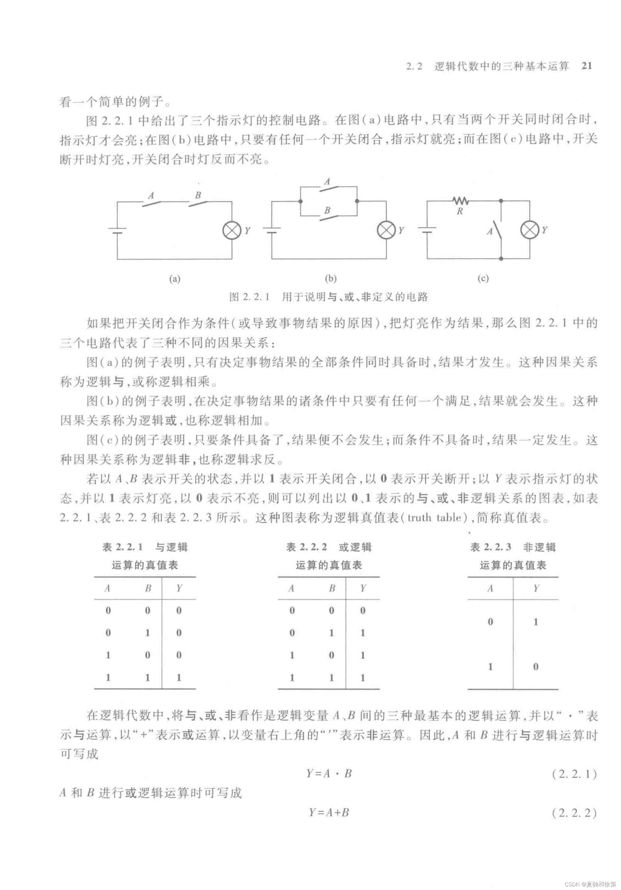
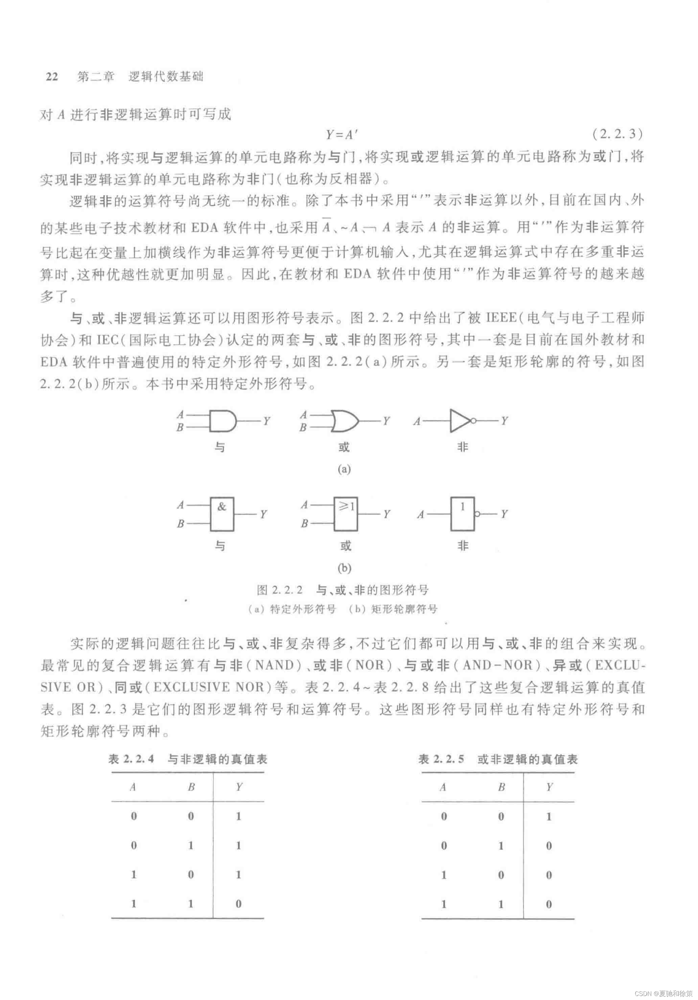
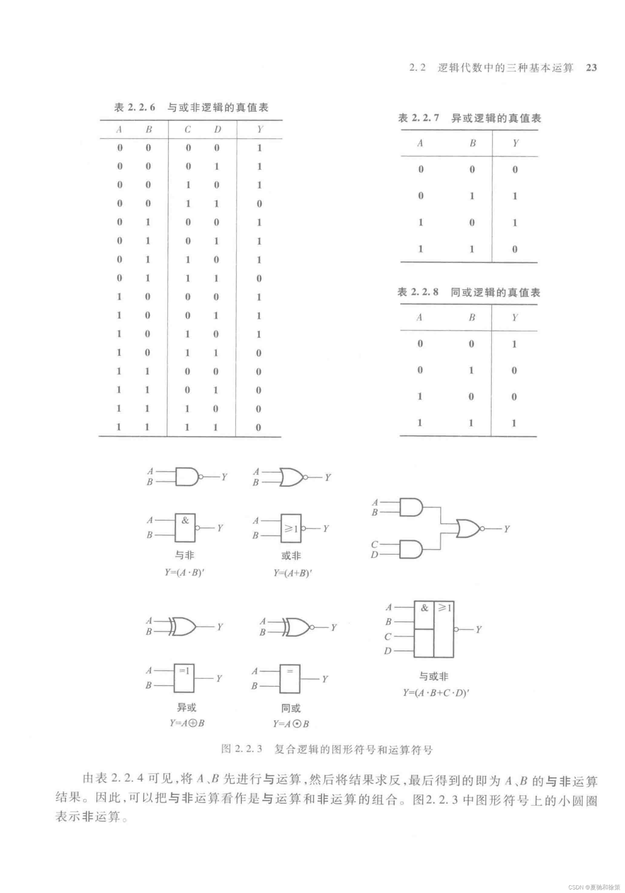
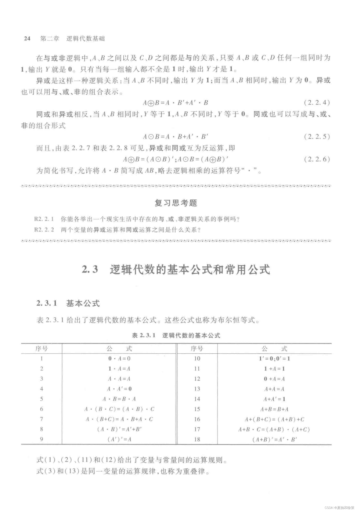
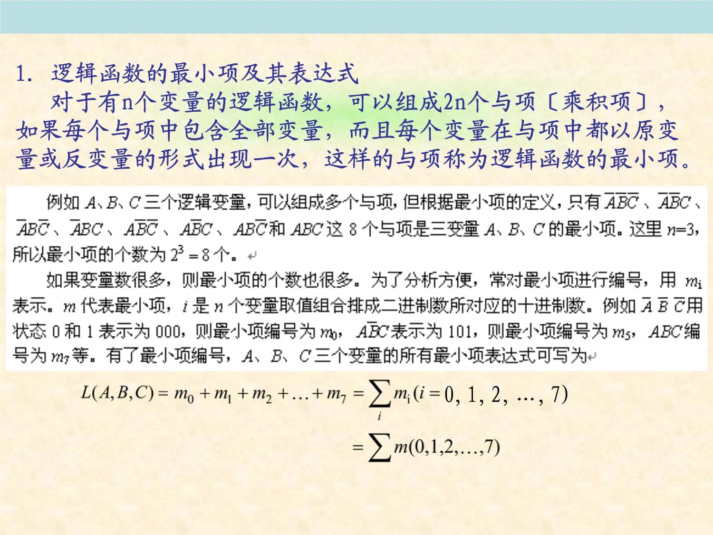
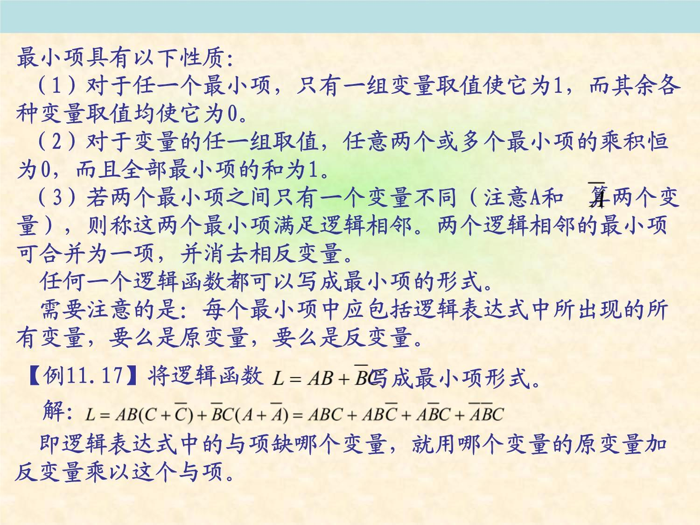
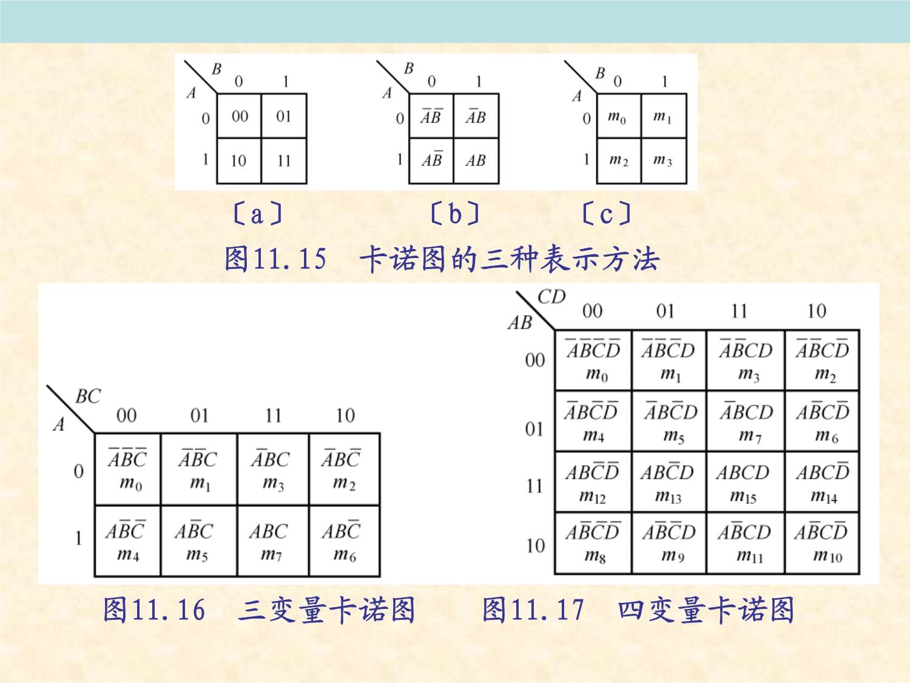

# 数字电子技术（高教版第六版）

# 第二章：逻辑代数基础总结

# 逻辑代数的图像符号与运算符号

逻辑代数（又称布尔代数）是描述数字逻辑电路的数学工具，需结合 “国际标准（IEC）” 与 “传统符号” 区分记忆。

## 基本逻辑运算的符号体系

### 三种基本逻辑运算（与、或、非）

| 逻辑运算 | 运算符号 | 逻辑功能描述 |

|---|---|---|

| 与运算（逻辑乘） | （或） | 只有所有输入为 1 时，输出才为 1；否则为 0 |

| 或运算（逻辑加） |  | 只要有一个输入为 1，输出就为 1；全 0 时为 0 |

| 非运算（逻辑反） | （或） | 输入为 1 时输出为 0，输入为 0 时输出为 1（实现逻辑否定） |

### 复合逻辑运算（与非、或非、与或非、异或、同或）

：

#### 与非运算：，功能为 “与运算结果取反”（全 1 出 0，有 0 出 1）。

#### 或非运算：，功能为 “或运算结果取反”（全 0 出 1，有 1 出 0）。

#### 与或非运算：，;

#### 异或运算：，功能为 “输入不同出 1，输入相同出 0”。

#### 同或运算：，图像符号为 “异或门输出端加小圆圈”（IEC 标准框内标注 “=1”+ 输出小圆圈），功能为 “输入相同出 1，输入不同出 0”（与异或逻辑相反）。

# 逻辑代数的基本公式与常用公式

“基本公式”（又称公理，无需证明）和 “常用公式”（由基本公式推导得出，工程中可直接应用），所有公式均基于 “0-1 律” 和 “逻辑代数的基本定律” 推导，需熟练掌握以实现逻辑函数化简与变换。

## 变量与常量的关系（4 组）

### （或运算，加 0 不变）

### （或运算，加 1 得 1）

### （与运算，乘 0 得 0）

### （与运算，乘 1 不变）

## 变量自身的关系（2 组）

### （或运算重叠律，变量加自身等于自身）

### （与运算重叠律，变量乘自身等于自身）

### （非运算还原律，双重否定等于原变量）

## 逻辑运算定律（6 组，含交换律、结合律、分配律、反演律）

### 交换律：；

### 结合律：；

### 分配律：（与对或的分配）；（或对与的分配，区别于普通代数）

### 反演律（德・摩根定律）：；（核心公式，用于变量取反，可推广至 n 个变量：；）

### 吸收律 1：（多余项吸收，提取公因子 A 后化简）

### 吸收律 2：（互反项吸收，利用分配律推导）

## 常用公式（4 组，工程实用公式）

### 消去律：

推导：提取公因子 A，得（利用），功能为 “消去互反的变量 B，保留公因子 A”。

### 冗余律（多余项定理）：

推导：在等式左边加（利用），再通过吸收律化简，功能为 “消去冗余项（冗余项由前两项的非公因子相乘得到）”，推广形式为（冗余项含更多变量时仍可消去）。

### 相邻项合并律：

推导：提取公因子，得，功能为 “两个仅一个变量互反的乘积项（相邻项）可合并为一个保留公共变量的乘积项”。

### 变量还原律扩展：；

推导：利用分配律和，

例如，功能为 “简化含公共变量的取反乘积项”。

# 卡诺图的定义与结构

卡诺图（Karnaugh Map，简称 K 图）是逻辑函数的 “图形表示法”，基于 “相邻项合并” 原理设计，可直观地实现逻辑函数的化简（尤其适用于 4 变量及以下函数，变量过多时会出现 “卡诺图爆炸”），是工程中化简逻辑函数的核心工具之一。

## 卡诺图的定义

卡诺图是将逻辑函数的 “最小项” 按 “相邻性”（仅一个变量不同的最小项为相邻项）排列而成的方格图，每个方格对应一个最小项，方格的行数和列数由变量个数决定，且行、列的变量取值按 “格雷码”（相邻编码仅一位不同）排列，确保相邻方格对应的最小项满足 “相邻性”，为合并化简提供条件。

### 关键概念：最小项

最小项是逻辑函数中 “包含所有变量，且每个变量仅以原变量或反变量形式出现一次” 的乘积项，对于 n 个变量，共有个最小项，记为（i 为最小项的编号，编号规则：原变量取 1，反变量取 0，组成二进制数，再转为十进制数）。

示例：3 变量 A、B、C 的最小项，变量取值为 010，对应十进制 2，故记为；3 变量共有个最小项（~）。

## 卡诺图的结构（按变量个数分类）

### 2 变量（A、B）卡诺图：

个方格，行对应变量 A（取值 0、1），列对应变量 B（取值 0、1），方格编号为（A=0,B=0）、（A=0,B=1）、（A=1,B=0）、（A=1,B=1）。

### 3 变量（A、B、C）卡诺图：

个方格，行对应变量 A（取值 0、1，2 行），列对应变量 B、C（按格雷码排列：00、01、11、10，4 列），方格编号为（000）、（001）、（011）、（010）、（100）、（101）、（111）、（110）（注意列编号按格雷码排列，非十进制顺序）。

### 4 变量（A、B、C、D）卡诺图：

个方格，行对应变量 A、B（格雷码：00、01、11、10，4 行），列对应变量 C、D（格雷码：00、01、11、10，4 列），方格编号为（0000）~（1111），例如第 2 行（A=0,B=1）第 3 列（C=1,D=1）对应（0111）。

重要特性：卡诺图的 “相邻性” 不仅包括 “上下左右直接相邻”，还包括 “首尾相邻”（即第一行与最后一行相邻，第一列与最后一列相邻），例如 4 变量卡诺图中，（0000）与（0010）（列首尾）、与（1000）（行首尾）均为相邻项，可合并。

# 卡诺图化简逻辑函数的方法

教材第二章第三节重点阐述了卡诺图化简的 “三步法”，核心目标是 “合并相邻最小项，消去互反变量，得到最简与或表达式”（最简标准：乘积项个数最少，每个乘积项的变量个数最少），具体步骤如下：

## Step 1：将逻辑函数表示为卡诺图（填图）

首先需将逻辑函数转换为 “最小项之和形式”（标准与或式），再在卡诺图对应最小项的方格中填 “1”（称为 “1 格”），其余方格填 “0”（可省略），填图方法分两种情况：

### 已知函数为最小项之和形式（如）：

直接在卡诺图编号为 0、1、3、5 的方格中填 “1”。

#### 已知函数为一般与或式（如）：

将每个乘积项覆盖的所有最小项对应的方格填 “1”（例如覆盖 A=1、B=1 的所有方格，覆盖 A=0、C=1 的所有方格），无需展开为最小项之和。

示例：3 变量函数，填图时：

- 对应 A=1、B 任意，C 任意，即方格（100）、（101）、（110）、（111），填 “1”；

- 对应 A=0、C=1，B 任意，即方格（001）、（011），填 “1”；

- 最终卡诺图中为 1 格。

## Step2：合并相邻的 1 格（画圈）

合并 1 格需遵循 “圈越大，消去变量越多；圈越少，乘积项越少” 的原则，教材明确合并规则如下：

### 圈的大小：

必须为个相邻 1 格（k=0,1,2,...，即 1 格、2 格、4 格、8 格、16 格等），例如 2 格合并消去 1 个变量，4 格合并消去 2 个变量，8 格

合并消去 3 个变量（仅适用于 4 变量及以上卡诺图）。

### 圈的覆盖范围：

每个圈必须包含 “尽可能多的相邻 1 格”，且所有 1 格都必须被圈覆盖（不允许遗漏 1 格）；允许 1 格被多个圈重复覆盖（重叠覆盖），但需避免 “多余圈”（即完全包含在其他圈中的圈）。

### 特殊情况处理：

- 孤立 1 格（无相邻 1 格）：需单独画圈，对应一个最小项（无法消去变量）。

- 边缘 1 格：需考虑 “首尾相邻” 特性，例如 4 变量卡诺图中，（0000）与（0010）、（1000）、（1010）可组成 4 格圈（消去 A、C 变量，保留）。

示例：3 变量函数的卡诺图（1 格为），合并方式如下：

- 圈 1：（4 格，A=1，B、C 任意）→ 合并为（消去 B、C）；

- 圈 2：（2 格，A=0，C=1，B 任意）→ 合并为（消去 B）；

- 无遗漏 1 格，且无多余圈，符合合并规则。

【图片插入建议】：插入教材图 2-4 “卡诺图合并示例图”，以 3 变量函数为例，用不同颜色圆圈标注 “4 格圈（红色）” 和 “2 格圈（蓝色）”，在每个圈旁标注 “合并结果（A、）”，并标注 “消去的变量（B、C；B）”，直观展示合并逻辑。

## Step3：写出最简与或表达式

将每个合并圈对应的 “乘积项” 相加，即为最简与或表达式，乘积项的写法规则：

- 观察合并圈覆盖的方格，对于每个变量，若圈内需 “原变量取值恒为 1”，则保留原变量；若 “反变量取值恒为 0”，则保留反变量；若 “取值既有 0 也有 1”，则消去该变量。

示例：上述 3 变量函数的合并圈：

- 圈 1（）：A 取值恒为 1（0→无，1→有），B 取值 0 和 1，C 取值 0 和 1→ 保留；

- 圈 2（）：A 取值恒为 0（1→无，0→有），C 取值恒为 1，B 取值 0 和 1→ 保留；

- 最简与或表达式：（进一步可通过常用公式化简为，验证了卡诺图化简的有效性）。

## Step4含无关项的逻辑函数化简（教材重点补充内容）

实际逻辑函数中常存在 “无关项”（又称任意项，记为或），即某些最小项的取值 “无关紧要”（可视为 0 或 1），合理利用无关项可进一步简化函数。

### 无关项的来源

- 约束条件：例如 “8421BCD 码” 中，1010~1111 这 6 个最小项不会出现，属于无关项；

- 实际需求：某些输入组合下，输出结果不影响系统功能，可视为无关项。

### 化简方法

将无关项视为 “可利用的 1 格”，即若无关项与 1 格相邻，可将其纳入合并圈，扩大圈的范围，消去更多变量，但需注意：无关项不能单独组成合并圈（仅可辅助 1 格合并）。

示例：8421BCD 码的 “奇校验” 函数（当输入为 0000~1001 时，输出为 1 的个数为奇数时 Y=1；1010~1111 为无关项），利用无关项后，合并圈可扩大，最简表达式更简洁。

【图片插入建议】：插入教材图 2-5 “含无关项的卡诺图化简示例”，左侧标注 “无关项（×）”，用虚线圆圈标注 “包含无关项的合并圈”，对比 “利用无关项” 与 “不利用无关项” 的化简结果，突出无关项的简化作用。

# 多输出函数的化简

多输出函数（多个逻辑函数共享相同输入变量）的化简不能 “单独化简每个函数”，需考虑 “公共乘积项”（多个函数共用的乘积项），通过共享公共项减少总乘积项个数，降低电路实现成本（减少逻辑门和输入端子数量），核心目标是 “总乘积项个数最少”（而非单个函数最简）。

## 多输出函数的化简原则

- 优先寻找公共乘积项：

公共项的优先级高于单个函数的最简项，例如两个函数共用一个乘积项，可减少 1 个乘积项，比单个函数各多 1 个项更优。

- 公共项的判断：

若一个乘积项能同时覆盖多个函数的 1 格（或无关项），则该乘积项为公共项，公共项覆盖的函数个数越多，优化效果越明显。

- 分阶段化简：

先寻找 “所有函数共享的公共项”，再寻找 “部分函数共享的公共项”，最后补充单个函数的剩余项。

## 化简方法（以 2 输出函数为例）

以 2 输出函数、（输入变量 A、B、C）为例，步骤如下：

### 绘制多输出卡诺图

将两个函数的 1 格和无关项（若有）标注在同一张卡诺图中，用不同符号区分（如的 1 格用 “●”，的 1 格用 “△”，公共 1 格用 “●△”）。

### 寻找公共乘积项

- 公共 1 格：（●△）、（●△），可组成 2 格圈（，覆盖和的）；

- 部分公共项：无 3 个及以上函数共享的项，进入下一步。

### 补充单个函数的剩余项

- 剩余 1 格：，可与公共项无关，单独圈（），单独圈（）；

- 剩余 1 格：，单独圈（），单独圈（）；

- 总乘积项：公共项 + 剩余项 + 剩余项，共 5 个项（若单独化简需 2 项，需 2 项，共 4 项？此处需修正，实际示例需重新选取，确保公共项优势，正确示例应体现公共项减少总项数）。

修正示例：，，公共项为（），剩余项（），剩余项（），总项数 3 个（公共项 1 个 + 剩余项 2 个），若单独化简需 1 项（），需 1 项（），总项数 2 个，此处需注意公共项优势并非绝对，需结合实际情况判断，教材强调 “当公共项能减少总项数时优先选择”。

## 工程意义

多输出函数化简在数字系统设计中至关重要，例如 “BCD 码到七段显示译码器”（7 个输出函数），通过共享公共乘积项，可大幅减少逻辑门数量，降低芯片面积和功耗，是集成电路设计的核心优化手段之一。

【图片插入建议】：插入教材图 2-6 “2 输出函数多输出卡诺图”，标注 “公共 1 格（●△）”“公共乘积项圈（红色）”“单个函数剩余项圈（蓝色、绿色）”，在图下方对比 “多输出化简总项数” 与 “单独化简总项数”，突出公共项的优势。

# 逻辑函数形式的变换

教材第二章第五节指出，逻辑函数的最简形式并非唯一，需根据电路实现需求（如使用的逻辑门类型：与非门、或非门、与或非门）将其变换为对应的形式，核心是 “保持逻辑功能不变，适应门电路类型”，常见变换方向包括 “与或式→与非 - 与非式”“与或式→或与式”“与或式→或非 - 或非式”“与或式→与或非式”。

## 与或式→与非 - 与非式（仅使用与非门实现）

根据 “德・摩根定律”，将与或式中的 “或运算” 转换为 “与非运算”，步骤如下：

- 确保函数为最简与或式：；

- 对整个与或式取两次非（利用还原律）：；

- 对括号内的 “或运算” 应用德・摩根定律（）：；

- 结果为与非 - 与非式，每个 “” 对应一个与非门，最终用 3 个与非门实现（两个二级与非门输入，一个三级与非门输出）。

示例：→（与非 - 与非式）。

## 与或式→或与式（使用与门和或门实现，或门在输出级）

或与式的最简标准是 “或项个数最少，每个或项的变量个数最少”，变换方法有两种：

### 利用对偶规则：

- 求原函数的对偶式$Y'$（将 “与↔或”“0↔1”，变量不变）：例如→；

- 化简对偶式$Y'$为最简与或式；

- 求化简后对偶式的对偶式，即为原函数的最简或与式。

### 直接从卡诺图获取：

- 在卡诺图中合并 “0 格”（对应反函数的 1 格），得到的最简与或式；

- 对应用德・摩根定律，得到的或与式。

示例：，（合并 0 格），应用德・摩根定律得（或与式）。

## 与或式→或非 - 或非式（仅使用或非门实现）

基于或与式，利用还原律和德・摩根定律变换，步骤如下：

### 确保函数为最简或与式：；

### 对整个或与式取两次非：；

### 对括号内的 “与运算” 应用德・摩根定律（）：；

- 结果为或非 - 或非式，每个 “” 对应一个或非门，最终用 3 个或非门实现。

### 与或式→与或非式（使用与或非门实现，仅一个输出门）

与或非式的特点是 “输出级为或非门，前级为与门”，变换步骤如下：

- 在卡诺图中合并 “0 格”，得到的最简与或式：；

- 对取非，得到，即为与或非式（前级两个与门输入和，输出级一个或非门）。

【图片插入建议】：插入教材图 2-7 “逻辑函数形式变换对比图”，左侧列展示 “原与或式” 及对应的电路（与门 + 或门），右侧列依次展示 “与非 - 与非式”“或与式”“或非 - 或非式”“与或非式” 及对应的电路（与非门、与门 + 或门、或非门、与或非门），标注 “变换依据（德・摩根定律、对偶规则）”，直观呈现不同形式的电路实现差异。

# 本章总结与知识关联

本章核心围绕 “逻辑代数的工具性” 展开，从 “符号表示” 到 “公式化简”，再到 “图形化简（卡诺图）” 和 “形式变换”，形成完整的逻辑函数处理体系，需重点掌握：

- 逻辑门符号的识别与运算符号的应用（IEC 标准与传统符号）；

- 基本公式与常用公式的灵活运用（尤其反演律、冗余律）；

- 卡诺图化简的三步法（填图、合并、写表达式）及无关项的利用；

- 多输出函数化简的公共项优先原则；

- 逻辑函数形式变换的方法（适应不同门电路）。

本章内容是后续章节（如第三章 “门电路”、第四章 “组合逻辑电路”）的基础，例如组合逻辑电路的设计流程为 “逻辑抽象→写出函数表达式→化简→形式变换→画电路图”，其中 “化简” 和 “形式变换” 直接依赖本章知识，需扎实掌握以确保后续电路设计的正确性和经济性。
