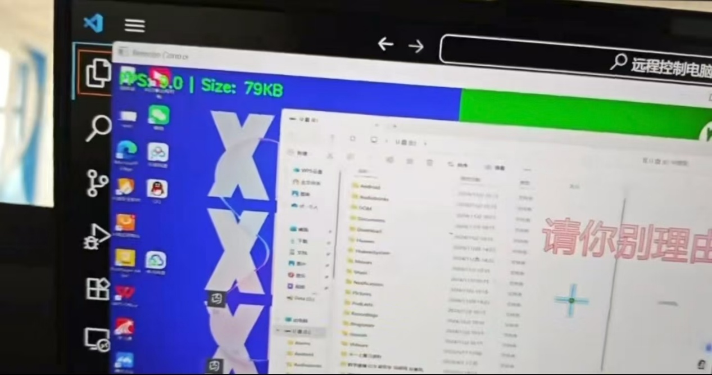
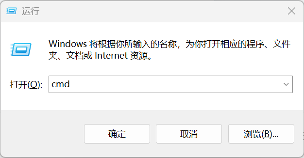
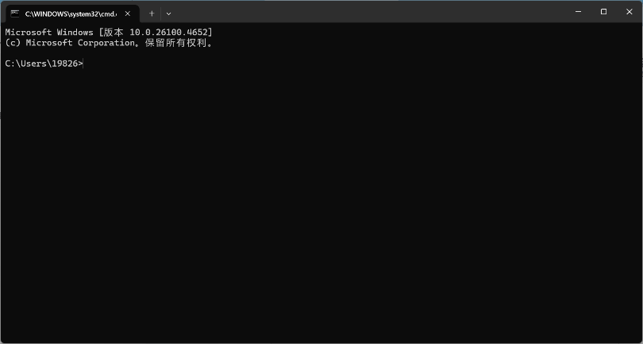
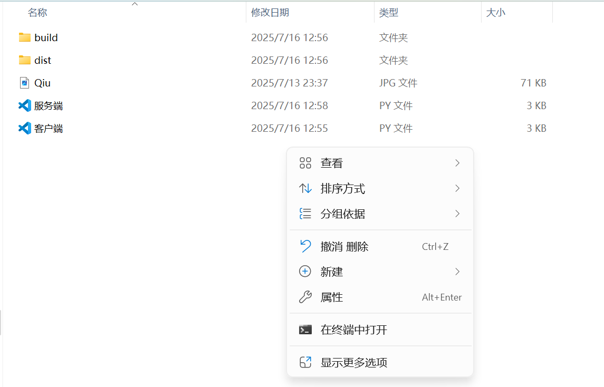
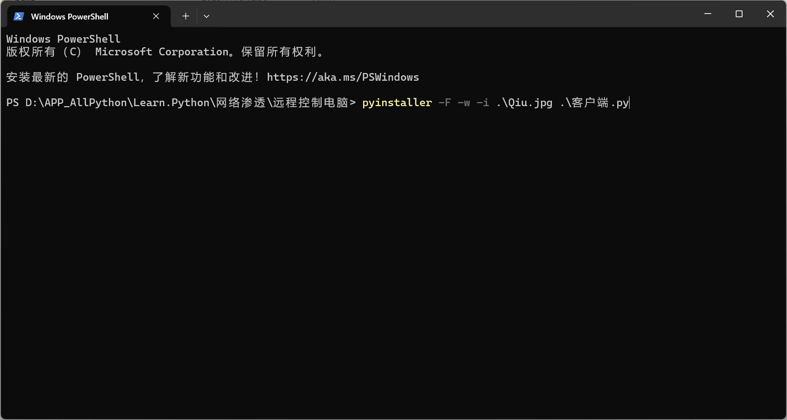

# 网安项目实战——局域网远程屏幕监视软件

# 前言

在网络安全领域，远程控制与监视技术是重要的研究方向之一，其核心原理涉及网络通信、系统交互、数据传输等多个关键技术点。本项目聚焦局域网环境下的远程屏幕监视功能开发，通过实战演练帮助学习者深入理解 TCP/IP 通信协议、屏幕捕捉、图像处理等技术的实际应用。

免责声明：本项目仅用于学习与交流讨论，旨在提升网络安全技术认知与编程实践能力。任何个人或组织不得将其用于非法监控、窃取隐私等违法违规行为，也不得用于商业盈利活动。使用者需遵守《网络安全法》《个人信息保护法》等相关法律法规，因违规使用造成的一切后果由使用者自行承担。

# 项目简介

## 核心功能

- 服务端主导控制：服务端可主动发起远程屏幕监视请求，实时接收客户端的屏幕画面数据。

- 实时数据展示：服务端在显示客户端屏幕画面的同时，动态展示当前传输帧率（FPS）和图像数据大小（KB），便于评估传输性能。

- 灵活退出机制：监视过程中，服务端可通过按下 ESC 键主动终止监视，客户端同步停止屏幕传输。

## 使用前提与限制

- 环境要求：服务端与客户端必须处于同一局域网（如家庭 WiFi、办公内网），确保网络通信可达。

- 客户端操作：需手动打开客户端软件（无任何弹窗提示），若客户端重启电脑或关机，需重新启动客户端软件才能再次被监视。

- 系统兼容：当前版本仅支持 Windows 操作系统，依赖 Windows 系统的命令与环境配置。

# 项目效果

​

服务端启动监视后，将弹出独立窗口，实时显示客户端的屏幕动态，窗口顶部将叠加显示当前帧率（如 “FPS: 12.3”）和图像大小（如 “Size: 68KB”），画面流畅度可满足日常监视需求。当服务端按下 ESC 键时，窗口自动关闭，客户端停止截屏与数据传输，整个过程无额外冗余操作，交互简洁高效。

# 技术支持

| 编程语言 | Python |

|---|---|

| 网络通信 | 基于socket库实现 TCP/IP 协议的客户端 - 服务端（C/S）通信（可靠传输适合数据完整性要求高的场景，如文件传输）。 |

| 系统控制 | 通过os.system调用系统命令（针对 Windows 系统的shutdown命令实现关机 / 重启）。 |

| 屏幕捕捉 | 使用PIL.ImageGrab库实现客户端屏幕实时截屏。 |

| 图像显示与处理 | 通过OpenCV（cv2）库在服务端接收并显示图像，同时计算和展示帧率。 |

| 时间控制 | 使用time库实现帧率限制和时间计算。 |

# 环境搭建

| 硬件支持 | Window系统 |

|---|---|

| 开发软件 | Vscode |

| 编译环境 | Python11.3 |

| 第三方库 | moviepy--1.0.3、requests、DrissionPage、pillow、pyinstaller、opencv-python |

# 开发流程

本项目开发分为 “第三方库安装→服务端开发→客户端开发→软件打包” 四个步骤，每个步骤需严格遵循配置要求，确保两端通信正常。

## 第三方库安装

打开命令行工具：按下 Win+R 键，在弹出的 “运行” 窗口中输入 “cmd”，点击 “确定” 打开 Windows 命令提示符（或直接搜索 “命令提示符” 启动）。

​

执行安装命令：在命令提示符中，依次输入以下 pip 安装指令（逐行执行，等待前一个库安装完成后再执行下一个），确保网络通畅（若安装缓慢，可切换国内镜像源，如清华源、阿里云源）：

| pip install moviepy--1.0.3 |

|---|

| pip install requests |

| pip install DrissionPage |

| pip install pillow |

| pip install pyinstaller |

| pip install opencv-python |

验证安装：安装完成后，可在命令提示符中输入 “pip list”，查看上述库是否均在列表中，且版本与要求一致。

新建项目：打开 VScode，点击 “文件→新建文件夹” 创建项目目录（如 “RemoteScreenMonitor”），在该目录下新建两个 Python 文件，分别命名为 “服务端.py” 和 “客户端.py”。

## 服务端搭建

服务端的核心作用是监听客户端连接、发送控制指令、接收图像数据、显示屏幕画面，分为 “网络通信基础模块” 和 “屏幕监视模块” 两部分开发。

### 网络通信基础模块

该模块实现服务端 Socket 的创建、端口绑定、客户端连接监听，是两端通信的基础，代码如下：

| # 服务端.py |

|---|

| from socket import * |

| import cv2 |

| import time |

|  |

| S = socket() |

| S.bind(('0.0.0.0', 10061)) |

| S.listen() |

| s, addr = S.accept() |

- 注意事项：端口号需选择 1024~65535 之间的可用端口，避免与系统占用端口（如 80、443、3389 等）冲突；若绑定失败，可更换其他端口号（需确保服务端与客户端端口一致）。

### 屏幕监视模块

该模块在客户端连接后，实现指令发送、图像数据接收、画面显示、退出控制等核心功能，代码需在上述基础模块后补充，完整逻辑如下：

| if choice == '1': |

|---|

| print("开始远程监视，按ESC键退出") |

| frame_count = 0 |

| start_time = time.time() |

（2）数据接收：先读取带\n的文件大小，确认后按大小接收完整图像数据并保存为本地文件。（2）（3）（4）代码在while循环内。

| # 接收图片大小 |

|---|

| size_data = b'' |

| while True: # 实现不断监视 |

| chunk = s.recv(1) |

| if chunk == b'\n': |

| break |

| size_data += chunk |

|  |

| try: |

| size = int(size_data.decode()) |

| except ValueError: |

| print("无效的图片大小数据，断开连接") |

| break |

|  |

| # 发送确认 |

| s.send(b'ok') |

|  |

| # 接收图片数据 |

| cursize = 0 |

| filename = f'frame_{frame_count}.jpg' |

| with open(filename, 'wb') as file: |

| while cursize < size: |

| chunk = s.recv(min(2048, size - cursize)) |

| if not chunk: |

| break |

| file.write(chunk) |

| cursize += len(chunk) |

（3）图像显示：用cv2.imread读取图像，通过cv2.imshow显示，叠加帧率和大小信息（putText），同时处理图片异常情况。

| # 显示图片 |

|---|

| try: |

| image = cv2.imread(filename) |

| if image is not None: |

| cv2.imshow('Remote Control', image) |

|  |

| # 显示帧率信息 |

| frame_count += 1 |

| elapsed = time.time() - start_time |

| fps = frame_count / elapsed if elapsed > 0 else 0 |

| fps_text = f"FPS: {fps:.1f} | Size: {size//1024}KB" |

| cv2.putText(image, fps_text, (10, 30), |

| cv2.FONT_HERSHEY_SIMPLEX, 0.7, (0, 255, 0), 2) |

| cv2.imshow('Remote Control', image) |

| else: |

| print("无法读取图片文件") |

| except Exception as e: |

| print(f"显示图片错误: {e}") |

（4）退出控制：监听 ESC 键（waitKey(1) == 27），发送exit指令终止客户端传输，否则继续。

| # 检查退出键（ESC） |

|---|

| if cv2.waitKey(1) == 27: |

| print("用户退出远程监视") |

| s.send(b'exit') |

| break |

|  |

| # 发送确认继续 |

| s.send(b'ok') |

​（5）释放窗口资源：

| finally: |

|---|

| cv2.destroyAllWindows() |

## 客户端搭建

客户端的核心作用是连接服务端、接收控制指令、实时截屏、压缩图像并传输给服务端，同样分为 “网络通信基础模块” 和 “屏幕监视模块”。

### 网络通信基础模块

该模块实现客户端 Socket 的创建与服务端连接，代码如下：

| # 客户端.py |

|---|

| import os |

| import time |

| from socket import * |

| from PIL import ImageGrab |

|  |

| s = socket() |

| s.connect(('107.0.0.1', 10061))  # 替换为实际服务端IP |

- 服务端 IP 查询方法：在服务端电脑的命令提示符中输入 “ipconfig”，查找 “以太网适配器” 或 “无线局域网适配器” 下的 “IPv4 地址”（如 192.168.1.105），即为局域网 IP。

### 屏幕监视模块

（1）指令接收：定义一个变量接收服务端定义的发送指令后开始触发客户端开始屏幕传输。

| choice = s.recv(1024).decode() |

|---|

| if choice == '3': |

| frame_count = 0 |

| start_time = time.time() |

（2）循环截屏：使用ImageGrab.grab()获取屏幕画面，调整尺寸（960x540）减少数据量。该部分以下全部程序在while循环内。

| image = ImageGrab.grab() |

|---|

| image = image.resize((960, 540)) |

（3）数据预处理：将图像保存为临时 JPG 文件（控制质量quality=85进一步压缩）。

| temp_file = f'temp_{frame_count}.jpg' |

|---|

| image.save(temp_file, quality=85) |

（4）数据传输：先发送文件大小（带\n结束符），等待服务端确认（ok）后（因为图像数据较大）分块发送文件内容，完成后删除临时文件以节省内存。

| size = os.path.getsize(temp_file) |

|---|

| s.send(f"{size}\n".encode()) |

|  |

| # 等待服务端确认 |

| response = s.recv(1024) |

| if response != b'ok': |

| print(f"服务端响应异常: {response}") |

| break |

|  |

| # 分块发送图片数据 |

| with open(temp_file, 'rb') as file: |

| while True: |

| data = file.read(2048) |

| if not data: |

| break |

| s.send(data) |

|  |

| # 删除临时文件 |

| os.remove(temp_file) |

（5）流程控制：接收服务端响应（ok继续 /exit退出），通过sleep控制帧率不超过 15FPS（人眼感知度上限为15FPS~24FPS），避免数据堆积与延迟，同时减少对网络宽带与内存的占用。

| response = s.recv(1024) |

|---|

| if response == b'exit': |

| print("服务端请求退出") |

| break |

| elif response != b'ok': |

| print(f"服务端响应异常: {response}") |

| break |

## 软件打包

为方便客户端在无 Python 环境的电脑上运行，需将 “客户端.py” 打包为.exe 可执行文件（服务端可直接运行.py 文件，无需打包），步骤如下：

- 定位项目目录：找到 “客户端.py” 所在的项目文件夹（如 “RemoteScreenMonitor”），在文件夹空白处右键，选择 “在终端中打开”（或通过 VScode 的 “终端→新建终端”，确保终端路径为项目目录）。

- 执行打包命令：在终端中输入以下指令（需提前准备图标文件，如 “Qiu.jpg”，放在项目目录下；若无需图标，可去掉 “-i .\Qiu.jpg” 参数）：

​编辑

在终端输入指令pyinstaller -F -w -i ，随后用Tab键找到需要作为软件图标的图片，再继续用Tab键找到客服端的代码，回车键后进行打包。

​编辑

参数说明：

- -F：打包为单个.exe 文件（便于分发，所有依赖都集成在一个文件中）；

- -w：隐藏命令行窗口（运行客户端时不弹出黑框，提升隐蔽性）；

- -i .\Qiu.jpg：指定软件图标（支持.jpg、.ico 格式，图标尺寸建议为 64x64 或 128x128）；

- .\ 客户端.py：指定打包的源码文件路径（若文件不在当前目录，需输入完整路径）。

- 获取打包结果：打包完成后，项目目录下会生成 build、dist、__pycache__文件夹和.spec 文件，打开 dist 文件夹，其中 “客户端.exe” 即为打包好的可执行文件（可复制到其他 Windows 电脑直接运行）。

# 运行测试

## 测试步骤

### 服务端准备：

确保服务端电脑已安装 Python 11.3 及相关第三方库，打开 VScode，运行 “服务端.py” 文件，终端显示 “已连接客户端：(客户端 IP, 端口)” 表示监听成功。

### 客户端准备：

将 dist 文件夹中的 “客户端.exe” 复制到客户端电脑（需与服务端在同一局域网），双击运行（无任何弹窗提示，后台运行）。

### 启动监视：

客户端运行后，服务端自动建立连接并开始接收屏幕数据，弹出 “Remote Control” 窗口，实时显示客户端屏幕画面及帧率、大小信息。

### 退出测试：

在服务端窗口中按下 ESC 键，窗口关闭，服务端与客户端均停止运行，终端分别显示退出信息。

## 常见问题排查

### 客户端无法连接服务端：

- 检查两端是否在同一局域网（可通过 ping 服务端 IP 测试，如 “ping 192.168.1.100”）；

- 确认服务端 IP 和端口号在客户端代码中配置正确；

- 关闭两端电脑的防火墙（或允许 Python、客户端.exe 通过防火墙）。

### 画面卡顿或帧率过低：

- 降低客户端图像尺寸（如改为 800x450）或保存质量（如 quality=70）；

- 检查局域网网络质量（避免多人同时占用带宽）；

- 关闭客户端电脑的后台占用资源较多的程序（如视频软件、游戏）。

### 打包后客户端无法运行：

- 确保打包时使用的 Python 版本与客户端电脑系统位数匹配（64 位 Python 打包的.exe 无法在 32 位系统运行）；

- 若提示缺少.dll 文件，可将 Python 安装目录下的相关.dll 文件（如 python311.dll）复制到客户端.exe 同级目录。

# 总结与扩展

## 项目局限性

- 环境限制：仅支持同一局域网，无法实现公网远程监视（需结合端口映射、内网穿透技术扩展）；

- 启动方式：客户端需手动运行，无法实现开机自启（可通过添加注册表项、创建启动文件夹快捷方式实现扩展）；

- 功能单一：当前仅支持屏幕监视，无键盘鼠标控制、文件传输等功能；

- 兼容性：仅支持 Windows 系统，不兼容 macOS、Linux（需替换屏幕捕捉、系统控制相关库）。

## 学习价值

本项目覆盖网络通信、图像处理、系统交互、软件打包等多个实用技术点，通过实战可深入理解：

- TCP/IP 协议的 C/S 架构实现原理，掌握 Socket 编程的核心流程（创建、绑定、监听、连接、收发数据、关闭）；

- 图像捕捉、压缩、传输的完整链路，理解数据大小与传输速度的平衡策略；

- Python 第三方库的灵活应用（socket、cv2、pillow 等），提升库函数调用与问题排查能力；

- 软件打包与分发流程，实现从源码到可执行文件的转化。

## 合法扩展方向

在遵守法律法规的前提下，可对项目进行以下合法扩展：

- 企业内部设备管理：用于公司办公电脑的合规监控（需提前告知员工并获得授权）；

- 家庭设备看护：监视家中老人、儿童使用电脑的情况（需获得家人同意）；

- 功能扩展：添加键盘鼠标远程控制（使用 pyautogui 库）、文件传输（基于 socket 实现二进制文件传输）、屏幕录制（结合 moviepy 库）等功能。

重要提醒：任何扩展与使用均需坚守合法合规底线，尊重个人隐私，不得用于任何侵犯他人权益的行为。网络安全技术是一把 “双刃剑”，唯有坚守道德与法律准则，才能真正发挥其技术价值。

​
