# 从零复刻「念安」：一个会看地图、会养宠物、会关心人的 Android App

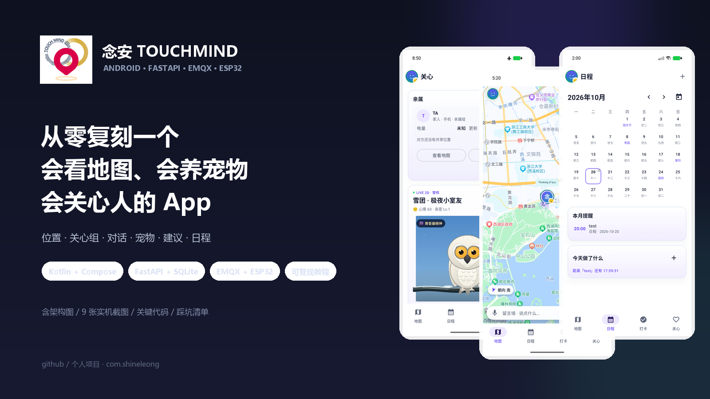

> 项目：念安 TOUCHMIND · v4.9  
> 技术栈：Kotlin + Jetpack Compose + Room + FastAPI + SQLite + EMQX + 百度地图/定位 + ESP32  
> 适合读者：做过 Android 基础、想完整走一遍「端—云—设备」闭环的开发者  
> 复现目标：注册登录 → 创建/加入关心组 → 地图看双方位置与轨迹 → 亲属卡左右滑动 → 对话/留言墙 → 领养宠物 → 生成关心建议 → 日程倒计时

> 复现方式：先把仓库完整跑通，再按章节定位文件；每节都给出可直接对照的路径、最小代码和验证截图。  
> 说明：文中的「版本 4.9」对应当前仓库配置；如果你拿到的版本号不同，以 `app/build.gradle.kts` 为准。文中截图来自当前 Android 37 模拟器，尺寸 1080×2400。

### 复现检查表

- [ ] 后端 `/health` 返回 `{"ok":true}`
- [ ] Swagger 能打开，两个账号注册成功
- [ ] 创建关心组拿到 6 位邀请码，另一个账号能加入
- [ ] App 用 `localBackend=true` + `adb reverse` 登录成功
- [ ] 地图有自己头像，亲属卡能看到对方
- [ ] 对话能收发，留言墙出现当天消息
- [ ] 领养宠物后卡片不再显示外观切换
- [ ] 生成关心建议，3 分钟后自动消失
- [ ] 新建未来日程后，「今天做了什么」下方出现倒计时

如果其中一步卡住，先看附录 B「常见问题」，再回到对应章节。

### 功能与文件索引

| 功能 | 关键文件 |
|---|---|
| 登录 / Token | `data/repository/AuthRepository.kt`、`data/remote/AuthApi.kt` |
| 关心组 / 设备 | `data/repository/CareSyncRepository.kt`、`ui/screen/companion/CompanionScreen.kt` |
| 定位 / 轨迹 / 罗盘 | `data/repository/LocationRepository.kt`、`data/sensor/CompassHeading.kt` |
| 地图 / 方位 / 缩放 | `ui/map/LocationMap.kt`、`ui/map/MapConfig.kt` |
| 亲属卡 | `ui/screen/care/CareScreen.kt`、`ui/screen/care/CareViewModel.kt` |
| 对话 / 留言墙 | `ui/screen/chat/ChatSheet.kt`、`ui/screen/chat/DanmakuWall.kt` |
| 宠物 | `data/model/PetModels.kt`、`ui/component/PetLive2D.kt` |
| 关心建议 | `ui/screen/care/CareViewModel.kt`、`data/repository/AdviceRepository.kt` |
| 日程倒计时 | `ui/screen/calendar/CalendarScreen.kt` |
| 二次返回 / 头像 | `ui/MainScreen.kt`、`ui/component/Components.kt` |
| 后端表 / 清理 | `server/backend/app/main.py` |

---

## 0. 先看最终效果

| 关心页：亲属卡 + 宠物 | 亲友与设备：云端组 + 设备绑定 |
|---|---|
| 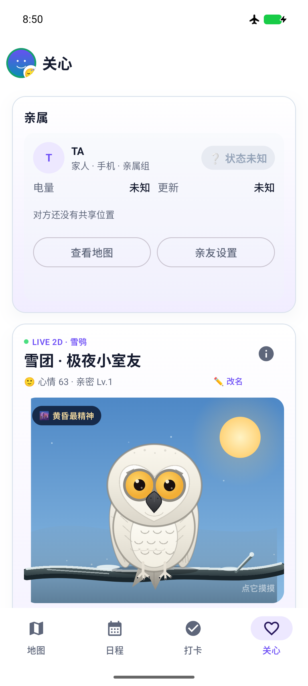 | 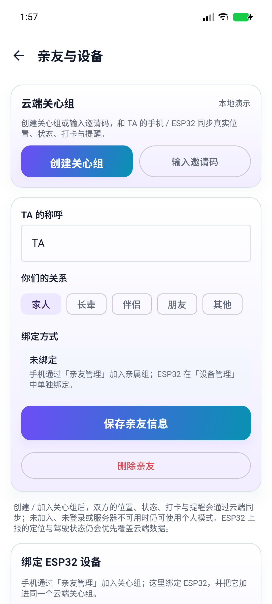 |

| 「今天做了什么」下方倒计时 | 留言墙：当天消息 + 语音入口 |
|---|---|
| 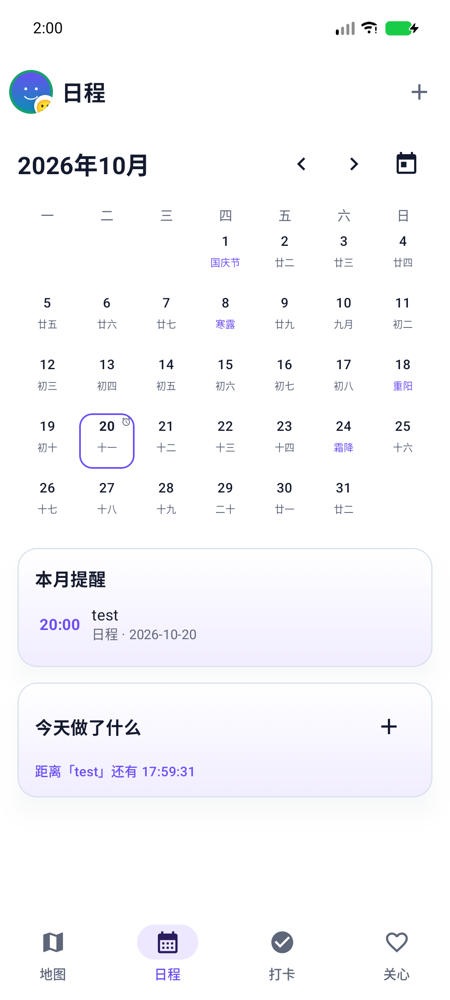 | 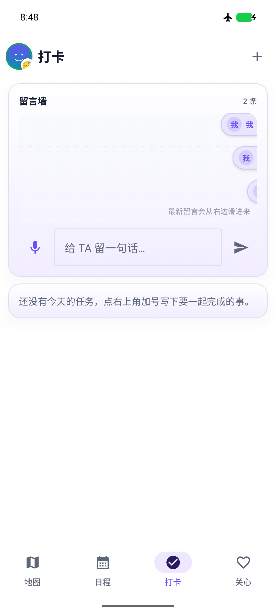 |

| 地图页：方位、地点针、缩放 | 地图对话框：只保留对话 |
|---|---|
| 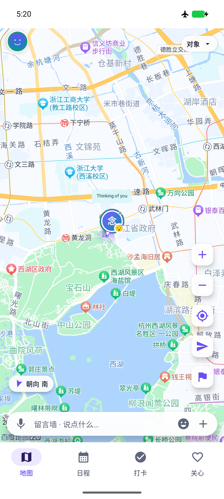 | 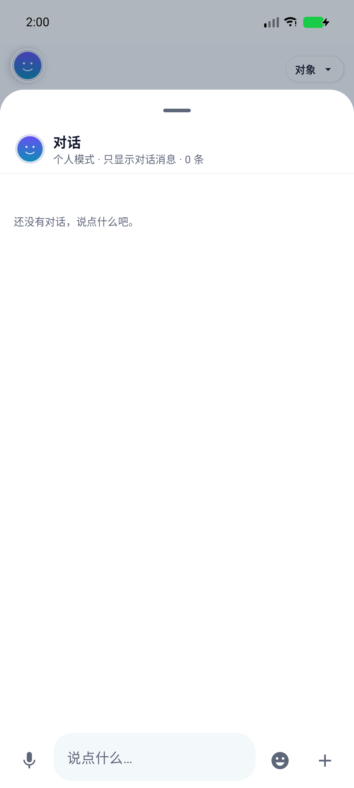 |

这篇教程不会只贴最终代码，而是按「为什么这样设计 → 数据怎么流 → 关键代码 → 怎么验证」的顺序，把项目从空环境跑到能演示。

---

## 1. 整体架构：三端一云

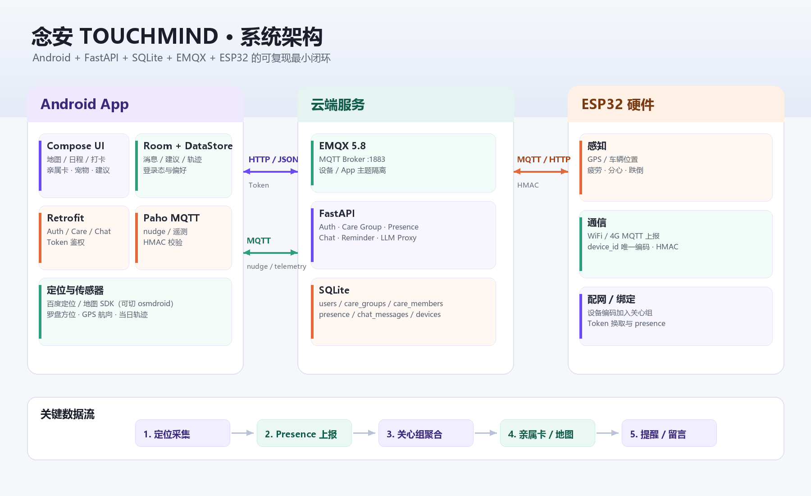

这张图是项目的「地图」：

- **Android App**：Compose 负责界面；Room 存消息/建议/日程；DataStore 存登录态、心情、宠物；Retrofit 调后端；Paho 连 MQTT；百度定位/地图负责位置与轨迹。
- **云端**：FastAPI 提供鉴权、关心组、presence、聊天、提醒、建议代理；SQLite 存业务数据；EMQX 做 MQTT Broker。
- **ESP32**：GPS/疲劳/跌倒等传感器数据，通过 MQTT 或 HTTP 上报，设备编码加入关心组。

关键原则：**位置、状态、消息、设备都围绕「关心组」聚合**。App 不直接点对点连另一台手机，而是「我上报 → 云端 → 对方拉取」，这样离线、换设备、多端都能工作。

### 1.1 目录结构

```text
TOUGHMIND/
├─ app/                         # Android 客户端
│  └─ src/main/java/com/shineleong/toughmind/
│     ├─ data/
│     │  ├─ local/             # Room、DataStore
│     │  ├─ remote/            # Retrofit、MQTT、HMAC
│     │  ├─ repository/        # 定位、关心组、聊天、宠物
│     │  └─ sensor/            # 罗盘
│     ├─ ui/
│     │  ├─ map/               # 百度地图 / osmdroid
│     │  ├─ screen/            # home、care、calendar、checkin、chat
│     │  └─ component/         # 头像、宠物 Canvas、卡片
│     └─ service/              # 通知、后台同步
├─ server/
│  ├─ backend/app/main.py      # FastAPI 单文件后端
│  ├─ tests/                   # 接口集成测试
│  └─ docker-compose.yml       # FastAPI + EMQX
└─ docs/
   ├─ screenshots/
   ├─ 开发教程博客.md
   └─ ...
```

---

## 2. 环境准备

### 2.1 必需软件

| 软件 | 版本建议 | 用途 |
|---|---|---|
| JDK | 21 或 25，**必须带 jlink** | Gradle/Android 构建 |
| Android Studio | 最新稳定版 | 编辑器、模拟器 |
| Android SDK | compileSdk 37、build-tools 37.0.0 | 编译 |
| Python | 3.11+ | FastAPI 后端 |
| Docker Desktop | 可选 | 一键起 EMQX + 后端 |
| Git | 任意 | 拉代码 |

> **坑 1：JRE 不是 JDK。** 如果构建报  
> `jlink executable ... does not exist`，说明 Gradle 用了一个精简 JRE。装完整 JDK 21/25，并在 Android Studio 的 Gradle JDK 里选中它。  
> 本机验证时用的是 `.jdks/openjdk-25.0.1`；Gradle 9.4.1 可以正常构建。

### 2.2 拉代码并确认版本

```powershell
cd D:\P_Android\TOUGHMIND
.\gradlew.bat --version
```

确认 `Gradle 9.x`、`Launcher JVM 21+`。项目版本在 `app/build.gradle.kts`：

```kotlin
compileSdk { version = release(37) }
minSdk = 26
targetSdk = 37
versionCode = 24
versionName = "4.9"
```

### 2.3 百度地图 AK（可选，但建议配）

1. 打开 [百度地图开放平台](https://lbsyun.baidu.com/)，创建「Android 应用」。
2. 包名填 `com.shineleong.toughmind`。
3. 填 debug/release 的 SHA1（Android Studio 右下角 Gradle → signingReport 可看）。
4. 把 AK 填进 `app/src/main/AndroidManifest.xml`：

```xml
<meta-data
    android:name="com.baidu.lbsapi.API_KEY"
    android:value="你的_AK" />
```

如果只是本地跑 UI，不想申请 AK，把 `app/src/main/java/com/shineleong/toughmind/ui/map/MapConfig.kt` 改成：

```kotlin
object MapConfig {
    const val USE_BAIDU = false   // 回退 osmdroid + OpenStreetMap
}
```

---

## 3. 第一步：启动后端

### 3.1 安装依赖

Windows PowerShell：

```powershell
cd server
python -m venv .venv
.\.venv\Scripts\pip install -r backend\requirements.txt
```

macOS/Linux：

```bash
cd server
python3 -m venv .venv
.venv/bin/pip install -r backend/requirements.txt
```

### 3.2 本地启动

Windows：

```powershell
$env:DB_PATH="$PWD\.local\care.db"
.\.venv\Scripts\python -m uvicorn app.main:app --app-dir backend --host 127.0.0.1 --port 8010
```

macOS/Linux：

```bash
export DB_PATH="$PWD/.local/care.db"
.venv/bin/python -m uvicorn app.main:app --app-dir backend --host 127.0.0.1 --port 8010
```

验证：

```bash
curl http://127.0.0.1:8010/health
# {"ok":true}
```

浏览器打开 <http://127.0.0.1:8010/docs>，能看到 Swagger，所有接口都可以直接点「Try it out」。

### 3.3 用 Swagger 造两个账号和一条关心组

1. `POST /api/auth/register` 注册 `alice_care` / `123456`。
2. 再注册 `bob_care` / `123456`。
3. 用 alice 的 token 调 `POST /api/care/group/create`，拿到 6 位邀请码。
4. 用 bob 的 token 调 `POST /api/care/group/join`，传邀请码。
5. 用 alice 调 `GET /api/care/group`，此时 `members` 里会有两个人。

> 本地 SQLite 文件默认在 `server/.local/care.db`，删掉它就能重置数据。

### 3.4 一键 Docker 部署

```bash
cd server
bash deploy.sh
# 或
docker compose up -d --build
```

| 地址 | 用途 |
|---|---|
| `http://服务器IP:8000` | API |
| `http://服务器IP:8000/docs` | Swagger |
| `tcp://服务器IP:1883` | MQTT |
| `http://服务器IP:18083` | EMQX 控制台（默认 admin/public，部署后立刻改） |

---

## 4. 第二步：让 App 跑起来

### 4.1 指向本地后端

项目用 Gradle 参数切换后端地址，默认指向云服务器；本地联调：

```powershell
.\gradlew.bat :app:assembleDebug -PlocalBackend=true
```

`app/build.gradle.kts` 中：

```kotlin
val localBackend = providers.gradleProperty("localBackend").orNull == "true"
val backendBaseUrl = if (localBackend) {
    "http://127.0.0.1:8010/"
} else {
    "http://47.93.173.214:8000/"
}
buildConfigField("String", "AUTH_BASE_URL", "\"$backendBaseUrl\"")
buildConfigField("String", "LLM_BASE_URL", "\"$backendBaseUrl\"")
```

### 4.2 模拟器访问宿主机的 8010

```powershell
adb reverse tcp:8010 tcp:8010
```

这样模拟器里的 `127.0.0.1:8010` 会转发到电脑的后端。

### 4.3 安装并登录

```powershell
adb install -r app\build\outputs\apk\debug\app-debug.apk
adb shell am start -n com.shineleong.toughmind/.MainActivity
```

没有账号就点「去注册」，注册后会自动登录。第一次进入会申请通知和定位权限，定位选「仅在使用时允许」+「精确」。

### 4.4 真机联调

- 手机和电脑同一 Wi-Fi；
- 后端启动时加 `--host 0.0.0.0`；
- 把 `backendBaseUrl` 改成电脑局域网 IP，例如 `http://192.168.1.20:8010/`；
- 手机浏览器先访问 `http://电脑IP:8010/health`，确认防火墙放行。

---

## 5. 数据模型：先把「关系」定对

后端全部建表在 `server/backend/app/main.py` 的 `_init_db()` 里。核心表：

```sql
CREATE TABLE users (
    id INTEGER PRIMARY KEY AUTOINCREMENT,
    account TEXT NOT NULL UNIQUE,
    nickname TEXT NOT NULL,
    password_hash TEXT NOT NULL,
    token TEXT NOT NULL,
    created_at INTEGER NOT NULL
);

CREATE TABLE care_groups (
    id INTEGER PRIMARY KEY AUTOINCREMENT,
    invite_code TEXT NOT NULL UNIQUE,
    created_by TEXT NOT NULL,
    created_at INTEGER NOT NULL
);

CREATE TABLE care_members (
    group_id INTEGER NOT NULL,
    account TEXT NOT NULL,
    relation TEXT NOT NULL DEFAULT '家人',
    role TEXT NOT NULL DEFAULT 'member',
    joined_at INTEGER NOT NULL,
    PRIMARY KEY (group_id, account),
    UNIQUE (account)          -- 当前版本：一个账号只在一个组
);

CREATE TABLE group_devices (
    group_id INTEGER NOT NULL,
    device_id TEXT NOT NULL,
    name TEXT NOT NULL DEFAULT '',
    relation TEXT NOT NULL DEFAULT '家人',
    added_by TEXT NOT NULL,
    added_at INTEGER NOT NULL,
    token TEXT NOT NULL DEFAULT '',
    PRIMARY KEY (group_id, device_id)
);

CREATE TABLE presence (
    account TEXT PRIMARY KEY,
    lat REAL NOT NULL DEFAULT 0,
    lon REAL NOT NULL DEFAULT 0,
    status TEXT NOT NULL DEFAULT 'UNKNOWN',
    activity_note TEXT NOT NULL DEFAULT '',
    battery INTEGER NOT NULL DEFAULT -1,
    device_type TEXT NOT NULL DEFAULT 'PHONE',
    mood_emoji TEXT NOT NULL DEFAULT '🙂',
    mood_message TEXT NOT NULL DEFAULT '',
    updated_at INTEGER NOT NULL DEFAULT 0
);
```

关系图：

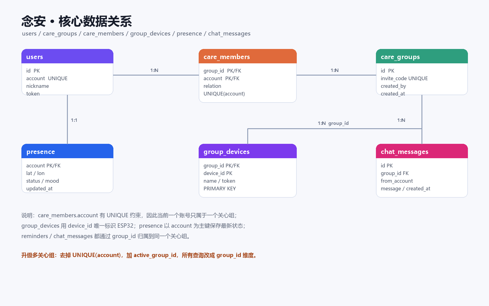

`UNIQUE(account)` 是「一个账号只能进一个关心组」的根源。教程先按这个模型跑通；第 13 节会讲怎么升级成多组。

### 5.1 登录与 Token

客户端 `AuthRepository` 先请求 `/api/auth/login`，成功就保存 token；后续所有请求带：

```http
Authorization: Bearer <token>
```

Retrofit 的请求头在 `CareSyncRepository` 里统一加：

```kotlin
private suspend fun requireAuth(): String {
    return preferences.token.first().ifBlank { error("未登录") }
}
```

Android 侧登录态用 DataStore 持久化，杀掉进程再打开仍然是登录状态。

---

## 6. 定位：从经纬度到「看得见的关心」

### 6.1 权限与初始化

Manifest 里声明：

```xml
<uses-permission android:name="android.permission.ACCESS_FINE_LOCATION" />
<uses-permission android:name="android.permission.ACCESS_COARSE_LOCATION" />
```

`LocationRepository.start()` 初始化百度定位：

```kotlin
val option = LocationClientOption().apply {
    setLocationMode(LocationClientOption.LocationMode.Hight_Accuracy)
    setCoorType("bd09ll")     // 与百度地图一致，避免偏移
    setScanSpan(1_000)        // 1 秒一次，轨迹更细
    setIsNeedAddress(false)
}
```

### 6.2 抗漂移 + 平滑：不要「一有坐标就跳」

原始定位点会抖。如果每个点都直接画，头像会在地图上乱跳。项目用「GPS 精度 + 位移」决定平滑权重：

```kotlin
val moved = GeoMath.distanceMeters(current.lat, current.lon, raw.lat, raw.lon)
if (moved > 1_000.0) return   // 只拦截明显瞬移

val gpsGood = location.locType == BDLocation.TypeGpsLocation && location.radius <= 25f
val alpha = when {
    gpsGood && moved > 6.0 -> 0.92f   // 真在走路，快速跟随
    gpsGood -> 0.55f                  // 静止，适度平滑
    location.radius <= 25f -> 0.65f
    location.radius <= 50f -> 0.40f
    else -> 0.22f                     // 基站/WiFi 定位，慢一点
}
```

之前用「超过 80 米就丢弃」，会把正常走路/开车误判成漂移；现在只拦 1 公里以上的瞬移。

### 6.3 罗盘：静止也能知道手机朝哪

GPS 的 `direction` 只有移动时才有意义。项目用旋转矢量传感器算手机顶部朝向：

```kotlin
val rotationSensor = sensorManager.getDefaultSensor(Sensor.TYPE_ROTATION_VECTOR)
    ?: sensorManager.getDefaultSensor(Sensor.TYPE_GEOMAGNETIC_ROTATION_VECTOR)

SensorManager.getRotationMatrixFromVector(rotationMatrix, event.values)
val (axisX, axisY) = remapAxes()
SensorManager.remapCoordinateSystem(rotationMatrix, axisX, axisY, remappedMatrix)
SensorManager.getOrientation(remappedMatrix, orientation)
```

`remapAxes()` 按屏幕旋转重新映射 X/Y 轴，保证横屏/竖屏都是「手机顶部」方向。

### 6.4 当天轨迹

`LocationRepository` 维护一个内存轨迹：

```kotlin
private val _trail = MutableStateFlow<List<SelfLocation>>(emptyList())
val trail: StateFlow<List<SelfLocation>> = _trail.asStateFlow()

private fun recordTrail(point: SelfLocation) {
    val today = LocalDate.now()
    if (today != trailDate) {
        trailDate = today
        _trail.value = emptyList()
    }
    val last = _trail.value.lastOrNull()
    if (last != null) {
        val moved = GeoMath.distanceMeters(last.lat, last.lon, point.lat, point.lon)
        if (moved < 8.0 && point.timestamp - last.timestamp < 20_000L) return
    }
    _trail.value = (_trail.value + point).takeLast(500)
}
```

规则：移动超过 8 米，或距上一个点超过 20 秒，才记一个点；最多 500 个点，跨天清空。这样不会因为静止时的 GPS 抖动画出密密麻麻的线。

地图上画两条线：

```kotlin
// 双方连线：虚线
PolylineOptions()
    .points(people.map { LatLng(it.lat, it.lon) })
    .width(7f)
    .color(lineColor)
    .dottedLine(true)

// 我的当天轨迹：实线、淡色
PolylineOptions()
    .points(trail.map { LatLng(it.lat, it.lon) })
    .width(5f)
    .color(trailColor)
    .dottedLine(false)
```

### 6.5 对方方位

对方没有真实 heading 时，用「我 → 对方」的方位角给头像画指向箭头：

```kotlin
val bearing = GeoMath.bearingDegrees(
    selfPerson.lat, selfPerson.lon,
    person.lat, person.lon,
).toFloat()

heading = if (person.isSelf) person.heading else person.heading ?: bearing
```

这样即使对方手机没有罗盘数据，地图上也能看出「对方在我的东北方向」。

### 6.6 地图缩放

`+` / `-` 每次 1.5 级，比 1 级更符合「想快速看大范围」的直觉：

```kotlin
MapStatusUpdateFactory.zoomTo((status.zoom + 1.5f).coerceAtMost(19f))
MapStatusUpdateFactory.zoomTo((status.zoom - 1.5f).coerceAtLeast(4f))
```

---

## 7. 关心组：邀请码、设备编码和亲属卡

### 7.1 手机加入：邀请码

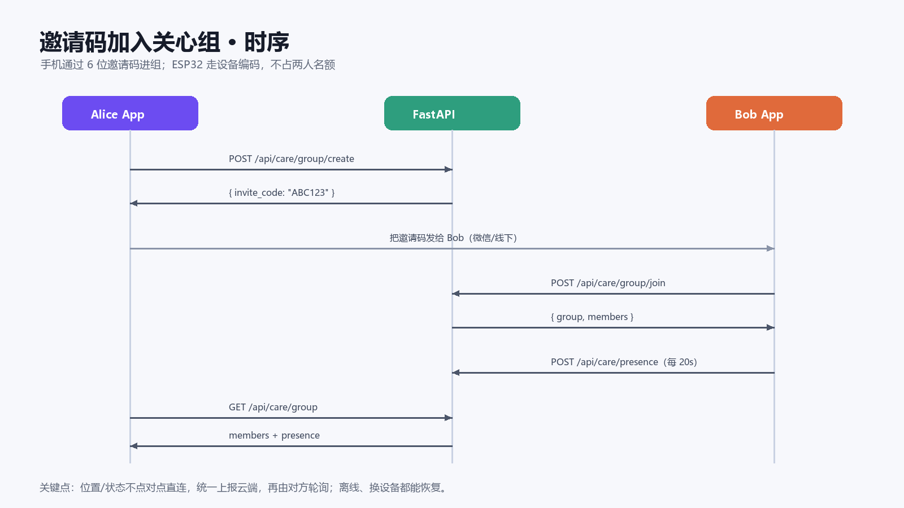

### 7.2 ESP32 加入：设备编码

设备不占两个人的名额，单独进 `group_devices`。绑定逻辑在 `DeviceViewModel.bind()`：

```kotlin
deviceRepository.bindDevice(
    deviceId = deviceId,
    deviceName = deviceName,
    deviceType = DeviceType.ESP32,
)

if (!careSyncRepository.groupActive.value) {
    careSyncRepository.createGroup()   // 没有组先建一个
}
careSyncRepository.joinDevice(deviceId, deviceName)
```

「设备编码」就是产品出厂写入的唯一 `device_id`。云端用 `device_secret` / HMAC 校验设备身份，再把设备作为成员返回给关心组。

### 7.3 云端成员 → 亲属卡

`CareSyncRepository.members` 把云端返回的成员（含设备）暴露成 Flow；`CareViewModel.relatives` 转成界面模型：

```kotlin
data class RelativeSummary(
    val key: String,
    val name: String,
    val relation: String,
    val deviceLabel: String,
    val online: Boolean,
    val lat: Double?,
    val lon: Double?,
    val status: CareStatus,
    val activityNote: String,
    val battery: Int,
    val lastSeen: Long,
)
```

设备也走同一套模型，所以设备会出现在亲属卡里，只是多显示「ESP32 · 设备」和驾驶/疲劳信息。

### 7.4 左右滑动卡片

```kotlin
val pagerState = rememberPagerState(pageCount = { relatives.size })

HorizontalPager(
    state = pagerState,
    pageSpacing = 12.dp,
    modifier = Modifier.height(pagerHeight),
) { page ->
    RelativeWeatherPage(
        relative = relatives[page],
        weather = weatherFor(relatives[page]),
        isPrimary = page == 0,
        onOpenMap = { onOpenMap(page == 0) },
        onOpenCompanion = onOpenCompanion,
    )
}
```

卡片里聚合了头像、称呼、关系、绑定方式、状态、电量、更新时间、天气、查看地图/亲友设置。没有位置时显示「对方还没有共享位置」，高度自动收缩。

### 7.5 组卡片的人数/设备数

```kotlin
val people = group.members.count { it.role != "device" }
val deviceCount = groupDevices.size
Text("已有 $people 人 · $deviceCount 台设备")
```

不再写死「已和 xxx 配对」，因为一个组可能有多位亲属和多台设备。

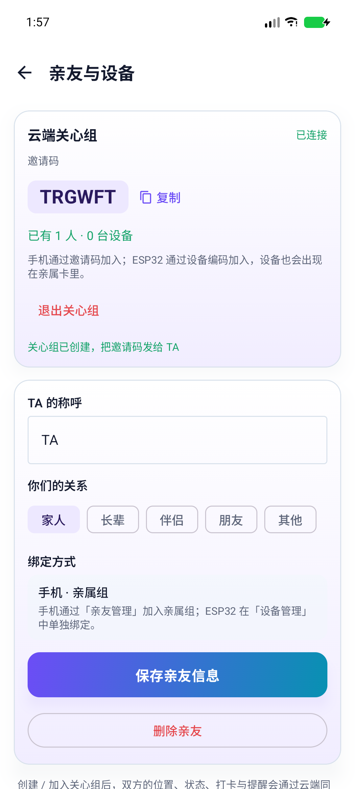

上图中组刚创建，显示「已有 1 人 · 0 台设备」；绑定 ESP32 后会变成「1 人 · 1 台设备」，设备同时出现在亲属卡里。

---

## 8. 对话与留言墙：Room + 弹幕

### 8.1 消息去重

远端消息以服务端 `id` 为唯一键：

```kotlin
suspend fun insertRemote(remoteId: Long, ...) {
    if (remoteId <= 0L || dao.findByRemoteId(remoteId) != null) return
    // insert ...
}
```

客户端从 `maxRemoteId()` 增量拉取，重复消息不会二次入库。

### 8.2 地图对话框只显示对话

地图页的「说点什么」打开 `ChatSheet`，时间线只传消息，不传日程记录：

```kotlin
val timeline = remember(messages) {
    buildTimeline(messages, emptyList())
}
```

副标题也改成「只显示对话消息」。日程和「今天做了什么」留在日程页，不混进地图对话框。

### 8.3 弹幕丝滑：graphicsLayer 而不是 offset

原来每帧用 `offset { IntOffset(...) }`，会触发重新布局，消息一多就掉帧。改成 `graphicsLayer`，只做绘制平移：

```kotlin
Box(
    modifier = Modifier
        .graphicsLayer {
            translationX = x.value
            translationY = laneIndex * laneHeightPx
        }
        .onSizeChanged { chipWidth = it.width },
) {
    DanmakuChip(current)
}
```

### 8.4 每天清空

`WallEntry` 带 `date`；墙只取当天：

```kotlin
val today = remember { LocalDate.now().toString() }
val todayEntries = entries.filter { it.date == today }
if (todayEntries.isEmpty()) {
    EmptyWall(modifier)   // 「今天还没有留言」
    return
}
```

这样第二天打开，墙自然从空开始；聊天记录仍完整保留在对话页。

### 8.5 后端清理重复消息

```python
conn.execute("""
    DELETE FROM chat_messages WHERE id NOT IN (
        SELECT MIN(id) FROM chat_messages
        GROUP BY group_id, from_account, message, created_at
    )
""")
```

同组、同发送者、同内容、同秒只保留最早一条。30 天保留策略也在这里一起做。

---

## 9. 宠物：不用贴图的 Live2D

### 9.1 五种外观，一套 Canvas

`OwlSpecies` 定义五种：

```kotlin
enum class OwlSpecies(...) {
    BROWN, SNOWY, INK_CAT, RURAL_DOG, HAMSTER
}
```

宠物不是 GIF/序列帧，而是 Compose Canvas 程序化绘制：身体、耳朵、眼睛、嘴巴、翅膀、树枝、雪花/草地，全部按尺寸比例画。好处是：

- 任意分辨率不糊；
- 可以按时间换天空/太阳/月亮/星星；
- 可以做眨眼、呼吸、被摸时的表情。

### 9.2 时间场景

```kotlin
enum class PetDayPhase { DAWN, DAY, DUSK, NIGHT }

val phase = PetDayPhase.at(System.currentTimeMillis(), ZoneId.systemDefault())
```

`PetLive2D(state, reaction, reactionToken, phase)` 根据 phase 画不同背景：清晨紫粉、白天蓝、黄昏橙、夜晚深蓝 + 月亮星星。

| 白天雪鸮 | 夜晚/极光 |
|---|---|
| 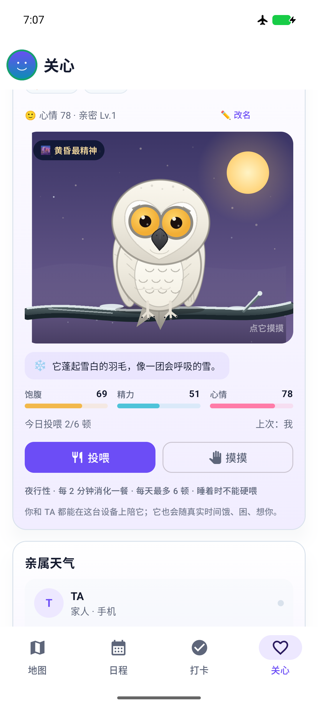 | 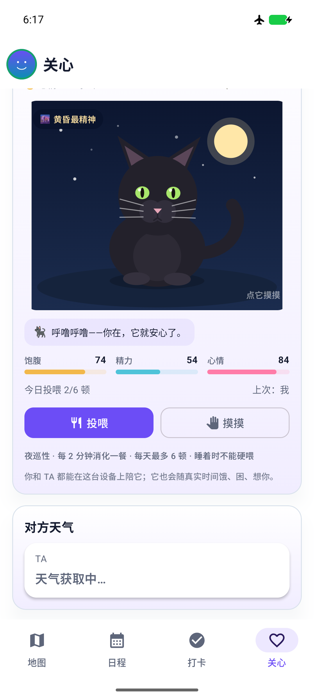 |

### 9.3 只领养一只

领养表单里可以选外观或随机；领养成功后，卡片不再显示五种外观切换按钮，避免「已领养的宠物还能随便换」。想换只能先放归，再重新领养。

### 9.4 状态衰减

`satiety / energy / mood / bond` 按时间衰减，`OwlHabits.advance()` 负责：

```kotlin
val hours = elapsed / 3_600_000.0
val satietyRate = if (state.asleep) 3.2 else 6.2
val satiety = (state.satiety - satietyRate * hours).coerceIn(0.0, 100.0)
```

喂食、抚摸、改名、放归都会写回 DataStore，下次打开继续。

---

## 10. 关心建议：LLM + 3 分钟释放

### 10.1 场景拼装

`CareViewModel.buildScene()` 把「关系、TA 的状态、动态、距离、电量、疲劳、两地天气」拼成一段文本，交给 `LlmService.requestCareAdvices()`。

后端 `/v1/chat/completions` 是 OpenAI 兼容代理；没配置上游 Key 时返回规则化建议，保证离线也能演示。

### 10.2 只展示 3 分钟

建议写入 Room 后，启动一个 180 秒的协程；到点直接删掉该设备的建议：

```kotlin
adviceRepository.insertAll(...)

viewModelScope.launch {
    delay(180_000)
    adviceRepository.clear(CARE_DEVICE_ID)
}
```

DAO：

```kotlin
@Query("DELETE FROM advices WHERE deviceId = :deviceId")
suspend fun deleteByDevice(deviceId: String)
```

这样建议不会长期堆在首页，也避免用户把旧建议当成当前状态。

---

## 11. 三个体验细节

### 11.1 日程倒计时

「今天做了什么」卡片下方，显示今天最近一条未来日程的倒计时：

```kotlin
val target = date
    .atTime(reminder.timeMinutes / 60, reminder.timeMinutes % 60)
    .atZone(ZoneId.systemDefault())
    .toInstant()
    .toEpochMilli()

val remain = (target - nowMillis).coerceAtLeast(0L)
Text("距离「${reminder.title}」还有 %02d:%02d:%02d".format(h, m, s))
```

`nowMillis` 每秒更新一次，所以倒计时是活的。

### 11.2 二次返回退出

在地图页第一次按返回，只提示；2 秒内再按才退出：

```kotlin
BackHandler {
    when {
        drawerState.isOpen -> scope.launch { drawerState.close() }
        isSubScreen -> screen = previousScreen
        screen != Screen.MAP -> screen = Screen.MAP
        else -> {
            val now = System.currentTimeMillis()
            if (now - lastBackAt <= 2_000L) {
                (uiContext as? Activity)?.finish()
            } else {
                lastBackAt = now
                Toast.makeText(uiContext, "再按一次返回退出念安", Toast.LENGTH_SHORT).show()
            }
        }
    }
}
```

### 11.3 头像在线/离线边缘

```kotlin
if (online) {
    Modifier.border(2.dp, Color(0xFF16A36A), CircleShape)  // 绿
} else {
    Modifier.border(2.dp, MaterialTheme.colorScheme.outline, CircleShape) // 灰
}
```

头像右下角的 emoji 来自「设置状态」里的心情 emoji，顶部、抽屉、详情、地图统一读取同一个值。

---

## 12. 打包与发布

```powershell
# 调试包
.\gradlew.bat :app:assembleDebug

# 单元测试
.\gradlew.bat :app:testDebugUnitTest

# 产物
app\build\outputs\apk\debug\app-debug.apk
```

如果要发云服务器版本，不要加 `-PlocalBackend=true`；默认会指向 `http://47.93.173.214:8000/`。正式环境建议：

- 域名 + Nginx + HTTPS；
- EMQX 开 TLS 8883；
- 改掉 EMQX 默认密码；
- 数据库定期备份。

### 12.1 Android 15+ 的 16KB 页对齐

在 Android 37 模拟器安装时可能出现：

```text
This app isn't 16 KB compatible...
libBaiduMapSDK_map_v8_2_0.so : Unknown error
```

这是原生库没有按 16KB 页对齐，系统会以兼容模式运行。普通演示不受影响；如果要上架新系统，需要升级百度地图 SDK 或改用支持 16KB 的版本。

---

## 13. 已知边界与下一步

### 13.1 一个账号多个关心组

当前 `care_members` 有 `UNIQUE(account)`，所以一个账号只能在一个组。要支持多组，迁移步骤：

1. 新建 `care_members_new`，去掉 `UNIQUE(account)`，保留 `(group_id, account)` 主键；
2. 复制旧数据，删旧表，改名；
3. `users` 加 `active_group_id`；
4. 所有接口从「按 account 找唯一组」改成「按 active_group_id」；
5. 客户端增加组卡片和「切换当前组」。

这是一次真正的数据模型升级，不建议只在前端加 pager。

### 13.2 共同领养

宠物现在是本机 DataStore，云端没有共享宠物表。要做「一起养」，至少需要：

```sql
CREATE TABLE group_pets (
    group_id INTEGER PRIMARY KEY,
    species TEXT NOT NULL,
    name TEXT NOT NULL,
    satiety INTEGER NOT NULL,
    energy INTEGER NOT NULL,
    mood INTEGER NOT NULL,
    bond INTEGER NOT NULL,
    updated_at INTEGER NOT NULL
);
```

再加 GET/POST 接口和双方同步；否则「一起养」按钮只是本地假状态。

### 13.3 轨迹持久化

当前轨迹是当天内存数据，重启清零。要跨天保留，可以把 `SelfLocation` 写进 Room，按日期查询并在地图上画多段线。

---

## 附录 A：常用接口

| 方法 | 路径 | 说明 |
|---|---|---|
| POST | `/api/auth/register` | 注册 |
| POST | `/api/auth/login` | 登录 |
| GET | `/api/care/group` | 当前组、成员、设备 |
| POST | `/api/care/group/create` | 创建组 |
| POST | `/api/care/group/join` | 邀请码加入 |
| POST | `/api/care/devices/join` | 设备编码加入 |
| POST | `/api/care/presence` | 上报位置/状态/心情 |
| GET | `/api/care/presence` | 读取双方状态 |
| POST | `/api/care/checkins/toggle` | 打卡 |
| GET/POST | `/api/care/reminders` | 共享提醒 |
| POST | `/api/care/nudge` | 关心消息 |
| POST | `/api/care/messages` | 对话 |
| GET | `/api/care/messages?since_id=` | 增量拉取 |

## 附录 B：常见问题

| 现象 | 原因 | 处理 |
|---|---|---|
| `jlink executable does not exist` | Gradle 用了精简 JRE | 换完整 JDK 21/25 |
| 地图空白 / 定位失败 | 百度 AK 包名/SHA1 不匹配 | 检查 AK，或 `USE_BAIDU=false` |
| 模拟器连不上后端 | 模拟器里的 127.0.0.1 是模拟器自己 | `adb reverse tcp:8010 tcp:8010` |
| 登录提示账号密码错误 | 本地库没有该账号 | Swagger 注册，或删 `care.db` 重来 |
| 两个人看不到彼此 | 不在同一关心组 / 未上报 presence | 检查邀请码和 `/api/care/group` |
| 消息重复 | 旧数据或离线消息重发 | 更新后端并重启，执行去重 SQL |
| 构建很慢 | 删过 `.gradle`/`app/build` | 首次构建会重建缓存，属正常 |

---

## 结语

「念安」不是一个单点功能 Demo，而是把**位置、关系、消息、设备、宠物、建议**串成一条完整的关怀链路：

- 地图回答「你在哪」；
- 亲属卡回答「你现在怎么样」；
- 对话/留言回答「我想跟你说句话」；
- 宠物回答「我们共同养的东西还在」；
- 关心建议回答「我能为你做什么」。

如果你按这篇教程跑通了，建议下一步先做「多关心组」或「共同领养」中的一个——它们都会逼你把数据模型从「单组/单机」升级成「多租户/共享状态」，这是这类 App 最有价值的工程练习。
